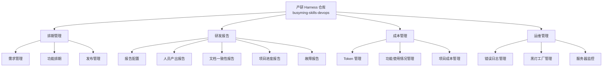

# 仓库总览

<cite>
**本文引用的文件**   
- [AGENTS.md](file://AGENTS.md)
- [报告配置/SKILL.md](file://研发报告/报告配置/SKILL.md)
- [文档一致性报告/SKILL.md](file://研发报告/文档一致性报告/SKILL.md)
- [错误日志管理/SKILL.md](file://运维管理/错误日志管理/SKILL.md)
</cite>

## 目录
1. [引言](#引言)
2. [工程定位](#工程定位)
3. [目录分层约定](#目录分层约定)
4. [文件用途约定](#文件用途约定)
5. [导航入口与模块索引](#导航入口与模块索引)
6. [子域与功能模块关系图](#子域与功能模块关系图)
7. [典型功能模块的文档结构示例](#典型功能模块的文档结构示例)
8. [协作要点与红线](#协作要点与红线)
9. [结论](#结论)

## 引言
本仓库是鸣鸣很忙产研域的 Harness 文档仓，用于沉淀需求、排期、实施、发布、报告、成本与运维的结构化 Markdown 文档与原型资产。它不是可运行服务代码仓，而是供人与 AI 助手协作消费的产品与研发过程知识基座。

## 工程定位
- **领域边界**：产研一级领域，独立 git 仓库。
- **体系位置**：位于「鸣鸣很忙」项目下的产研领域仓库。
- **核心目标**：以结构化文档承载产品逻辑、业务规则、流程与原型资产，作为产研协作与自动化消费的权威来源。
- **内容形态**：以三级功能模块为最小建设单元，每个模块包含 `SKILL.md`（功能说明），按需补充 `references/`（技术细节）与 `assets/`（只读原型与设计资产）。

**章节来源**
- [AGENTS.md:7-13](file://AGENTS.md#L7-L13)

## 目录分层约定
仓库采用“子域 → 功能模块”的分层组织方式：

```text
busyming-skills-devops/          ← 一级：产研领域（本仓库）
├── 排期管理/                    ← 二级：子域
├── 研发报告/                    ← 二级：子域
├── 成本管理/                    ← 二级：子域
└── 运维管理/                    ← 二级：子域
    └── <功能模块>/              ← 三级：具体功能（最小建设单元）
```

- **二级子域**：按产研能力域划分，如排期管理、研发报告、成本管理、运维管理。
- **三级功能模块**：最小建设单元，一个目录聚焦单一功能；未建目录前不在仓库中提前占坑。
- **瘦身索引**：二级子域可选维护 `SKILL.md` 作为子域索引；研发报告子域以根 `AGENTS.md` 表格为唯一索引。

**章节来源**
- [AGENTS.md:16-28](file://AGENTS.md#L16-L28)

## 文件用途约定
| 路径模式 | 用途 | 说明 |
| --- | --- | --- |
| `AGENTS.md` | 工程导航与协作约定 | 本仓库的权威入口，定义分层、用途、红线与模块索引。 |
| 二级 `SKILL.md` | 子域瘦身索引 | 子域定位 + 下辖三级功能清单；非强制，研发报告子域不设。 |
| 三级 `SKILL.md` | 功能说明 | 具体功能的需求、对象、端、流程、规则与页面职责。 |
| 三级 `references/` | 技术细节真源 | 数据模型、接口契约、实现细节、业务规则等。 |
| 三级 `assets/` | 只读引用资产 | 截图、HTML 原型、Web/App 界面锚点等。 |

**章节来源**
- [AGENTS.md:30-38](file://AGENTS.md#L30-L38)

## 导航入口与模块索引
根 `AGENTS.md` 提供四个二级子域的模块索引，并给出服务对象与关键说明：

### 排期管理
- **需求管理**：审批通过后关联排期并生成开发会话；缺陷修复自动分流黑灯工厂自动化修复。
- **功能排期**：根据提交自动生成卡片并在月历跟踪；维护项目与代码仓映射真源。
- **发布管理**：根据代码仓提交自动生成卡片。

### 研发报告
- **报告配置**：子域共享规则与配置真源，包括报告类型、归档、触发、版本、渲染、权限与统计人员范围。
- **人员产出报告**：人员维度产出，支持周报双端查阅与日报实时快照。
- **文档一致性报告**：分项目校验文档与代码一致性，服务端生成。
- **项目进度报告**：分项目汇总排期进度、延期分布与需求吞吐。
- **故障报告**：故障登记、复盘与闭环，关联运维证据。

### 成本管理
- **Token 管理**：Qoder Credits 用量监控与多维透视。
- **功能使用情况管理**：多来源数据采集与三维打标。
- **项目成本管理**：费用单分摊、审核与透视。

### 运维管理
- **错误日志管理**：ERROR 日志每日指纹聚合报表、标记处理与阈值告警。
- **黑灯工厂管理**：问题分级分类、自动化修复、缺陷分流与 SLA 闭环。
- **服务器监控**：服务器异常快照与节假日监控快照。

**章节来源**
- [AGENTS.md:63-99](file://AGENTS.md#L63-L99)

## 子域与功能模块关系图
下图展示仓库顶层结构与主要二级子域及其代表性三级功能模块。



**图表来源**
- [AGENTS.md:16-28](file://AGENTS.md#L16-L28)
- [AGENTS.md:63-99](file://AGENTS.md#L63-L99)

## 典型功能模块的文档结构示例
以下三个 SKILL 文件展示了三级功能模块的典型文档结构：它们均包含元信息、服务对象与端、业务流程或规则、页面职责、关联模块等，便于人/AI 快速定位真源。

### 报告配置（子域共享配置）
- 定位：研发报告子域的共享机制与配置真源。
- 关键职责：
  - 托管报告类型、命名、周期归属、触发生成入库、版本、渲染、权限矩阵与异常场景。
  - 维护报告项目配置（项目 key、分支策略）、报告触发配置（定时/手动、立即生成、失败重试）与统计人员范围。
- 端型：Web 管理端。
- 关联：与功能排期的项目映射、Token 管理的人员名单、其他报告模块共享规则存在明确依赖。

**章节来源**
- [报告配置/SKILL.md:1-53](file://研发报告/报告配置/SKILL.md#L1-L53)

### 文档一致性报告（报告类功能）
- 定位：面向管理层、PM 与研发的文档与代码一致性检查报告。
- 关键职责：
  - 按项目周期性生成，触发方式在 Web 端统一配置。
  - 服务端通过 Qoder SDK 挂载内置 skill 生成报告并落库归档。
  - 支持周索引查阅与版本回溯。
- 端型：Web 管理端 + App 查阅端。
- 关联：依赖报告配置的共享规则与项目配置。

**章节来源**
- [文档一致性报告/SKILL.md:1-52](file://研发报告/文档一致性报告/SKILL.md#L1-L52)

### 错误日志管理（运维类功能）
- 定位：每日聚合 ERROR/FATAL 日志为异常报表，支持分组、趋势、详情、标记处理与阈值告警。
- 关键职责：
  - 采集链路：定时任务拉取日志、指纹归一化、聚合落库、告警与留痕。
  - 使用链路：Web 列表筛选、详情抽屉、跳转日志控制台、标记已处理/忽略。
  - 业务规则：时间窗、指纹归一化、状态机、重跑幂等、保留期与清理任务。
- 端型：仅 Web 端。
- 关联：企微告警集成、导出中心、权限控制。

**章节来源**
- [错误日志管理/SKILL.md:1-134](file://运维管理/错误日志管理/SKILL.md#L1-L134)

## 协作要点与红线
### 协作要点
1. 新增三级功能模块时，先建 `<子域>/<功能>/SKILL.md`，再同步回补根 `AGENTS.md` 索引。
2. 单一目录聚焦单一功能；跨功能共享的规范、接口、数据模型集中登记，不互相复制。
3. 根索引随目录结构演进；若目录调整而本文件未更新，以实际目录为准并及时回补。

### 内容红线
- 文档只承载自然语言描述的产品逻辑、规则与流程。
- 禁止写入伪代码、SQL、接口报文、正则字典等实现级内容。
- 文档只描述当前生效的目标状态，禁止写入变更记录、中间状态、规划类内容。
- 实现细节一律以链接指向代码仓或外部文档，不内嵌。

**章节来源**
- [AGENTS.md:42-59](file://AGENTS.md#L42-L59)
- [AGENTS.md:103-108](file://AGENTS.md#L103-L108)

## 结论
本仓库以“子域 → 功能模块”的分层结构，将产研过程资产沉淀为可导航、可协作、可被 AI 消费的结构化文档。根 `AGENTS.md` 是权威导航入口，三级 `SKILL.md` 是功能真源，`references/` 与 `assets/` 分别承载技术细节与只读原型。遵循文件用途约定与内容红线，可保证仓库长期一致、可演进且易于检索。