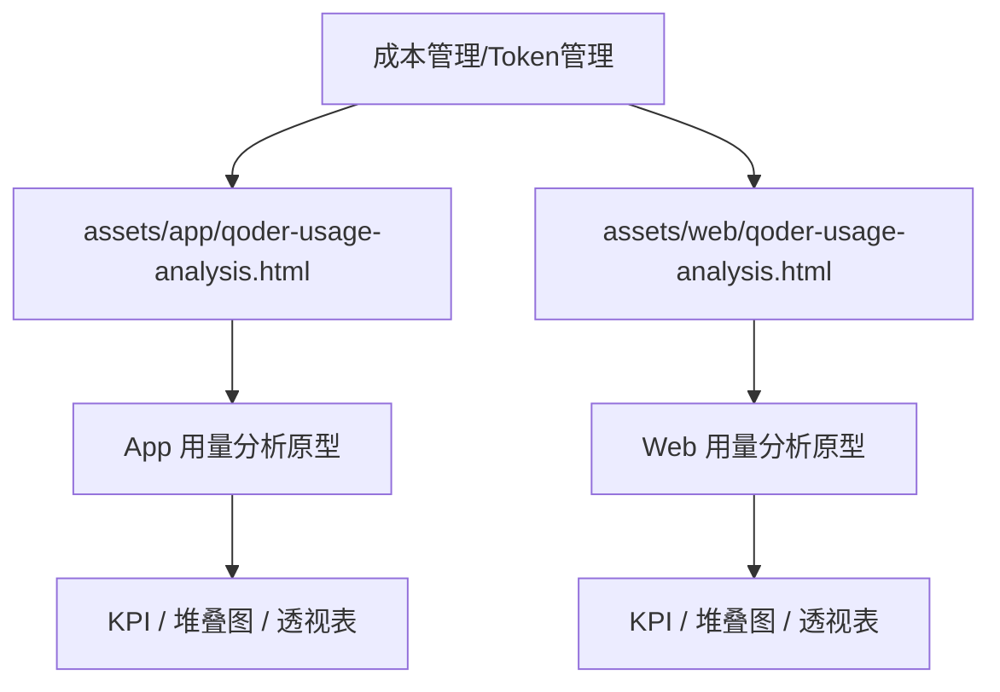
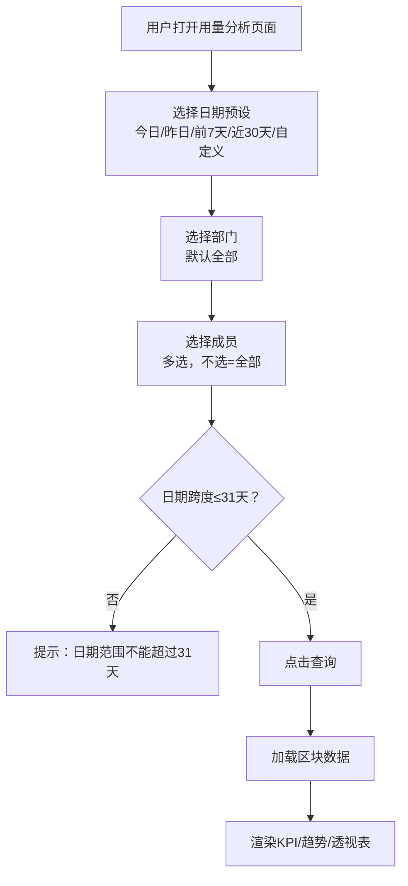
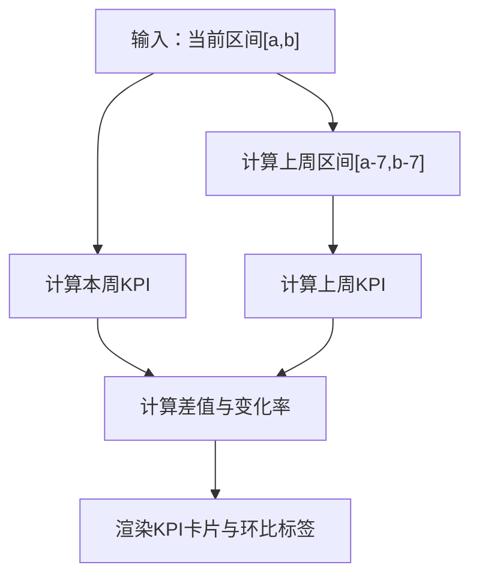
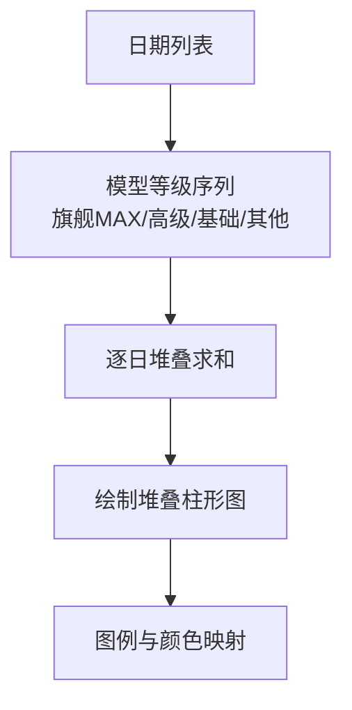
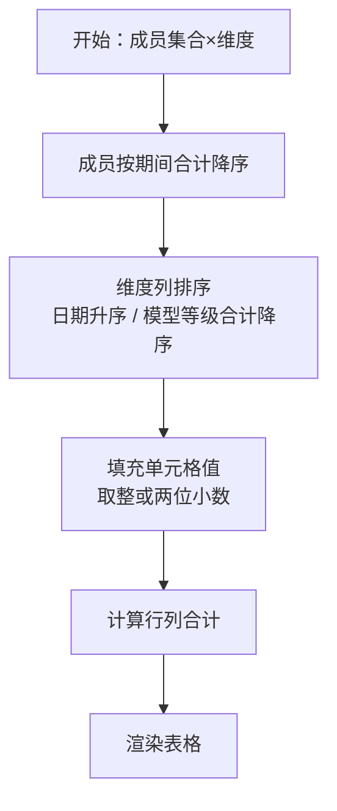
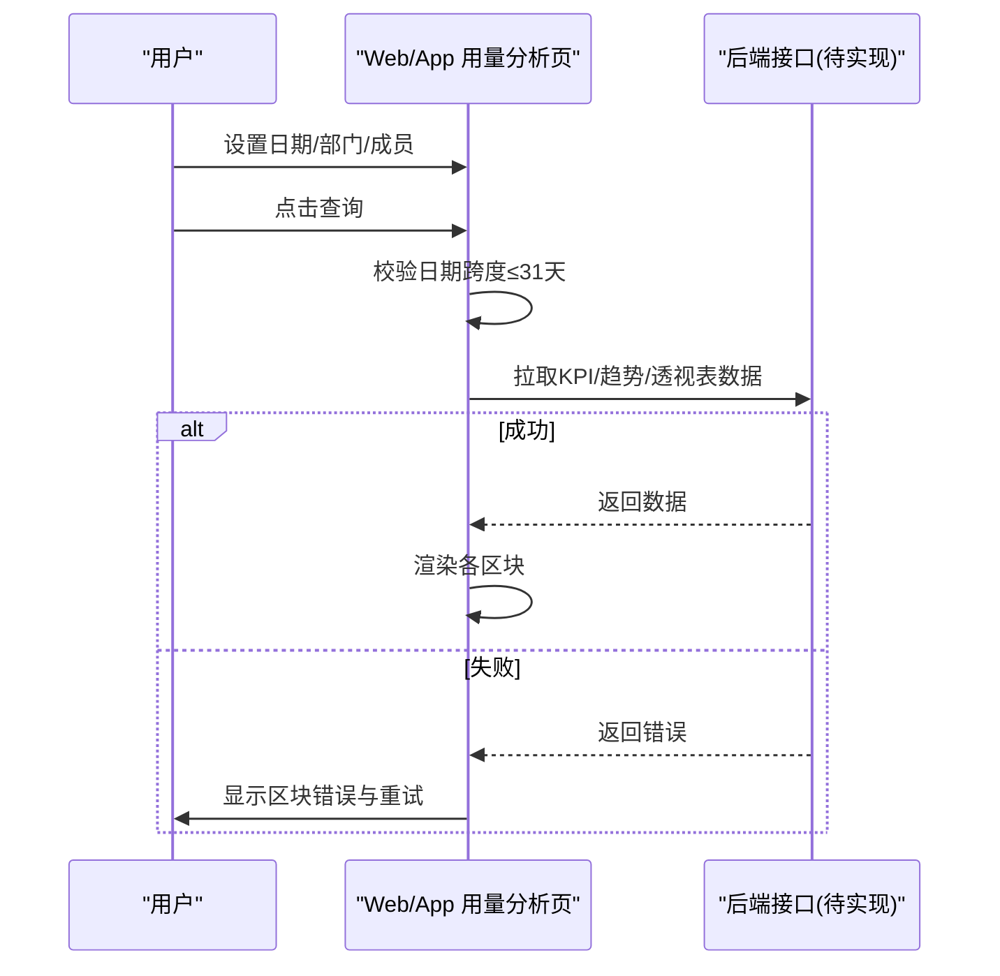
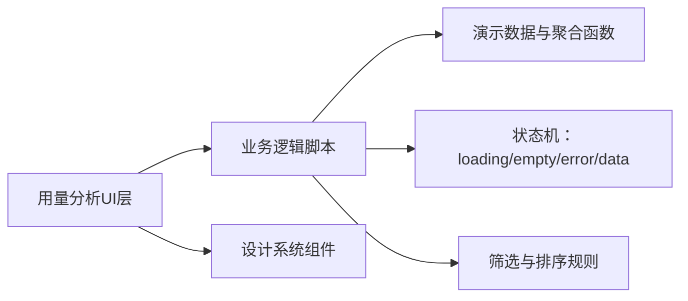

# Token 管理

<cite>
**本文引用的文件**   
- [qoder-usage-analysis.html（App）](file://成本管理/Token管理/assets/app/qoder-usage-analysis.html)
- [qoder-usage-analysis.html（Web）](file://成本管理/Token管理/assets/web/qoder-usage-analysis.html)
</cite>

## 目录
1. [引言](#引言)
2. [项目结构](#项目结构)
3. [核心概念与数据模型](#核心概念与数据模型)
4. [时段与筛选规则](#时段与筛选规则)
5. [用量监控指标与看板](#用量监控指标与看板)
6. [透视表与图表规则](#透视表与图表规则)
7. [状态、错误与交互流程](#状态错误与交互流程)
8. [依赖关系分析](#依赖关系分析)
9. [性能与实现要点](#性能与实现要点)
10. [故障排查指南](#故障排查指南)
11. [结论](#结论)

## 引言
本仓是鸣鸣很忙产研域文档仓，不含可运行服务代码。Token 管理模块以“Qoder 用量分析”原型页面为核心载体，通过 App 与 Web 两套前端原型，描述 Token 用量的统计口径、时段约束、维度拆分与监控展示方式。本文聚焦以下目标：
- Token 用量的模型与维度定义；
- 时段选择、部门与成员筛选规则；
- KPI、堆叠图、透视表的监控规则；
- 空态、加载态、错误态等状态处理；
- 前后端职责边界与后续扩展建议。

## 项目结构
成本管理/Token管理 目录下仅包含 Qoder 用量分析的原型资产，分为 App 与 Web 两个视图，二者共享同一套业务口径说明与演示数据。

**图示来源**
- [qoder-usage-analysis.html（App）:33-39](file://成本管理/Token管理/assets/app/qoder-usage-analysis.html#L33-L39)
- [qoder-usage-analysis.html（Web）:6-7](file://成本管理/Token管理/assets/web/qoder-usage-analysis.html#L6-L7)

**章节来源**
- [qoder-usage-analysis.html（App）:33-39](file://成本管理/Token管理/assets/app/qoder-usage-analysis.html#L33-L39)
- [qoder-usage-analysis.html（Web）:6-7](file://成本管理/Token管理/assets/web/qoder-usage-analysis.html#L6-L7)

## 核心概念与数据模型
### 1. 基本实体
- 成员：用量统计的最小组织单元，如张悦、李思远等。
- 部门：成员的归属部门，用于聚合与筛选，例如数字化中心、创新业务部。
- 日期：按天粒度的统计时间单位。
- 模型等级：用于拆分 Credits 消耗的分类，包括旗舰 MAX、高级、基础、其他（未标注）。
- Credits：Token 用量的计量单位，所有指标最终归一为 Credits。

### 2. 用量事件与聚合口径
- 每个成员在某个日期上会产出若干用量事件；这些事件按模型等级分类后累加得到当日该成员在该模型等级的 Credits。
- 日级合计 = 各模型等级 Credits 之和；单元格值通常取整展示。
- 请求次数为独立计数维度，用于计算次均消耗。
- 活跃成员指在统计范围内 Credits 大于 0 的成员数量。

### 3. 关键数据字段
| 字段 | 含义 | 取值或说明 |
|---|---|---|
| member | 成员名称 | 字符串 |
| dept | 所属部门 | 全部 / 数字化中心 / 创新业务部 |
| date | 日期 | YYYY-MM-DD |
| tier | 模型等级 | 旗舰 MAX / 高级 / 基础 / 其他 |
| credits | Credits 消耗 | 数值，可为负值表示冲正 |
| requests | 请求次数 | 整数 |
| active | 是否活跃 | 当日总 Credits > 0 时为活跃 |

**章节来源**
- [qoder-usage-analysis.html（App）:205-236](file://成本管理/Token管理/assets/app/qoder-usage-analysis.html#L205-L236)
- [qoder-usage-analysis.html（Web）:208-236](file://成本管理/Token管理/assets/web/qoder-usage-analysis.html#L208-L236)

## 时段与筛选规则
### 1. 公共筛选项
- 日期范围：支持今日、昨日、前 7 天、近 30 天、自定义区间。
- 部门：单选，默认“全部”。
- 成员：多选；不选时代表当前部门交集内的全部成员。
- 查询与重置：触发全量刷新。

### 2. 时段上限
- 自定义日期范围最多 31 天；超出时拦截并提示。
- 默认时段为前 7 天，即 T-7 至 T-1，不包含当天。

### 3. 部门与成员联动
- 切换部门时，清空已选成员，并按新部门重新计算可选成员池。
- 成员可选池 = 当前部门 ∩ 统计范围；若成员筛选为空，则使用可选池内全部成员。

**图示来源**
- [qoder-usage-analysis.html（App）:60-85](file://成本管理/Token管理/assets/app/qoder-usage-analysis.html#L60-L85)
- [qoder-usage-analysis.html（Web）:41-72](file://成本管理/Token管理/assets/web/qoder-usage-analysis.html#L41-L72)
- [qoder-usage-analysis.html（App）:401-426](file://成本管理/Token管理/assets/app/qoder-usage-analysis.html#L401-L426)
- [qoder-usage-analysis.html（Web）:472-488](file://成本管理/Token管理/assets/web/qoder-usage-analysis.html#L472-L488)

**章节来源**
- [qoder-usage-analysis.html（App）:60-85](file://成本管理/Token管理/assets/app/qoder-usage-analysis.html#L60-L85)
- [qoder-usage-analysis.html（Web）:41-72](file://成本管理/Token管理/assets/web/qoder-usage-analysis.html#L41-L72)
- [qoder-usage-analysis.html（App）:401-426](file://成本管理/Token管理/assets/app/qoder-usage-analysis.html#L401-L426)
- [qoder-usage-analysis.html（Web）:472-488](file://成本管理/Token管理/assets/web/qoder-usage-analysis.html#L472-L488)

## 用量监控指标与看板
### 1. KPI 指标
| 指标 | 口径 | 对比方式 |
|---|---|---|
| 总用量 | 筛选范围内全部用量事件的 Credits 之和，整数展示 | 较上周同期 |
| 总请求数 | 筛选范围内请求次数累计 | 较上周同期 |
| 次均消耗 | 总用量 ÷ 总请求数 | 较上周同期 |
| 人均用量 | 总用量 ÷ 活跃成员数 | 较上周同期 |
| 活跃成员 | 统计范围内 Credits > 0 的成员人数 | 较上周同期 |

### 2. 周环比计算
- 本周区间为所选起止日期；上周同期为起止日期各向前移动 7 天。
- 变化率小于阈值时显示“—”，否则显示上升或下降百分比。

**图示来源**
- [qoder-usage-analysis.html（App）:267-285](file://成本管理/Token管理/assets/app/qoder-usage-analysis.html#L267-L285)
- [qoder-usage-analysis.html（Web）:260-289](file://成本管理/Token管理/assets/web/qoder-usage-analysis.html#L260-L289)

**章节来源**
- [qoder-usage-analysis.html（App）:108-115](file://成本管理/Token管理/assets/app/qoder-usage-analysis.html#L108-L115)
- [qoder-usage-analysis.html（Web）:80-107](file://成本管理/Token管理/assets/web/qoder-usage-analysis.html#L80-L107)
- [qoder-usage-analysis.html（App）:267-285](file://成本管理/Token管理/assets/app/qoder-usage-analysis.html#L267-L285)
- [qoder-usage-analysis.html（Web）:260-289](file://成本管理/Token管理/assets/web/qoder-usage-analysis.html#L260-L289)

## 透视表与图表规则
### 1. 日 Credits 消耗堆叠柱形图
- X 轴：日期升序。
- Y 轴：Credits 总量，固定刻度范围。
- 系列：按模型等级分段堆叠，顺序固定，其他（未标注）位于最顶层。
- 负值：允许负向冲正，向上绘制；正值向下绘制。

**图示来源**
- [qoder-usage-analysis.html（App）:117-127](file://成本管理/Token管理/assets/app/qoder-usage-analysis.html#L117-L127)
- [qoder-usage-analysis.html（Web）:117-142](file://成本管理/Token管理/assets/web/qoder-usage-analysis.html#L117-L142)
- [qoder-usage-analysis.html（App）:286-308](file://成本管理/Token管理/assets/app/qoder-usage-analysis.html#L286-L308)
- [qoder-usage-analysis.html（Web）:291-324](file://成本管理/Token管理/assets/web/qoder-usage-analysis.html#L291-L324)

### 2. Credits 用量透视表：成员 × 日期
- 行：成员，按期间合计降序排列。
- 列：日期，按天升序排列。
- 单元格：当日该成员在各模型等级的 Credits 合计，取整展示。
- 末行末列：行列总计。

### 3. 模型用量透视表：成员 × 模型等级
- 行：成员，按期间合计降序排列。
- 列：模型等级，按合计降序排列，“未标注”固定最后。
- 单元格：两位小数展示。
- 末行末列：行列总计。

**图示来源**
- [qoder-usage-analysis.html（App）:129-143](file://成本管理/Token管理/assets/app/qoder-usage-analysis.html#L129-L143)
- [qoder-usage-analysis.html（Web）:144-196](file://成本管理/Token管理/assets/web/qoder-usage-analysis.html#L144-L196)
- [qoder-usage-analysis.html（App）:309-344](file://成本管理/Token管理/assets/app/qoder-usage-analysis.html#L309-L344)
- [qoder-usage-analysis.html（Web）:326-373](file://成本管理/Token管理/assets/web/qoder-usage-analysis.html#L326-L373)

**章节来源**
- [qoder-usage-analysis.html（App）:117-143](file://成本管理/Token管理/assets/app/qoder-usage-analysis.html#L117-L143)
- [qoder-usage-analysis.html（Web）:117-196](file://成本管理/Token管理/assets/web/qoder-usage-analysis.html#L117-L196)
- [qoder-usage-analysis.html（App）:286-344](file://成本管理/Token管理/assets/app/qoder-usage-analysis.html#L286-L344)
- [qoder-usage-analysis.html（Web）:291-373](file://成本管理/Token管理/assets/web/qoder-usage-analysis.html#L291-L373)

## 状态、错误与交互流程
### 1. 页面状态
- 骨架屏：加载过程中显示占位。
- 空态：无可用用量事件时展示。
- 错误态：网络或服务异常时展示，并提供重试入口。
- 成功态：刷新成功后短暂反馈。

### 2. 错误类型
- 全局筛选失败：顶部表单区域提示。
- 区块级失败：KPI、趋势图、透视表各自独立错误提示与重试。
- 操作失败：例如查询失败、刷新失败、超 31 天拦截。

### 3. 交互流程

**图示来源**
- [qoder-usage-analysis.html（App）:401-426](file://成本管理/Token管理/assets/app/qoder-usage-analysis.html#L401-L426)
- [qoder-usage-analysis.html（Web）:472-488](file://成本管理/Token管理/assets/web/qoder-usage-analysis.html#L472-L488)

**章节来源**
- [qoder-usage-analysis.html（App）:88-105](file://成本管理/Token管理/assets/app/qoder-usage-analysis.html#L88-L105)
- [qoder-usage-analysis.html（Web）:108-115](file://成本管理/Token管理/assets/web/qoder-usage-analysis.html#L108-L115)
- [qoder-usage-analysis.html（Web）:131-140](file://成本管理/Token管理/assets/web/qoder-usage-analysis.html#L131-L140)
- [qoder-usage-analysis.html（Web）:160-168](file://成本管理/Token管理/assets/web/qoder-usage-analysis.html#L160-L168)
- [qoder-usage-analysis.html（Web）:187-195](file://成本管理/Token管理/assets/web/qoder-usage-analysis.html#L187-L195)

## 依赖关系分析
- 前端原型依赖设计系统组件库，包括导航栏、筛选器、下拉面板、图表、表格、骨架屏、空态、Toast 等。
- 业务逻辑集中在原型脚本中，负责：
  - 演示数据生成；
  - 筛选状态管理；
  - KPI、趋势、透视表渲染；
  - 错误与空态控制；
  - 场景切换（默认、成员筛选、部门筛选、空态、加载态、错误态、操作失败、超 31 天拦截）。

**图示来源**
- [qoder-usage-analysis.html（App）:198-525](file://成本管理/Token管理/assets/app/qoder-usage-analysis.html#L198-L525)
- [qoder-usage-analysis.html（Web）:201-586](file://成本管理/Token管理/assets/web/qoder-usage-analysis.html#L201-L586)

**章节来源**
- [qoder-usage-analysis.html（App）:198-525](file://成本管理/Token管理/assets/app/qoder-usage-analysis.html#L198-L525)
- [qoder-usage-analysis.html（Web）:201-586](file://成本管理/Token管理/assets/web/qoder-usage-analysis.html#L201-L586)

## 性能与实现要点
- 区块化渲染：KPI、趋势、透视表分别加载与错误隔离，避免单点失败影响整体体验。
- 数据聚合复杂度：成员 × 日期 × 模型等级的三重循环在演示数据规模下可接受；实际接入大数据时应考虑预聚合与分页。
- 格式化与展示：Credits 单元格取整或两位小数，避免浮点误差对视觉的影响。
- 交互防抖：查询与刷新采用定时器模拟异步，便于原型演示；生产环境应结合真实接口与重试策略。

[本节为通用指导，不直接分析具体文件]

## 故障排查指南
- 日期范围超过 31 天：检查自定义日期选择逻辑，确保结束日期不早于开始日期且跨度不超过 31 天。
- 查询失败：确认筛选条件有效，查看区块级错误提示，点击重试恢复。
- 空态：当筛选范围内无用量事件时，正常显示空态；若预期有数据却为空，检查成员与部门筛选是否正确。
- 刷新失败：下拉刷新或手动刷新失败时，提示刷新失败并重试。

**章节来源**
- [qoder-usage-analysis.html（App）:401-426](file://成本管理/Token管理/assets/app/qoder-usage-analysis.html#L401-L426)
- [qoder-usage-analysis.html（Web）:472-488](file://成本管理/Token管理/assets/web/qoder-usage-analysis.html#L472-L488)

## 结论
Token 管理模块通过 Qoder 用量分析原型，明确了以下规则：
- 用量以 Credits 为单位，按成员、日期、模型等级进行多维统计；
- 时段支持常用预设与自定义区间，统一限制最大 31 天；
- KPI 提供总用量、总请求数、次均消耗、人均用量与活跃成员，并附带周环比；
- 堆叠图与两张透视表分别呈现趋势与明细，支撑成本分析与模型优化；
- 前端原型实现了完整的状态管理与错误处理，为后续接入真实数据与服务奠定基础。

[本节为总结性内容，不直接分析具体文件]