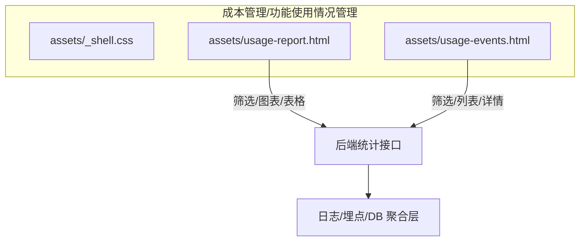
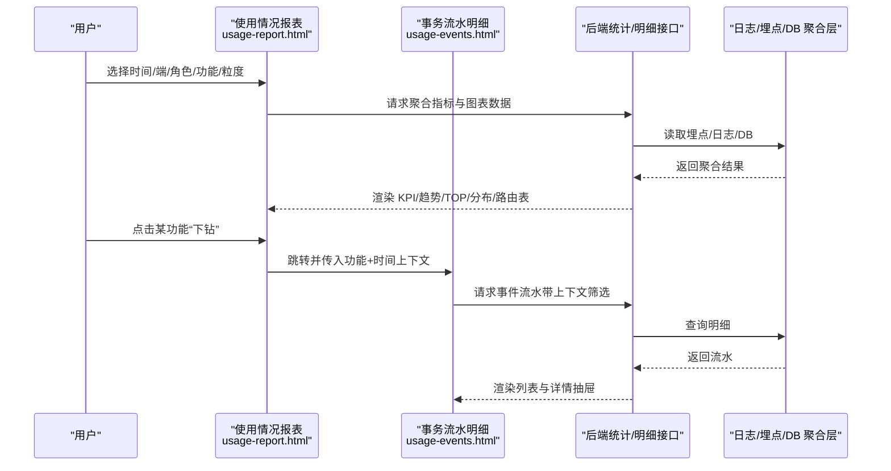
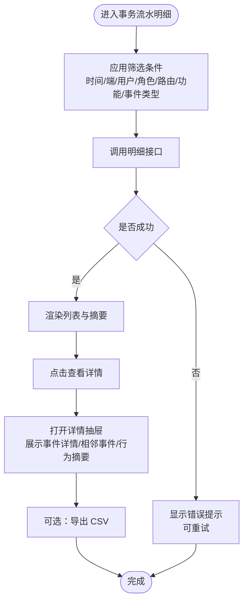
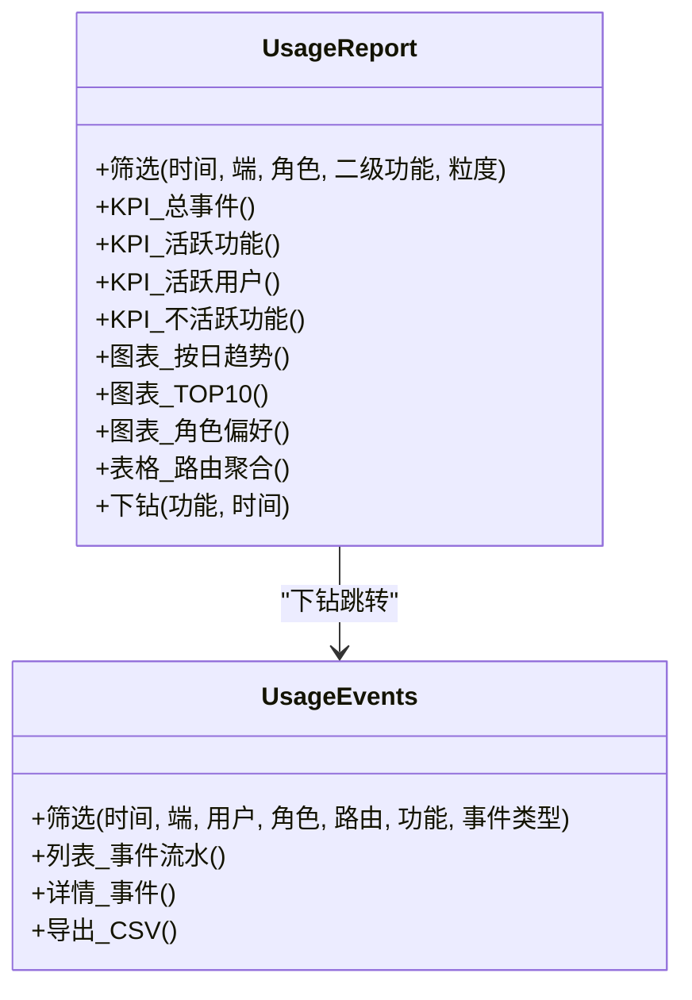
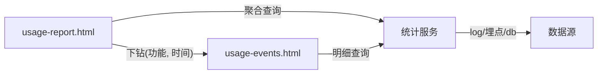

# 功能使用情况管理

<cite>
**本文引用的文件**   
- [usage-events.html](file://成本管理/功能使用情况管理/assets/usage-events.html)
- [usage-report.html](file://成本管理/功能使用情况管理/assets/usage-report.html)
</cite>

## 目录
1. [引言](#引言)
2. [项目结构](#项目结构)
3. [核心组件](#核心组件)
4. [架构总览](#架构总览)
5. [详细组件分析](#详细组件分析)
6. [依赖关系分析](#依赖关系分析)
7. [性能与容量特性](#性能与容量特性)
8. [故障排查指南](#故障排查指南)
9. [结论](#结论)

## 引言
本模块聚焦“功能使用情况观察规则”，以 log、前端埋点与 db 为数据源，提供两类能力：
- 事务流水明细：按时间、端、用户、角色、路由、功能、事件类型等维度查询原始事件。
- 使用情况报表：对事件进行聚合，输出 KPI、趋势、TOP 功能、角色偏好与路由级使用清单，并支持下钻到明细。

该文档仅描述当前生效的规则与流程；排期基线、产能参考等目标值不得写成已验证成果。

## 项目结构
功能使用情况管理位于“成本管理”域下，包含两个原型页面与样式资源：
- assets/_shell.css：全局样式变量与基础样式（被页面引用）。
- assets/usage-events.html：事务流水明细页原型。
- assets/usage-report.html：使用情况报表页原型。

**图示来源**
- [usage-report.html:168-204](file://成本管理/功能使用情况管理/assets/usage-report.html#L168-L204)
- [usage-events.html:174-230](file://成本管理/功能使用情况管理/assets/usage-events.html#L174-L230)

**章节来源**
- [usage-report.html:1-10](file://成本管理/功能使用情况管理/assets/usage-report.html#L1-L10)
- [usage-events.html:1-10](file://成本管理/功能使用情况管理/assets/usage-events.html#L1-L10)

## 核心组件
- 事务流水明细（UsageEvents）
  - 作用：展示原始事件流水，支持多维度筛选、分页、导出 CSV，以及单条事件详情抽屉。
  - 关键筛选：时间范围、端、用户、角色、路由关键词、功能、事件类型。
  - 关键指标：事件总数、去重用户数、去重功能数、最近事件时间。
  - 交互：从报表“下钻”进入时自动带入上下文筛选条件。

- 使用情况报表（UsageReport）
  - 作用：汇总展示整体使用情况，包括 KPI、日趋势、TOP 高频功能、角色偏好分布、路由级使用清单。
  - 关键筛选：时间范围、端、角色、二级功能名称、聚合粒度（日/周/月）、是否仅未触发。
  - 关键指标：总事件、活跃功能、活跃用户、不活跃功能。
  - 交互：点击“下钻”跳转到事务流水明细，并携带功能与时间上下文。

**章节来源**
- [usage-events.html:174-230](file://成本管理/功能使用情况管理/assets/usage-events.html#L174-L230)
- [usage-events.html:233-253](file://成本管理/功能使用情况管理/assets/usage-events.html#L233-L253)
- [usage-report.html:168-204](file://成本管理/功能使用情况管理/assets/usage-report.html#L168-L204)
- [usage-report.html:206-309](file://成本管理/功能使用情况管理/assets/usage-report.html#L206-L309)

## 架构总览
从数据到页面的端到端流程如下：

**图示来源**
- [usage-report.html:435-571](file://成本管理/功能使用情况管理/assets/usage-report.html#L435-L571)
- [usage-events.html:164-172](file://成本管理/功能使用情况管理/assets/usage-events.html#L164-L172)
- [usage-events.html:267-466](file://成本管理/功能使用情况管理/assets/usage-events.html#L267-L466)

## 详细组件分析

### 事务流水明细（UsageEvents）
- 页面定位
  - 路由：/portal/usage-events
  - 权限码：MENU:RND:MANAGE:USAGE_EVENTS
  - 类型：list（对齐 list-page 骨架）

- 筛选区规则
  - 时间范围默认近 24 小时。
  - 支持端（Web/App）、用户（autocomplete）、角色、路由关键词、功能（sys_function_catalog）、事件类型（VIEW/CLICK/OPERATION）。
  - 支持隐式查询（change 自动触发）与显式按钮兜底。

- 摘要指标
  - 事件总数（当前条件）、去重用户数、去重功能数、最近事件时间。

- 列表与操作
  - 列：端、用户、角色、手机号、页面（路由）、功能、事件类型、时间、操作。
  - 操作：查看详情（打开右侧抽屉）。
  - 导出：CSV（最多 5 万行，超量引导离线导出）。

- 详情抽屉
  - 事件详情字段：端、用户、手机号、事件类型、页面路由、功能编码、触发时间、客户端 UA、IP、追踪 ID。
  - 相邻事件：该用户前后各 5 条近期事件时间轴。
  - 行为摘要：近 7 日事件数、涉及功能数、最常用功能。
  - 快捷操作：关闭、跳转该功能报表。

**图示来源**
- [usage-events.html:174-230](file://成本管理/功能使用情况管理/assets/usage-events.html#L174-L230)
- [usage-events.html:267-466](file://成本管理/功能使用情况管理/assets/usage-events.html#L267-L466)
- [usage-events.html:471-566](file://成本管理/功能使用情况管理/assets/usage-events.html#L471-L566)

**章节来源**
- [usage-events.html:1-10](file://成本管理/功能使用情况管理/assets/usage-events.html#L1-L10)
- [usage-events.html:174-230](file://成本管理/功能使用情况管理/assets/usage-events.html#L174-L230)
- [usage-events.html:233-253](file://成本管理/功能使用情况管理/assets/usage-events.html#L233-L253)
- [usage-events.html:267-466](file://成本管理/功能使用情况管理/assets/usage-events.html#L267-L466)
- [usage-events.html:471-566](file://成本管理/功能使用情况管理/assets/usage-events.html#L471-L566)

### 使用情况报表（UsageReport）
- 页面定位
  - 路由：/portal/usage-report
  - 权限码：MENU:RND:MANAGE:USAGE_REPORT
  - 类型：dashboard（聚合 Card + 多图表）

- 筛选区规则
  - 时间范围默认近 30 天。
  - 支持端、角色、二级功能名称、聚合粒度（日/周/月）。
  - 路由聚合表支持“仅未触发”开关。

- KPI 与图表
  - KPI：总事件（连续 area+line）、活跃功能（连续 area+line）、活跃用户（离散 bar）、不活跃功能（离散 bar），均含较上 30 天环比。
  - 图表：按日趋势（line）、TOP 10 高频功能（横向 bar）、角色偏好分布（donut）。

- 路由聚合表
  - 字段：账套、功能编码、功能名称、路由、事件数、用户数、状态、最近触发、操作。
  - 排序：默认按事件数降序，0 触发置末尾。
  - 状态：ACTIVE / LOW / INACTIVE。
  - 操作：下钻至事务流水明细。

**图示来源**
- [usage-report.html:168-204](file://成本管理/功能使用情况管理/assets/usage-report.html#L168-L204)
- [usage-report.html:206-309](file://成本管理/功能使用情况管理/assets/usage-report.html#L206-L309)
- [usage-report.html:435-571](file://成本管理/功能使用情况管理/assets/usage-report.html#L435-L571)
- [usage-events.html:174-230](file://成本管理/功能使用情况管理/assets/usage-events.html#L174-L230)

**章节来源**
- [usage-report.html:1-10](file://成本管理/功能使用情况管理/assets/usage-report.html#L1-L10)
- [usage-report.html:168-204](file://成本管理/功能使用情况管理/assets/usage-report.html#L168-L204)
- [usage-report.html:206-309](file://成本管理/功能使用情况管理/assets/usage-report.html#L206-L309)
- [usage-report.html:435-571](file://成本管理/功能使用情况管理/assets/usage-report.html#L435-L571)

## 依赖关系分析
- 页面与路由
  - usage-report.html：/portal/usage-report
  - usage-events.html：/portal/usage-events
- 权限控制
  - 菜单权限：MENU:RND:MANAGE:USAGE_REPORT / MENU:RND:MANAGE:USAGE_EVENTS
  - 按钮权限：EXPORT 相关按钮在原型中以注释形式标注权限位
- 数据来源
  - 事件来源：log、前端埋点、db
  - 聚合层：后端根据筛选条件对事件进行计数、去重、分组、排序与分页
- 交互依赖
  - 报表 → 明细：通过“下钻”传递功能与时间上下文
  - 明细 ← 报表：从报表跳转后自动应用筛选上下文

**图示来源**
- [usage-report.html:435-571](file://成本管理/功能使用情况管理/assets/usage-report.html#L435-L571)
- [usage-events.html:164-172](file://成本管理/功能使用情况管理/assets/usage-events.html#L164-L172)

**章节来源**
- [usage-report.html:1-10](file://成本管理/功能使用情况管理/assets/usage-report.html#L1-L10)
- [usage-events.html:1-10](file://成本管理/功能使用情况管理/assets/usage-events.html#L1-L10)

## 性能与容量特性
- 明细导出上限：CSV 导出最多 5 万行，超出需走离线导出流程。
- 分页策略：列表采用分页控件，避免一次性加载全量数据。
- 聚合粒度：报表支持日/周/月粒度切换，降低大时间跨度的计算压力。
- 空态与零触发：路由聚合表中 0 触发项置末尾并以 INACTIVE 标识，便于快速识别低活功能。

[本节为通用指导，不直接分析具体文件]

## 故障排查指南
- 查询失败
  - 现象：页面显示错误提示，并提供“重试”入口。
  - 处理：检查后端接口可用性、网络连通性与权限；必要时重试或放宽筛选条件。
- 无数据
  - 现象：列表为空或路由聚合表出现大量 0 触发。
  - 处理：扩大时间范围、更换功能或端；确认埋点上报与日志采集是否正常。
- 导出超限
  - 现象：导出 CSV 超过 5 万行限制。
  - 处理：改用离线导出或缩小筛选范围后再导出。

**章节来源**
- [usage-events.html:255-265](file://成本管理/功能使用情况管理/assets/usage-events.html#L255-L265)
- [usage-events.html:441-447](file://成本管理/功能使用情况管理/assets/usage-events.html#L441-L447)
- [usage-report.html:560-571](file://成本管理/功能使用情况管理/assets/usage-report.html#L560-L571)

## 结论
本模块通过“事务流水明细 + 使用情况报表”的组合，形成从原始事件到聚合洞察的完整闭环：
- 明细页用于精准定位问题、还原用户行为轨迹；
- 报表页用于宏观把握功能活跃度、角色偏好与趋势变化；
- 两者通过“下钻”联动，配合筛选上下文，提升问题定位效率。

实施时应严格遵循筛选语义、导出容量与状态标识规则，确保数据口径一致与用户体验稳定。