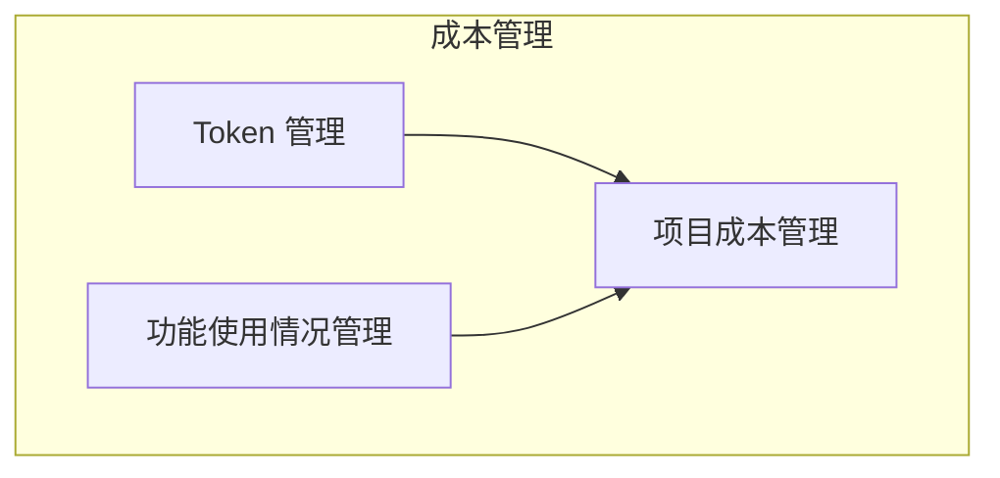
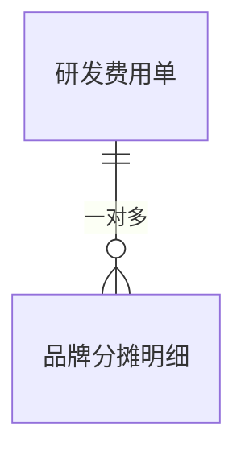
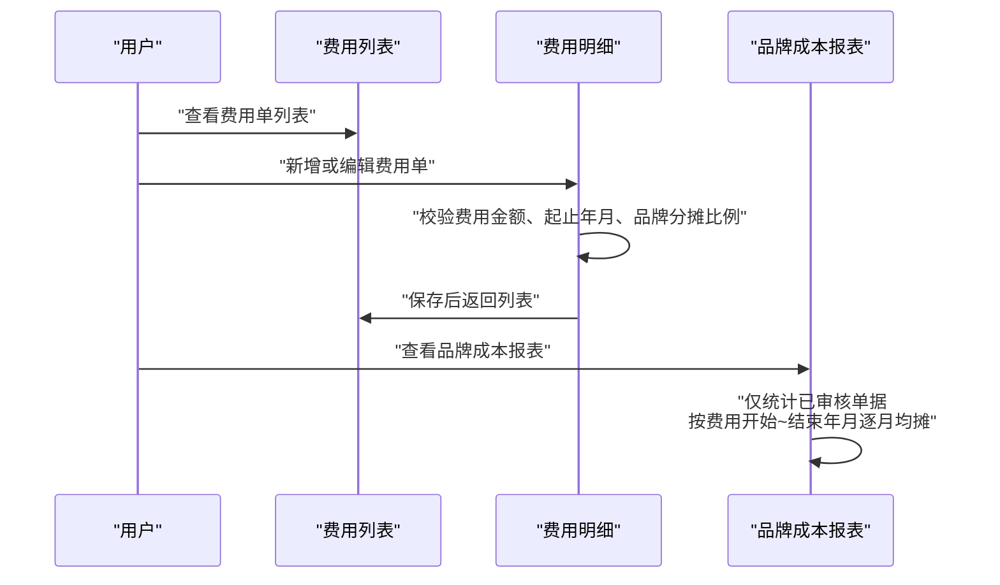
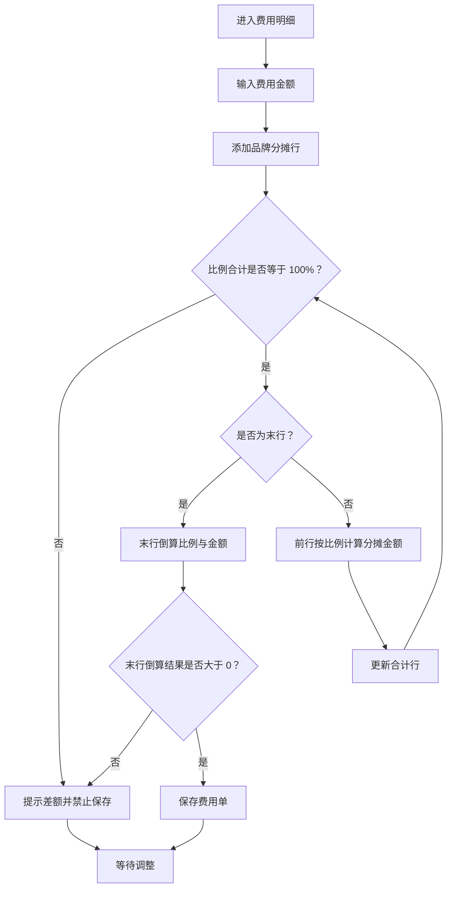
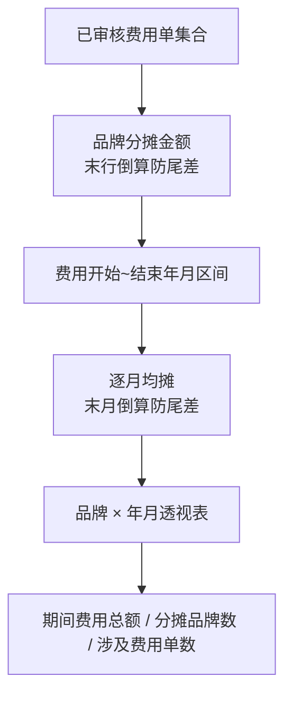
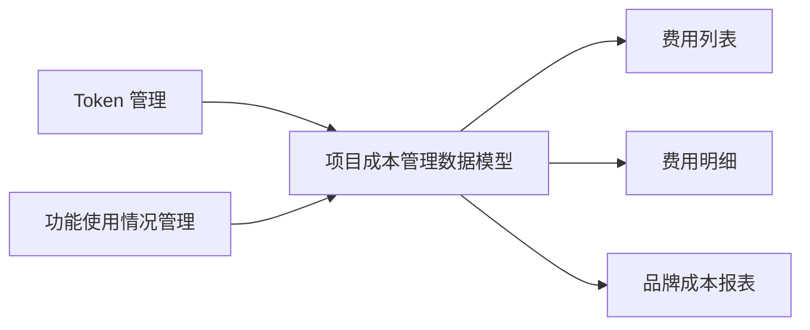

# 成本管理

<cite>
**本文引用的文件**   
- [项目成本管理数据模型](file://成本管理/项目成本管理/references/data-model.md)
- [费用列表原型](file://成本管理/项目成本管理/assets/web/cost-list.html)
- [费用明细原型](file://成本管理/项目成本管理/assets/web/cost-detail.html)
- [品牌成本报表原型](file://成本管理/项目成本管理/assets/web/cost-report.html)
</cite>

## 目录
1. [引言](#引言)
2. [子域定位与结构总览](#子域定位与结构总览)
3. [下辖功能模块概览](#下辖功能模块概览)
4. [核心业务概念与数据模型](#核心业务概念与数据模型)
5. [页面与流程关系](#页面与流程关系)
6. [关键处理逻辑](#关键处理逻辑)
7. [依赖与边界](#依赖与边界)
8. [常见问题与排错建议](#常见问题与排错建议)
9. [结论](#结论)

## 引言
成本管理子域聚焦研发相关费用的录入、分摊与统计，覆盖 Token 使用成本、功能使用情况以及项目维度的研发费用单与品牌分摊。该子域当前以结构化文档与 Web 原型资产为主，不包含可运行服务代码；规则与口径以各模块 `references/` 与 `assets/` 为真源。

本仓整体说明：
- 本仓是鸣鸣很忙产研域 Harness 文档仓：需求、排期、发布、报告、成本与运维的结构化 Markdown 文档与原型资产，不含可运行服务代码。
- 功能正文以各三级模块的 `references/` 与 `assets/` 为真源；AGENTS.md 与各层 SKILL.md 仅作导航与定位，不复述规则细节。
- 只描述当前生效的规则与流程；排期基线、产能参考等目标值不得写成已验证成果；wiki 正文使用中文。

**章节来源**
- [项目成本管理数据模型:1-3](file://成本管理/项目成本管理/references/data-model.md#L1-L3)

## 子域定位与结构总览
成本管理子域位于仓库顶层 `成本管理/` 下，包含三个并列的功能方向：
- Token 管理：面向 Token 使用成本的记录与分析。
- 功能使用情况管理：面向功能使用事件与使用报告的记录与分析。
- 项目成本管理：面向研发费用单的录入、审核、作废与品牌分摊，并输出品牌成本报表。

**图示来源**
- [费用列表原型:107-165](file://成本管理/项目成本管理/assets/web/cost-list.html#L107-L165)
- [费用明细原型:113-189](file://成本管理/项目成本管理/assets/web/cost-detail.html#L113-L189)
- [品牌成本报表原型:92-181](file://成本管理/项目成本管理/assets/web/cost-report.html#L92-L181)

**章节来源**
- [费用列表原型:107-165](file://成本管理/项目成本管理/assets/web/cost-list.html#L107-L165)
- [费用明细原型:113-189](file://成本管理/项目成本管理/assets/web/cost-detail.html#L113-L189)
- [品牌成本报表原型:92-181](file://成本管理/项目成本管理/assets/web/cost-report.html#L92-L181)

## 下辖功能模块概览
| 模块 | 主要职责 | 典型入口或资产 | 与项目成本的关系 |
|---|---|---|---|
| Token 管理 | 记录与分析 Token 使用成本，提供使用分析视图 | `assets/app/qoder-usage-analysis.html`、`assets/web/qoder-usage-analysis.html` | Token 是研发费用科目之一，最终进入项目成本的费用科目维度 |
| 功能使用情况管理 | 记录功能使用事件与生成使用报告 | `assets/usage-events.html`、`assets/usage-report.html` | 用于理解功能使用侧成本动因，可与 Token、人员等费用联动分析 |
| 项目成本管理 | 维护研发费用单、品牌分摊明细、审核与作废，并输出品牌成本报表 | `assets/web/cost-list.html`、`cost-detail.html`、`cost-report.html`、`references/data-model.md` | 子域内核心落地模块，承载费用归集、分摊与报表聚合 |

**章节来源**
- [费用列表原型:107-165](file://成本管理/项目成本管理/assets/web/cost-list.html#L107-L165)
- [费用明细原型:113-189](file://成本管理/项目成本管理/assets/web/cost-detail.html#L113-L189)
- [品牌成本报表原型:92-181](file://成本管理/项目成本管理/assets/web/cost-report.html#L92-L181)

## 核心业务概念与数据模型
项目成本管理定义了成本子域中最完整的数据模型，包括实体、字段语义、取值规则与枚举。

### 实体关系
- 研发费用单与品牌分摊明细为一对多关系。
- 品牌分摊明细从属于费用单，随单据级联保存或删除，无独立生命周期。
- 报表不建实体，按上述两个实体实时聚合。

**图示来源**
- [项目成本管理数据模型:5-12](file://成本管理/项目成本管理/references/data-model.md#L5-L12)

### 研发费用单关键字段
| 字段 | 含义 | 关键规则 |
|---|---|---|
| 流水号 | 单据唯一编号 | 系统生成，不可修改，软删除后号码不复用 |
| 费用科目 | 费用归属科目 | 人员 / Token / 系统采购 / 弱电 / 硬件 / 差旅 / 福利 |
| 费用金额 | 单据总金额 | > 0，两位小数 |
| 费用开始年月 | 费用归属期间起点 | 粒度到月，≤ 结束年月 |
| 费用结束年月 | 费用归属期间终点 | 粒度到月，≥ 开始年月 |
| 单据状态 | 流转状态 | 待审核 / 已审核 / 已作废 |
| 制单人 / 制单时间 | 创建信息 | 系统写入 |
| 审核人 / 审核时间 | 审核信息 | 审核后不再变化 |

**章节来源**
- [项目成本管理数据模型:14-28](file://成本管理/项目成本管理/references/data-model.md#L14-L28)

### 品牌分摊明细关键字段
| 字段 | 含义 | 关键规则 |
|---|---|---|
| 所属费用单 | 关联费用单 | 必填引用 |
| 行号 | 明细顺序 | 从 1 递增，末行承担倒算 |
| 品牌 | 分摊主体 | 鸣鸣很忙 / 有点推荐 / 满气食品 / 数字化中心，同单内唯一 |
| 分摊比例 | 分摊占比 | > 0% 且 ≤ 100%，同一单据合计 = 100% |
| 分摊金额 | 该品牌承担金额 | 前行按比例计算，末行倒算防尾差 |

**章节来源**
- [项目成本管理数据模型:29-38](file://成本管理/项目成本管理/references/data-model.md#L29-L38)

### 枚举汇总
| 枚举 | 取值 |
|---|---|
| 单据状态 | 待审核、已审核、已作废 |
| 费用科目 | 人员、Token、系统采购、弱电、硬件、差旅、福利 |
| 品牌 | 鸣鸣很忙、有点推荐、满气食品、数字化中心 |

**章节来源**
- [项目成本管理数据模型:39-46](file://成本管理/项目成本管理/references/data-model.md#L39-L46)

## 页面与流程关系
项目成本管理通过三个 Web 原型页面串联费用单的生命周期：费用列表 → 费用明细 → 品牌成本报表。

**图示来源**
- [费用列表原型:156-165](file://成本管理/项目成本管理/assets/web/cost-list.html#L156-L165)
- [费用明细原型:191-197](file://成本管理/项目成本管理/assets/web/cost-detail.html#L191-L197)
- [品牌成本报表原型:169-181](file://成本管理/项目成本管理/assets/web/cost-report.html#L169-L181)

**章节来源**
- [费用列表原型:156-165](file://成本管理/项目成本管理/assets/web/cost-list.html#L156-L165)
- [费用明细原型:191-197](file://成本管理/项目成本管理/assets/web/cost-detail.html#L191-L197)
- [品牌成本报表原型:169-181](file://成本管理/项目成本管理/assets/web/cost-report.html#L169-L181)

## 关键处理逻辑
成本管理子域的关键处理逻辑集中在费用明细的品牌分摊与报表的月度均摊。

### 品牌分摊明细处理流程
- 同一品牌只允许一行。
- 非末行按比例计算分摊金额。
- 末行按比例倒算，避免尾差。
- 所有品牌分摊比例合计必须等于 100%。
- 至少保留一条分摊明细。

**图示来源**
- [费用明细原型:159-189](file://成本管理/项目成本管理/assets/web/cost-detail.html#L159-L189)
- [费用明细原型:230-392](file://成本管理/项目成本管理/assets/web/cost-detail.html#L230-L392)

**章节来源**
- [费用明细原型:159-189](file://成本管理/项目成本管理/assets/web/cost-detail.html#L159-L189)
- [费用明细原型:230-392](file://成本管理/项目成本管理/assets/web/cost-detail.html#L230-L392)

### 品牌成本报表聚合口径
- 仅统计已审核单据。
- 按费用开始年月至结束年月逐月均摊。
- 末月采用倒算方式处理尾差。
- 行维度可为品牌，或叠加费用科目维度。
- 列维度为年月，值为分摊金额合计。

**图示来源**
- [品牌成本报表原型:192-335](file://成本管理/项目成本管理/assets/web/cost-report.html#L192-L335)

**章节来源**
- [品牌成本报表原型:192-335](file://成本管理/项目成本管理/assets/web/cost-report.html#L192-L335)

## 依赖与边界
- 成本管理子域内部依赖关系：
  - Token 管理与功能使用情况管理为成本动因来源，项目成本管理为费用归集与分摊落点。
  - 项目成本管理内部依赖数据模型定义与三个 Web 原型页面。
- 外部边界：
  - 物理表结构、索引等实现细节不在本仓体现，以代码仓为准。
  - 权限矩阵、状态机、Web UI 描述等规则由对应 `references/` 文档定义，当前可见真源以数据模型与原型注释为准。

**图示来源**
- [项目成本管理数据模型:1-3](file://成本管理/项目成本管理/references/data-model.md#L1-L3)
- [费用列表原型:107-165](file://成本管理/项目成本管理/assets/web/cost-list.html#L107-L165)
- [费用明细原型:113-189](file://成本管理/项目成本管理/assets/web/cost-detail.html#L113-L189)
- [品牌成本报表原型:92-181](file://成本管理/项目成本管理/assets/web/cost-report.html#L92-L181)

**章节来源**
- [项目成本管理数据模型:1-3](file://成本管理/项目成本管理/references/data-model.md#L1-L3)
- [费用列表原型:107-165](file://成本管理/项目成本管理/assets/web/cost-list.html#L107-L165)
- [费用明细原型:113-189](file://成本管理/项目成本管理/assets/web/cost-detail.html#L113-L189)
- [品牌成本报表原型:92-181](file://成本管理/项目成本管理/assets/web/cost-report.html#L92-L181)

## 常见问题与排错建议
| 问题现象 | 可能原因 | 处理建议 |
|---|---|---|
| 品牌分摊比例合计不等于 100% | 未填写末行倒算比例或手动输入错误 | 检查末行是否启用倒算，重新调整前行比例 |
| 末行倒算比例为 0 或负数 | 前行比例过高导致剩余比例不足 | 降低前行比例，确保末行倒算结果大于 0 |
| 保存时提示存在未选择品牌的分摊行 | 新增品牌行未选择具体品牌 | 为每行选择鸣鸣很忙、有点推荐、满气食品或数字化中心之一 |
| 报表中某月金额为空 | 费用单覆盖区间与筛选范围不相交 | 调整费用年月筛选范围，确认费用开始~结束年月 |
| 报表总额与单据总额不一致 | 跨月费用按月份均摊，并非全额计入单月 | 理解“逐月均摊 + 末月倒算”的报表口径 |

**章节来源**
- [费用明细原型:335-392](file://成本管理/项目成本管理/assets/web/cost-detail.html#L335-L392)
- [品牌成本报表原型:241-335](file://成本管理/项目成本管理/assets/web/cost-report.html#L241-L335)

## 结论
成本管理子域以项目成本管理为核心落地模块，围绕研发费用单与品牌分摊明细构建费用录入、审核、作废与报表统计闭环；Token 管理与功能使用情况管理则提供成本动因视角，共同支撑研发成本的可追溯、可分摊、可分析。当前仓库以结构化文档与 Web 原型为主，后续实现应以代码仓的物理结构与业务规则为准。