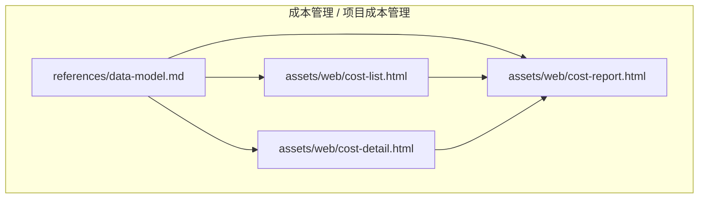
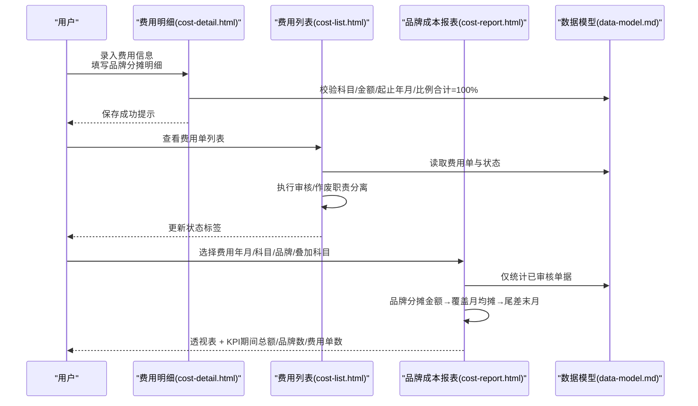
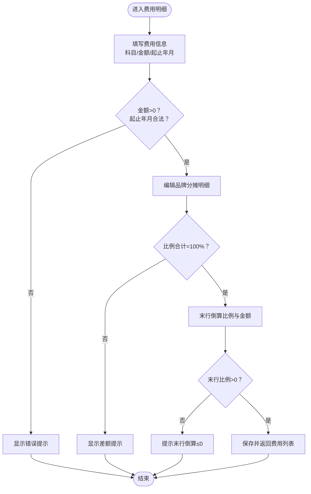
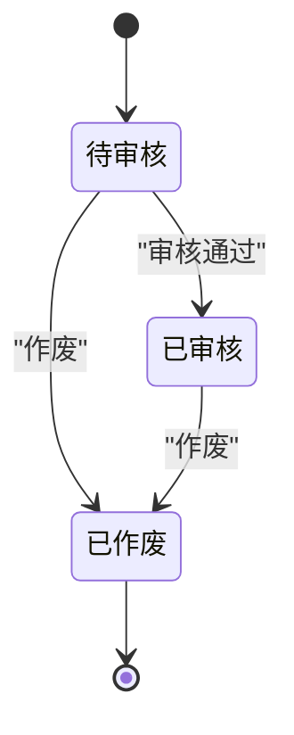
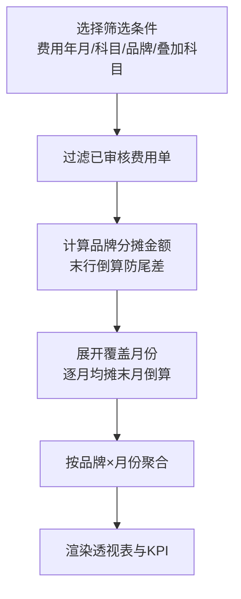
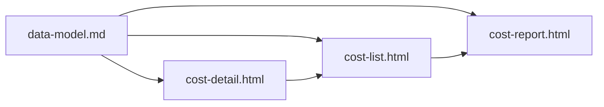

# 项目成本管理

<cite>
**本文引用的文件**   
- [data-model.md](file://成本管理/项目成本管理/references/data-model.md)
- [cost-report.html](file://成本管理/项目成本管理/assets/web/cost-report.html)
- [cost-list.html](file://成本管理/项目成本管理/assets/web/cost-list.html)
- [cost-detail.html](file://成本管理/项目成本管理/assets/web/cost-detail.html)
</cite>

## 目录
1. [引言](#引言)
2. [项目结构](#项目结构)
3. [核心组件](#核心组件)
4. [架构总览](#架构总览)
5. [详细组件分析](#详细组件分析)
6. [依赖关系分析](#依赖关系分析)
7. [性能与口径一致性](#性能与口径一致性)
8. [故障排查指南](#故障排查指南)
9. [结论](#结论)

## 引言
本文件面向“项目费用与人员成本（云费用、工资、差旅、Token）的汇总报表规则”，聚焦成本管理模块中“项目成本管理”子域。该仓为鸣鸣很忙产研域 Harness 文档仓，包含需求、排期、发布、报告、成本与运维的结构化 Markdown 文档与原型资产，不含可运行服务代码；功能正文以各三级模块的 references/ 与 assets/ 为真源。

本项目成本管理通过以下能力支撑费用与人员成本的汇总：
- 费用单录入与品牌分摊：支持人员、Token、系统采购、弱电、硬件、差旅、福利等科目，按品牌分摊比例拆分金额。
- 审核与作废控制：仅已审核单据计入报表统计，作废后不再参与聚合。
- 品牌成本透视报表：按品牌 × 月份维度汇总分摊金额，支持叠加费用科目维度，并展示期间总额、涉及品牌数、费用单数等 KPI。

## 项目结构
成本管理/项目成本管理目录下包含：
- references/data-model.md：产品侧数据模型，定义研发费用单与品牌分摊明细实体、字段语义、枚举及关系。
- assets/web/cost-report.html：品牌成本报表原型，含筛选区、KPI 区与透视表，演示 13 张已审核单据的月均分摊与尾差处理。
- assets/web/cost-list.html：费用列表原型，展示状态机、权限与操作列行为。
- assets/web/cost-detail.html：费用明细原型，实现品牌分摊明细编辑、末行倒算防尾差与校验提示。



**图表来源**
- [data-model.md:1-46](file://成本管理/项目成本管理/references/data-model.md#L1-L46)
- [cost-report.html:1-339](file://成本管理/项目成本管理/assets/web/cost-report.html#L1-L339)
- [cost-list.html:1-384](file://成本管理/项目成本管理/assets/web/cost-list.html#L1-L384)
- [cost-detail.html:1-399](file://成本管理/项目成本管理/assets/web/cost-detail.html#L1-L399)

**章节来源**
- [data-model.md:1-46](file://成本管理/项目成本管理/references/data-model.md#L1-L46)
- [cost-report.html:1-339](file://成本管理/项目成本管理/assets/web/cost-report.html#L1-L339)
- [cost-list.html:1-384](file://成本管理/项目成本管理/assets/web/cost-list.html#L1-L384)
- [cost-detail.html:1-399](file://成本管理/项目成本管理/assets/web/cost-detail.html#L1-L399)

## 核心组件
- 研发费用单：承载费用科目、金额、起止年月、制单/审核信息与状态。
- 品牌分摊明细：从属于费用单，记录品牌、分摊比例与分摊金额，末行倒算防尾差。
- 品牌成本报表：基于已审核费用单，按品牌 × 月份维度进行月均分摊与汇总，支持叠加费用科目维度。

关键业务规则要点：
- 流水号全局唯一，生成后不可改，软删除不复用。
- 费用科目枚举：人员、Token、系统采购、弱电、硬件、差旅、福利。
- 品牌枚举：鸣鸣很忙、有点推荐、满气食品、数字化中心。
- 同一费用单内品牌唯一，分摊比例合计等于 100%。
- 末行分摊比例与分摊金额倒算，防止尾差。
- 报表仅统计已审核单据，按费用开始~结束年月逐月均摊，尾差落在末月。

**章节来源**
- [data-model.md:14-46](file://成本管理/项目成本管理/references/data-model.md#L14-L46)
- [cost-report.html:192-339](file://成本管理/项目成本管理/assets/web/cost-report.html#L192-L339)
- [cost-detail.html:208-399](file://成本管理/项目成本管理/assets/web/cost-detail.html#L208-L399)

## 架构总览
成本管理模块的数据与页面交互遵循“数据模型 → 表单录入 → 列表管理 → 报表汇总”的链路：
- data-model.md 定义实体与枚举，作为所有页面的统一口径。
- cost-detail.html 负责费用信息录入与品牌分摊明细编辑，确保比例合计=100%、末行倒算。
- cost-list.html 提供费用单查询、审核、作废等操作，体现状态机与权限约束。
- cost-report.html 基于已审核费用单，按品牌 × 月份维度进行月均分摊与汇总，输出透视表与 KPI。



**图表来源**
- [cost-detail.html:113-189](file://成本管理/项目成本管理/assets/web/cost-detail.html#L113-L189)
- [cost-list.html:156-317](file://成本管理/项目成本管理/assets/web/cost-list.html#L156-L317)
- [cost-report.html:92-181](file://成本管理/项目成本管理/assets/web/cost-report.html#L92-L181)
- [data-model.md:14-46](file://成本管理/项目成本管理/references/data-model.md#L14-L46)

## 详细组件分析

### 数据模型与实体关系
- 实体关系：研发费用单 1 ─── N 品牌分摊明细；品牌分摊明细随单据级联保存/删除，无独立生命周期。
- 报表不建实体，按上述两个实体实时聚合，口径见 business-rule.md §5（当前仓库未提供该文件，但原型注释明确引用）。

```mermaid
erDiagram
R&D_BILL {
string serial_no PK
enum subject
decimal amount
string start_month
string end_month
enum status
string maker
datetime created_at
string auditor
datetime audited_at
}
BRAND_SHARE {
string bill_ref FK
int row_no
enum brand
decimal ratio
decimal share_amount
}
R&D_BILL ||--o{ BRAND_SHARE : "1对N"
```

**图表来源**
- [data-model.md:5-12](file://成本管理/项目成本管理/references/data-model.md#L5-L12)
- [data-model.md:14-38](file://成本管理/项目成本管理/references/data-model.md#L14-L38)

**章节来源**
- [data-model.md:5-12](file://成本管理/项目成本管理/references/data-model.md#L5-L12)
- [data-model.md:14-46](file://成本管理/项目成本管理/references/data-model.md#L14-L46)

### 费用明细（录入与分摊）
- 费用信息：费用科目、费用金额、费用开始年月、费用结束年月；月均分摊只读提示。
- 品牌分摊明细：同单内品牌唯一；比例合计须等于 100%；最后一行按比例倒算，分摊金额 = 费用金额 × 比例；末行金额倒算防尾差。
- 校验与提示：比例差额、末行倒算 ≤ 0、品牌已达上限时给出 Toast 提示。



**图表来源**
- [cost-detail.html:113-189](file://成本管理/项目成本管理/assets/web/cost-detail.html#L113-L189)
- [cost-detail.html:230-399](file://成本管理/项目成本管理/assets/web/cost-detail.html#L230-L399)

**章节来源**
- [cost-detail.html:113-189](file://成本管理/项目成本管理/assets/web/cost-detail.html#L113-L189)
- [cost-detail.html:208-399](file://成本管理/项目成本管理/assets/web/cost-detail.html#L208-L399)

### 费用列表（状态机与权限）
- 筛选条件：费用年月范围、费用科目、单据状态、制单人、流水号。
- 操作列：待审核显示查看/编辑/审核/删除；已审核显示查看/作废；已作废仅查看。
- 职责分离：制单人不可审核本人单据，审核按钮置灰并提示。
- 状态机：待审核 → 已审核 → 已作废；作废后不可恢复且不再计入报表统计。



**图表来源**
- [cost-list.html:156-317](file://成本管理/项目成本管理/assets/web/cost-list.html#L156-L317)
- [data-model.md:14-28](file://成本管理/项目成本管理/references/data-model.md#L14-L28)

**章节来源**
- [cost-list.html:107-317](file://成本管理/项目成本管理/assets/web/cost-list.html#L107-L317)
- [data-model.md:14-28](file://成本管理/项目成本管理/references/data-model.md#L14-L28)

### 品牌成本报表（汇总规则）
- 筛选区：费用年月范围、费用科目、品牌、是否叠加费用科目维度。
- KPI：期间费用总额（筛选范围内各月已审核分摊额之和）、分摊品牌数（范围内分摊金额>0的品牌数）、涉及费用单数（范围内已审核费用单张数）。
- 透视表：行=品牌（可叠加费用科目），列=年月，值=分摊金额合计；单位元。
- 汇总算法：
  - 单据金额 → 品牌分摊金额（比例换算，末行倒算防尾差）。
  - 品牌分摊金额 → 覆盖月逐月均摊（末月倒算防尾差）。
  - 报表交叉格累加各品牌在各月的分摊金额。



**图表来源**
- [cost-report.html:92-181](file://成本管理/项目成本管理/assets/web/cost-report.html#L92-L181)
- [cost-report.html:192-339](file://成本管理/项目成本管理/assets/web/cost-report.html#L192-L339)

**章节来源**
- [cost-report.html:92-181](file://成本管理/项目成本管理/assets/web/cost-report.html#L92-L181)
- [cost-report.html:192-339](file://成本管理/项目成本管理/assets/web/cost-report.html#L192-L339)

## 依赖关系分析
- 数据模型依赖：所有页面均以 data-model.md 定义的实体与枚举为准，保证字段语义一致。
- 页面间依赖：
  - cost-detail.html 保存成功后跳转至 cost-list.html。
  - cost-list.html 的操作触发状态变更，影响 cost-report.html 的统计结果。
  - cost-report.html 仅统计已审核单据，依赖 cost-list.html 的状态机。



**图表来源**
- [data-model.md:1-46](file://成本管理/项目成本管理/references/data-model.md#L1-L46)
- [cost-detail.html:384-399](file://成本管理/项目成本管理/assets/web/cost-detail.html#L384-L399)
- [cost-list.html:156-317](file://成本管理/项目成本管理/assets/web/cost-list.html#L156-L317)
- [cost-report.html:192-339](file://成本管理/项目成本管理/assets/web/cost-report.html#L192-L339)

**章节来源**
- [data-model.md:1-46](file://成本管理/项目成本管理/references/data-model.md#L1-L46)
- [cost-detail.html:384-399](file://成本管理/项目成本管理/assets/web/cost-detail.html#L384-L399)
- [cost-list.html:156-317](file://成本管理/项目成本管理/assets/web/cost-list.html#L156-L317)
- [cost-report.html:192-339](file://成本管理/项目成本管理/assets/web/cost-report.html#L192-L339)

## 性能与口径一致性
- 月均分摊与尾差处理：
  - 品牌分摊金额按比例换算，末行倒算避免累计误差。
  - 覆盖月份逐月均摊，末月承担尾差，确保总和等于原分摊金额。
- 报表聚合复杂度：
  - 对每张费用单，先计算品牌分摊（O(品牌行数)），再展开覆盖月份（O(月份数)），最后聚合到透视表（O(品牌×月份)）。
- 口径一致性保障：
  - 仅已审核单据参与统计，作废单据不参与。
  - 费用科目与品牌枚举在数据模型中统一定义，前端原型与后端实现需保持一致。

[本节为通用指导，不直接分析具体文件]

## 故障排查指南
- 比例合计不为 100%：
  - 检查品牌分摊明细中前行比例输入是否正确；末行倒算会自动补齐，但若前行比例超限会导致末行倒算 ≤ 0。
  - 参考 cost-detail.html 中的校验逻辑与提示文案。
- 末行倒算 ≤ 0：
  - 调整前行比例，使末行倒算结果为正。
- 报表总额异常：
  - 确认费用单状态是否为“已审核”；作废或待审核单据不计入报表。
  - 检查费用年月筛选是否与费用单的起止年月相交。
- 品牌重复或缺失：
  - 同一费用单内品牌必须唯一；若品牌已达上限（4个），无法继续添加新品牌。
- 职责分离限制：
  - 制单人不可审核本人单据；如需审核，应更换审核人。

**章节来源**
- [cost-detail.html:335-399](file://成本管理/项目成本管理/assets/web/cost-detail.html#L335-L399)
- [cost-list.html:205-225](file://成本管理/项目成本管理/assets/web/cost-list.html#L205-L225)
- [cost-report.html:138-167](file://成本管理/项目成本管理/assets/web/cost-report.html#L138-L167)

## 结论
项目成本管理通过“研发费用单 + 品牌分摊明细”的数据模型，结合费用明细录入、费用列表管理与品牌成本报表，形成完整的费用与人员成本汇总闭环。关键规则包括：
- 仅已审核单据参与报表统计。
- 品牌分摊比例合计=100%，末行倒算防尾差。
- 覆盖月份逐月均摊，尾差落在末月。
- 报表按品牌 × 月份维度汇总，支持叠加费用科目维度，并提供期间总额、品牌数、费用单数等 KPI。

这些规则在 data-model.md 与三个 Web 原型页面中得到一致体现，可作为后续开发实现的权威依据。