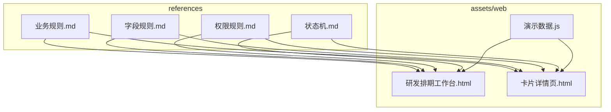
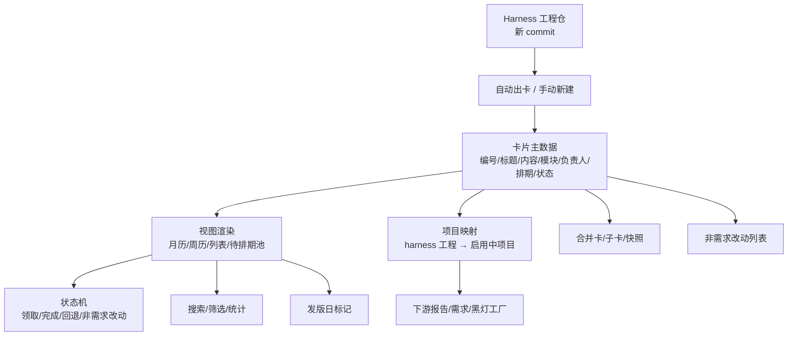
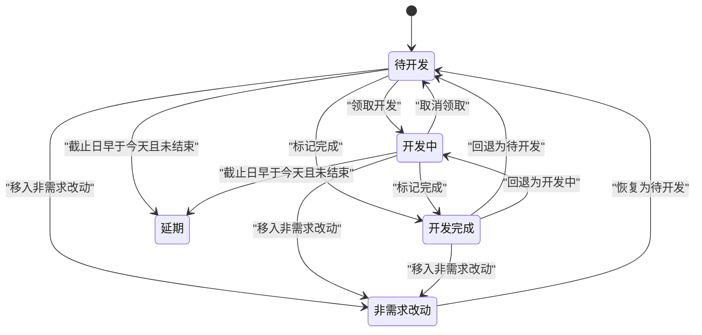
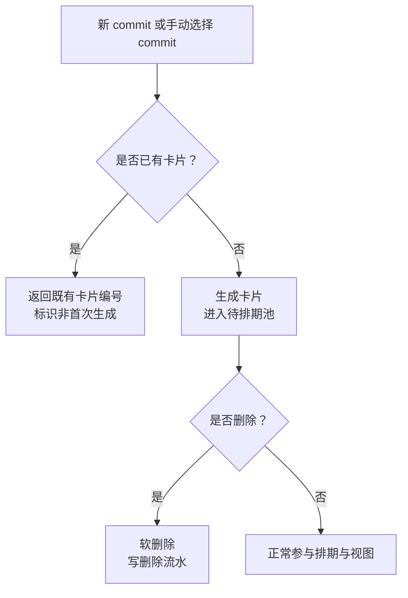
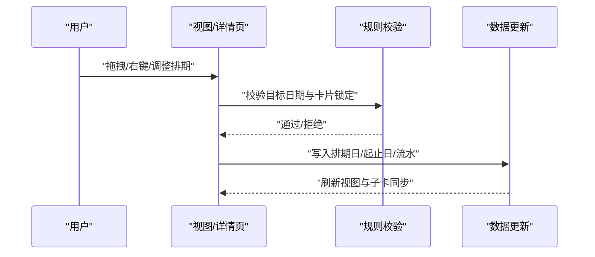
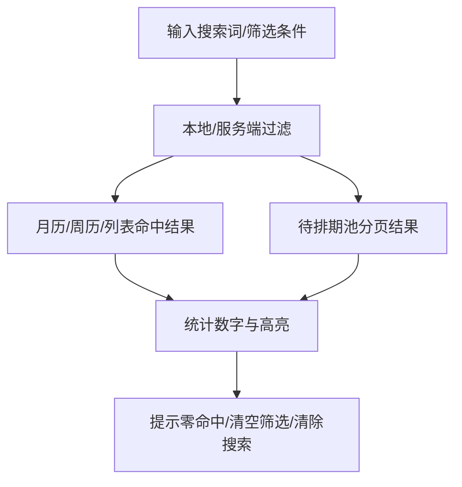
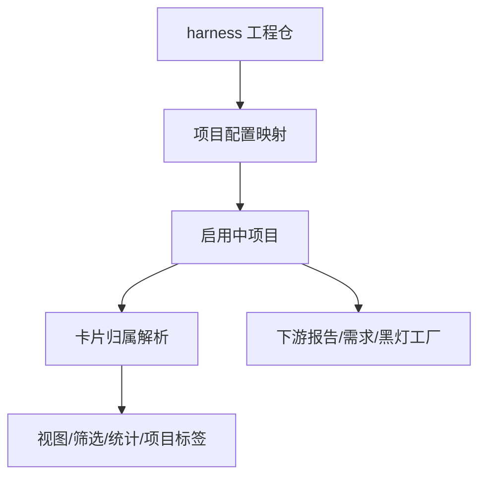
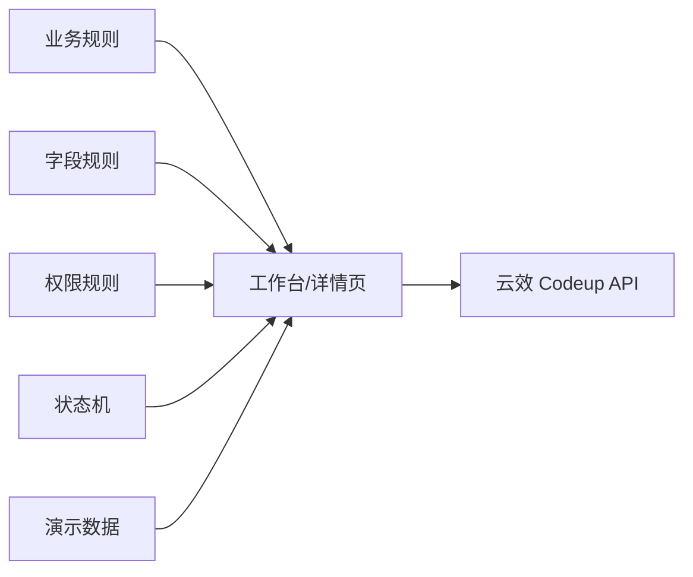

# 功能排期

<cite>
**本文引用的文件**   
- [业务规则.md](file://排期管理/功能排期/references/business-rule.md)
- [字段规则.md](file://排期管理/功能排期/references/field-rules.md)
- [权限规则.md](file://排期管理/功能排期/references/permission-rules.md)
- [状态机.md](file://排期管理/功能排期/references/state-machine.md)
- [研发排期工作台.html](file://排期管理/功能排期/assets/web/feature-schedule.html)
- [卡片详情页.html](file://排期管理/功能排期/assets/web/feature-schedule-detail.html)
- [演示数据.js](file://排期管理/功能排期/assets/web/feature-schedule-data.js)
</cite>

## 目录
1. [引言](#引言)
2. [项目结构](#项目结构)
3. [核心组件](#核心组件)
4. [架构总览](#架构总览)
5. [详细组件分析](#详细组件分析)
6. [依赖关系分析](#依赖关系分析)
7. [性能与可用性考虑](#性能与可用性考虑)
8. [故障排查指南](#故障排查指南)
9. [结论](#结论)
10. [附录：页面元素与交互要点](#附录页面元素与交互要点)

## 引言
本文件说明“功能排期”模块的业务规则、数据口径、页面结构与项目映射真源。该模块以 Harness 工程仓的 commit 为采集入口，生成 PM 内部使用的功能卡片，提供待排期池、月历/周历/列表视图、合并卡、非需求改动旁路、发版日标记、项目归属与配色等能力；同时明确编号、日期、负责人、完成 commit、延期判定、筛选搜索、权限与状态流转等规则。

## 项目结构
功能排期模块由两类资产组成：
- references：业务规则、字段规则、权限规则、状态机的权威文档。
- assets/web：Web 原型页面与共用演示数据，用于展示工作台、详情页、弹窗、筛选抽屉、非需求改动弹层与项目配置弹层等界面行为。



**图表来源**
- [业务规则.md:1-201](file://排期管理/功能排期/references/business-rule.md#L1-L201)
- [字段规则.md:1-72](file://排期管理/功能排期/references/field-rules.md#L1-L72)
- [权限规则.md:1-30](file://排期管理/功能排期/references/permission-rules.md#L1-L30)
- [状态机.md:1-49](file://排期管理/功能排期/references/state-machine.md#L1-L49)
- [研发排期工作台.html:1-220](file://排期管理/功能排期/assets/web/feature-schedule.html#L1-L220)
- [卡片详情页.html:1-180](file://排期管理/功能排期/assets/web/feature-schedule-detail.html#L1-L180)
- [演示数据.js:1-160](file://排期管理/功能排期/assets/web/feature-schedule-data.js#L1-L160)

**章节来源**
- [业务规则.md:1-201](file://排期管理/功能排期/references/business-rule.md#L1-L201)
- [研发排期工作台.html:1-220](file://排期管理/功能排期/assets/web/feature-schedule.html#L1-L220)
- [卡片详情页.html:1-180](file://排期管理/功能排期/assets/web/feature-schedule-detail.html#L1-L180)
- [演示数据.js:1-160](file://排期管理/功能排期/assets/web/feature-schedule-data.js#L1-L160)

## 核心组件
- 业务规则：出卡、去重、排期、发版日、统计、搜索、筛选、待排期池、合并卡、项目归属与非需求改动。
- 字段规则：编号、标题内容、来源模块、负责人、排期日期、需求性质、业务对接人、完成 commit、项目配置。
- 权限规则：菜单与按钮级权限编码及缺权限表现。
- 状态机：状态枚举、流转动作、延期判定、锁定守卫。
- 页面组件：工作台（月/周/列表、待排期池、筛选、搜索、更多菜单）、卡片详情（基本信息、子卡明细、完成 commit、操作日志）。
- 演示数据：仓库、commit、卡片、项目、发版日、用户与时间基准。

**章节来源**
- [业务规则.md:5-201](file://排期管理/功能排期/references/business-rule.md#L5-L201)
- [字段规则.md:5-72](file://排期管理/功能排期/references/field-rules.md#L5-L72)
- [权限规则.md:5-30](file://排期管理/功能排期/references/permission-rules.md#L5-L30)
- [状态机.md:5-49](file://排期管理/功能排期/references/state-machine.md#L5-L49)
- [研发排期工作台.html:41-214](file://排期管理/功能排期/assets/web/feature-schedule.html#L41-L214)
- [卡片详情页.html:27-176](file://排期管理/功能排期/assets/web/feature-schedule-detail.html#L27-L176)
- [演示数据.js:12-133](file://排期管理/功能排期/assets/web/feature-schedule-data.js#L12-L133)

## 架构总览
功能排期的运行逻辑可抽象为“采集 → 卡片 → 视图 → 状态 → 项目映射”。



**图表来源**
- [业务规则.md:5-201](file://排期管理/功能排期/references/business-rule.md#L5-L201)
- [状态机.md:5-49](file://排期管理/功能排期/references/state-machine.md#L5-L49)
- [字段规则.md:5-72](file://排期管理/功能排期/references/field-rules.md#L5-L72)
- [研发排期工作台.html:41-214](file://排期管理/功能排期/assets/web/feature-schedule.html#L41-L214)
- [卡片详情页.html:27-176](file://排期管理/功能排期/assets/web/feature-schedule-detail.html#L27-L176)

## 详细组件分析

### 卡片生命周期与状态机
卡片状态包括待开发、开发中、开发完成、非需求改动与展示态延期。关键流转包括领取开发、取消领取、标记完成、回退、移入非需求改动、恢复为待开发。延期不写入卡片，仅按截止日与当前视图范围计算呈现。



**图表来源**
- [状态机.md:5-49](file://排期管理/功能排期/references/state-machine.md#L5-L49)

**章节来源**
- [状态机.md:5-49](file://排期管理/功能排期/references/state-machine.md#L5-L49)

### 出卡、去重与删除
- 自动出卡：全部启用中项目的 harness 工程仓每个新 commit 生成一张待开发卡片；无启用中项目时不产生新卡。
- 去重：以“源仓 + 源 commit”唯一；重复触发返回既有卡片并标识为非首次生成。
- 删除：软删除，不再出现在待排期池、视图与非需求改动列表；子卡不可直接删除；合并卡删除走解散路径。
- 手动新建：从采集源仓选 commit 建卡，复用默认值与去重规则。



**图表来源**
- [业务规则.md:5-23](file://排期管理/功能排期/references/business-rule.md#L5-L23)

**章节来源**
- [业务规则.md:5-23](file://排期管理/功能排期/references/business-rule.md#L5-L23)

### 排期与改期
- 拖拽：待排期池到日历格为排期；日历格之间为改期；日历格回到待排期池为取消排期；跨月灰显格拒绝。
- 右键快捷改期：支持改期到今天/明天、移回待排期，条件与拖拽一致。
- 详情页调整排期：支持起止日期与时长，联动排期日；早于今天拒绝。
- 区间卡：在月/周视图覆盖每一天显示，拖拽保持原时长。



**图表来源**
- [业务规则.md:24-53](file://排期管理/功能排期/references/business-rule.md#L24-L53)
- [字段规则.md:32-36](file://排期管理/功能排期/references/field-rules.md#L32-L36)
- [研发排期工作台.html:750-795](file://排期管理/功能排期/assets/web/feature-schedule.html#L750-L795)
- [卡片详情页.html:657-725](file://排期管理/功能排期/assets/web/feature-schedule-detail.html#L657-L725)

**章节来源**
- [业务规则.md:24-53](file://排期管理/功能排期/references/business-rule.md#L24-L53)
- [字段规则.md:32-36](file://排期管理/功能排期/references/field-rules.md#L32-L36)

### 统计口径与搜索筛选
- 统计项：待排期、待开发、开发中、已完成、延期；均为真实数据口径。
- 待排期：当前筛选条件下待排期池全量总数，与分页无关。
- 其他统计：当月/本周已排期卡片；延期卡只计入延期，不计入待开发/开发中；非需求改动不计入。
- 搜索：对标题、内容、编号、提交人模糊匹配；关键字 AND；日历高亮命中、淡化未命中；待排期池服务端过滤并分页。
- 筛选：只看自己、状态、负责人、skills 仓库、项目、模块；草稿与应用分离；重置立即生效；搜索词独立保留。



**图表来源**
- [业务规则.md:60-118](file://排期管理/功能排期/references/business-rule.md#L60-L118)
- [研发排期工作台.html:322-347](file://排期管理/功能排期/assets/web/feature-schedule.html#L322-L347)

**章节来源**
- [业务规则.md:60-118](file://排期管理/功能排期/references/business-rule.md#L60-L118)

### 合并卡与子卡
- 发起：多选合并或拖拽合并；首张勾选锁定模块；至少两张；仅允许待开发/开发中；子卡不可直接合并。
- 生成：编号按全局序列；内容为系统合成；负责人为当前操作人；状态待开发；排期为子卡最早非空排期；源仓/commit 使用合并卡专用标识。
- 子卡主从：合并成功记录合并前快照；子卡状态/排期/开发人覆盖为合并卡当前值；合并卡操作扩散至子卡；子卡不在视图与池中展示。
- 嵌套扁平化：再次合并含旧合并卡时，展开原始子卡，旧合并卡软删除，最终单层扁平集合。
- 解散：二次确认；按快照恢复子卡；快照过期强制清空排期并回待排期池；随后删除合并明细并软删除合并卡。

```mermaid
classDiagram
class 合并卡 {
+编号
+标题
+内容
+负责人
+状态
+排期
+源仓/源commit
+来源模块
+children[]
+snaps{}
+merged
}
class 子卡 {
+编号
+标题
+状态
+排期
+负责人
+parent
+合并前快照
}
合并卡 "1" o--> "*" 子卡 : "children/snaps"
```

**图表来源**
- [业务规则.md:120-177](file://排期管理/功能排期/references/business-rule.md#L120-L177)
- [演示数据.js:77-82](file://排期管理/功能排期/assets/web/feature-schedule-data.js#L77-L82)

**章节来源**
- [业务规则.md:120-177](file://排期管理/功能排期/references/business-rule.md#L120-L177)

### 项目映射与配色
- 真源定位：功能排期的项目配置是“项目 ↔ harness 工程/代码服务仓”映射的唯一真源，供下游报告、需求、黑灯工厂等取数。
- 归属解析：卡片不存项目字段；查询时按卡片源仓命中某启用中项目的 harness 工程即归属该项目；一仓至多归属一个启用中项目。
- 未归属项目：兜底筛选与统计项，不是实体项目；项目停用后其 harness 工程仓卡片自然回落。
- 不做快照：调整映射后历史卡片归属随之变化，统计与筛选始终以当前生效配置为准。
- 标识色：创建时按调色板顺序分配并固定；停用不释放颜色；未归属项目固定灰色标签。
- 代码服务仓：完成 commit 回执可选仓与下游 git 事实边界，不参与归属解析。



**图表来源**
- [业务规则.md:178-191](file://排期管理/功能排期/references/business-rule.md#L178-L191)
- [字段规则.md:62-72](file://排期管理/功能排期/references/field-rules.md#L62-L72)
- [演示数据.js:126-133](file://排期管理/功能排期/assets/web/feature-schedule-data.js#L126-L133)

**章节来源**
- [业务规则.md:178-191](file://排期管理/功能排期/references/business-rule.md#L178-L191)
- [字段规则.md:62-72](file://排期管理/功能排期/references/field-rules.md#L62-L72)

### 非需求改动列表
- 收纳状态为非需求改动、非子卡的卡片；入口“更多 → 非需求改动”，角标与弹层总数取全量。
- 服务端分页，默认每页 10，可切换 10/20/50；排序为创建时间倒序、编号倒序。
- 弹层宽度 600，高度固定 640px，视口不足收缩；列表区滚动，分页条固定底部。
- 不受“只看自己”影响；卡片可进入详情页，返回工作台不自动重开。

**章节来源**
- [业务规则.md:192-201](file://排期管理/功能排期/references/business-rule.md#L192-L201)
- [研发排期工作台.html:171-180](file://排期管理/功能排期/assets/web/feature-schedule.html#L171-L180)

### 页面结构与交互要点
- 工作台：顶部工具栏含周期切换、进度统计、搜索、视图切换、筛选、新建卡片、更多菜单（合并卡片、密度、非需求改动、项目配置）；左侧待排期池；右侧月历/周历/列表；底部批量操作栏；筛选抽屉；日详情弹窗；合并弹窗；新建卡片弹窗；非需求改动弹层；项目配置弹层；确认弹窗；右键菜单；消息提示。
- 卡片详情：页头返回、编号标题、标签、复制编号；业务提示；开发进度步骤；关键摘要；Tab（基本信息、子卡明细、完成 commit、操作日志）；编辑信息弹窗；调整排期弹窗；标记完成/关联 commit 弹窗；回退弹窗；确认与弹出确认。

**章节来源**
- [研发排期工作台.html:41-214](file://排期管理/功能排期/assets/web/feature-schedule.html#L41-L214)
- [卡片详情页.html:27-176](file://排期管理/功能排期/assets/web/feature-schedule-detail.html#L27-L176)

## 依赖关系分析
- 规则依赖：页面交互与数据口径以 references 下的业务规则、字段规则、权限规则、状态机为准。
- 页面依赖：工作台与详情页共享演示数据，会话内保存；演示数据提供仓库、commit、卡片、项目、发版日、用户与时间基准。
- 外部依赖：云效 Codeup API 实时获取仓名称、默认分支、分支与可访问性；云效组织标识取自配置；commit 链接按托管平台地址规则生成。



**图表来源**
- [业务规则.md:1-201](file://排期管理/功能排期/references/business-rule.md#L1-L201)
- [字段规则.md:1-72](file://排期管理/功能排期/references/field-rules.md#L1-L72)
- [权限规则.md:1-30](file://排期管理/功能排期/references/permission-rules.md#L1-L30)
- [状态机.md:1-49](file://排期管理/功能排期/references/state-machine.md#L1-L49)
- [演示数据.js:12-160](file://排期管理/功能排期/assets/web/feature-schedule-data.js#L12-L160)

**章节来源**
- [业务规则.md:1-201](file://排期管理/功能排期/references/business-rule.md#L1-L201)
- [字段规则.md:1-72](file://排期管理/功能排期/references/field-rules.md#L1-L72)
- [权限规则.md:1-30](file://排期管理/功能排期/references/permission-rules.md#L1-L30)
- [状态机.md:1-49](file://排期管理/功能排期/references/state-machine.md#L1-L49)
- [演示数据.js:12-160](file://排期管理/功能排期/assets/web/feature-schedule-data.js#L12-L160)

## 性能与可用性考虑
- 分页与排序：待排期池与非需求改动列表采用服务端分页，排序保证翻页不重不漏；统计与筛选同口径，避免前端大数组计算。
- 搜索优化：月历/周视图在已载入当月经筛卡片中本地匹配；待排期池关键字并入服务端分页查询，减少前端过滤成本。
- 相对时间：待排期池相对时间基于创建时间与浏览器当前时间差，建议长时间打开页面后刷新。
- 视图响应：工具栏自适应窄屏，进度统计可能下沉为浮动面板；密度标准/紧凑切换提升信息密度。
- 并发与锁：合并卡操作扩散至子卡，同成同败；子卡自身状态动作一律拒绝，避免并发冲突。

[本节为通用指导，不直接分析具体文件]

## 故障排查指南
- 无法拖拽或右键改期：检查是否持有编辑权限；卡片是否为开发完成、非需求改动或子卡；目标日期是否早于今天或跨月灰显格。
- 搜索无结果：确认搜索词拆分与 AND 语义；查看是否处于“只看自己”或项目/skills 仓库筛选；清空筛选或搜索词重试。
- 统计异常：确认统计范围为当月/本周；延期卡只计入延期；非需求改动不计入；项目筛选与服务端过滤通道一致。
- 合并失败：检查选中卡片数量、模块一致性、状态限制、是否已是其他合并卡子卡；必要时先解散旧合并卡或整张选中旧合并卡。
- 项目映射失效：若 harness 工程仓在云效侧被删除或失去访问权限，映射自动失效；配置弹层中标灰提示；存量卡片仍按既有仓标识归属原项目。
- 权限缺失：菜单或按钮权限缺失会导致入口隐藏或服务端拒绝；核对 system 菜单管理的权限编码与角色授予。

**章节来源**
- [权限规则.md:5-30](file://排期管理/功能排期/references/permission-rules.md#L5-L30)
- [业务规则.md:24-118](file://排期管理/功能排期/references/business-rule.md#L24-L118)
- [字段规则.md:62-72](file://排期管理/功能排期/references/field-rules.md#L62-L72)

## 结论
功能排期模块以 Harness 工程仓 commit 为采集入口，围绕卡片生命周期、视图与状态机构建 PM 排期工作流；以项目配置作为项目映射真源，统一下游取数口径；通过合并卡、非需求改动、发版日、搜索筛选与权限控制，形成完整、可审计、可扩展的排期体系。实现上，references 定义规则与约束，assets/web 提供原型页面与演示数据，便于验证交互与数据口径。

[本节为总结性内容，不直接分析具体文件]

## 附录：页面元素与交互要点
- 工作台关键元素：周期控件、进度统计、搜索框、视图分段、筛选按钮、新建卡片、更多下拉、待排期池、月历/周历/列表、零命中提示、批量操作栏、筛选抽屉、日详情弹窗、合并弹窗、新建卡片弹窗、非需求改动弹层、项目配置弹层、确认弹窗、右键菜单、消息提示。
- 详情页关键元素：返回、编号标题、标签、复制编号、业务提示、开发进度步骤、关键摘要、Tab（基本信息、子卡明细、完成 commit、操作日志）、编辑信息弹窗、调整排期弹窗、标记完成/关联 commit 弹窗、回退弹窗、确认与弹出确认。

**章节来源**
- [研发排期工作台.html:41-214](file://排期管理/功能排期/assets/web/feature-schedule.html#L41-L214)
- [卡片详情页.html:27-176](file://排期管理/功能排期/assets/web/feature-schedule-detail.html#L27-L176)