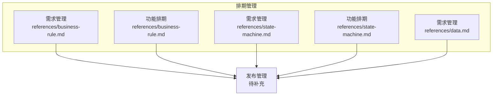
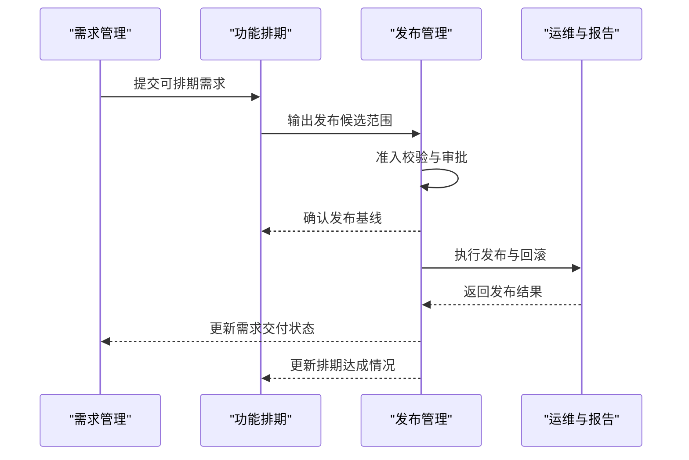
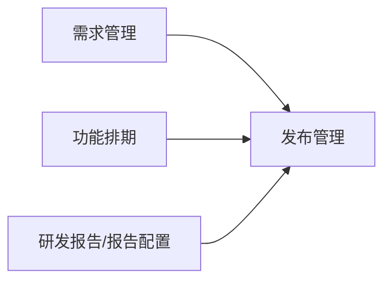

# 发布管理

<cite>
**本文引用的文件**   
- [排期管理/功能排期/references/business-rule.md](file://排期管理/功能排期/references/business-rule.md)
- [排期管理/功能排期/references/state-machine.md](file://排期管理/功能排期/references/state-machine.md)
- [排期管理/需求管理/references/business-rule.md](file://排期管理/需求管理/references/business-rule.md)
- [排期管理/需求管理/references/data.md](file://排期管理/需求管理/references/data.md)
- [排期管理/需求管理/references/state-machine.md](file://排期管理/需求管理/references/state-machine.md)
</cite>

## 目录
1. [引言](#引言)
2. [项目结构](#项目结构)
3. [核心组件](#核心组件)
4. [架构总览](#架构总览)
5. [详细组件分析](#详细组件分析)
6. [依赖关系分析](#依赖关系分析)
7. [性能与一致性考虑](#性能与一致性考虑)
8. [故障排查指南](#故障排查指南)
9. [结论](#结论)

## 引言
本文件聚焦“发布管理”模块的业务规则、审批流与发布记录口径。需要特别说明的是：当前仓库中“排期管理/发布管理”目录下尚未沉淀独立的 references 与 assets 文档，因此本文以“需求管理”和“功能排期”的已生效规则为真源，推导并发布管理的业务边界、审批路径与数据口径；同时明确哪些内容属于待补充范围，避免将目标值或规划写成已验证事实。

## 项目结构
从仓库结构看，发布管理作为排期管理的下游环节，主要依赖以下已沉淀文档：
- 需求管理：定义需求生命周期、状态机、字段与业务规则，是发布范围与准入依据的主要来源。
- 功能排期：定义功能排期的业务规则与状态机，是发布基线、版本计划与变更控制的关键输入。
- 发布管理：当前目录为空，尚未提供独立文档；其规则应以上述两个模块为准，并在后续补充发布专属的 references 与 assets。

**图表来源**
- [排期管理/需求管理/references/business-rule.md](file://排期管理/需求管理/references/business-rule.md)
- [排期管理/功能排期/references/business-rule.md](file://排期管理/功能排期/references/business-rule.md)
- [排期管理/需求管理/references/state-machine.md](file://排期管理/需求管理/references/state-machine.md)
- [排期管理/功能排期/references/state-machine.md](file://排期管理/功能排期/references/state-machine.md)
- [排期管理/需求管理/references/data.md](file://排期管理/需求管理/references/data.md)

**章节来源**
- [排期管理/需求管理/references/business-rule.md](file://排期管理/需求管理/references/business-rule.md)
- [排期管理/功能排期/references/business-rule.md](file://排期管理/功能排期/references/business-rule.md)
- [排期管理/需求管理/references/state-machine.md](file://排期管理/需求管理/references/state-machine.md)
- [排期管理/功能排期/references/state-machine.md](file://排期管理/功能排期/references/state-machine.md)
- [排期管理/需求管理/references/data.md](file://排期管理/需求管理/references/data.md)

## 核心组件
围绕发布管理，建议形成如下核心能力域（当前仓库未实现，仅作为规范建议）：
- 发布范围管理：基于需求与功能排期的有效范围，确定本次发布的可交付项清单。
- 发布准入校验：检查需求完成度、测试通过、缺陷收敛、评审通过等前置条件。
- 发布审批流：按风险等级、影响面与合规要求，驱动多级审批节点。
- 发布基线与版本：生成发布基线、版本号与变更记录，并与需求、排期建立双向追溯。
- 发布执行与回滚：记录发布动作、环境、操作人、时间戳与结果，支持回滚策略。
- 发布度量与审计：统计发布成功率、回滚率、平均恢复时长、变更失败率等指标，并保留审计轨迹。

上述能力在现有仓库中尚未落地，需在“排期管理/发布管理”下新增 references 与 assets 文档进行固化。

## 架构总览
发布管理处于“需求→排期→发布→运维”的下游位置，向上承接需求与排期，向下对接运维与报告体系。下图展示概念性交互关系（非代码级映射）。

[本图为概念流程示意，不直接对应具体源码文件]

## 详细组件分析

### 发布范围与准入规则
- 发布范围应以“已完成且通过验收的需求”以及“已纳入排期基线的功能”为依据，避免将未评审或未测试完成的条目纳入发布。
- 准入条件至少包括：
  - 需求状态达到可发布级别；
  - 功能排期状态进入可发布阶段；
  - 测试用例通过率满足阈值；
  - 缺陷数量与严重级别满足发布门槛；
  - 相关评审与合规审批已通过。

这些规则需分别对齐“需求管理”的状态机与业务规则，以及“功能排期”的状态机与业务规则，确保发布范围与上游一致。

**章节来源**
- [排期管理/需求管理/references/business-rule.md](file://排期管理/需求管理/references/business-rule.md)
- [排期管理/功能排期/references/business-rule.md](file://排期管理/功能排期/references/business-rule.md)
- [排期管理/需求管理/references/state-machine.md](file://排期管理/需求管理/references/state-machine.md)
- [排期管理/功能排期/references/state-machine.md](file://排期管理/功能排期/references/state-machine.md)

### 发布审批流
- 审批流应按风险分级设计，例如：
  - 低风险：单点变更、无外部依赖，可由项目负责人审批；
  - 中风险：跨系统变更、涉及数据迁移，需技术负责人与安全合规审批；
  - 高风险：生产大版本、重大架构调整，需产品、技术、安全、运维多方会签。
- 审批节点应记录：
  - 审批人、角色与权限；
  - 审批意见与附件；
  - 审批时间与决策结果；
  - 是否触发回滚预案。

审批流应与“需求管理”和“功能排期”的状态机联动，确保只有满足前置条件的发布申请才能进入审批。

**章节来源**
- [排期管理/需求管理/references/state-machine.md](file://排期管理/需求管理/references/state-machine.md)
- [排期管理/功能排期/references/state-machine.md](file://排期管理/功能排期/references/state-machine.md)

### 发布记录口径
发布记录应遵循“可追溯、可审计、可度量”的原则，关键字段建议包括：
- 基础信息：发布编号、版本号、环境、发布时间、操作人、所属项目。
- 范围信息：包含的需求列表、功能排期条目、关联缺陷修复清单。
- 审批信息：审批链、审批结果、审批时间、审批意见。
- 执行信息：部署步骤、脚本或制品标识、回滚策略、执行结果。
- 质量信息：冒烟测试、回归测试、监控告警、错误率与可用性指标。
- 审计信息：变更记录、变更原因、变更影响评估、复盘结论。

发布记录的口径应与“需求管理”的数据模型保持一致，确保发布与需求、排期之间的双向追溯。

**章节来源**
- [排期管理/需求管理/references/data.md](file://排期管理/需求管理/references/data.md)

### 发布状态机与上下游衔接
- 发布状态机应覆盖：草稿、待审批、审批中、已批准、已拒绝、已发布、发布失败、已回滚、已关闭。
- 状态转换需受以下条件约束：
  - 仅当发布范围满足准入规则时，允许进入“待审批”；
  - 审批通过后，方可进入“已批准”；
  - 发布执行成功后，进入“已发布”，否则进入“发布失败”；
  - 若触发回滚，则进入“已回滚”，并记录回滚原因与结果；
  - 所有发布最终必须闭环至“已关闭”。

该状态机需与“需求管理”和“功能排期”的状态机协同，避免状态不一致导致的发布越权或漏审。

**章节来源**
- [排期管理/需求管理/references/state-machine.md](file://排期管理/需求管理/references/state-machine.md)
- [排期管理/功能排期/references/state-machine.md](file://排期管理/功能排期/references/state-machine.md)

### 发布度量与报告
- 建议统计：
  - 发布成功率、回滚率；
  - 平均发布时长、平均恢复时长；
  - 变更失败率、缺陷逃逸率；
  - 审批平均耗时、审批驳回率。
- 报告维度：
  - 按项目、团队、版本、环境、变更类型；
  - 结合“研发报告”中的报告配置，形成周期性发布质量看板。

发布度量应与“研发报告/报告配置”的数据与 UI 约定对齐，便于统一呈现。

**章节来源**
- [研发报告/报告配置/references/data.md](file://研发报告/报告配置/references/data.md)
- [研发报告/报告配置/references/web-ui.md](file://研发报告/报告配置/references/web-ui.md)

## 依赖关系分析
发布管理与上游模块存在强依赖关系：
- 依赖“需求管理”的范围与状态，决定发布候选集与准入条件。
- 依赖“功能排期”的基线与计划，决定发布节奏与版本划分。
- 依赖“研发报告”的报告配置，用于发布度量与可视化。

**图表来源**
- [排期管理/需求管理/references/business-rule.md](file://排期管理/需求管理/references/business-rule.md)
- [排期管理/功能排期/references/business-rule.md](file://排期管理/功能排期/references/business-rule.md)
- [研发报告/报告配置/references/data.md](file://研发报告/报告配置/references/data.md)
- [研发报告/报告配置/references/web-ui.md](file://研发报告/报告配置/references/web-ui.md)

**章节来源**
- [排期管理/需求管理/references/business-rule.md](file://排期管理/需求管理/references/business-rule.md)
- [排期管理/功能排期/references/business-rule.md](file://排期管理/功能排期/references/business-rule.md)
- [研发报告/报告配置/references/data.md](file://研发报告/报告配置/references/data.md)
- [研发报告/报告配置/references/web-ui.md](file://研发报告/报告配置/references/web-ui.md)

## 性能与一致性考虑
- 发布范围计算应避免全量扫描，优先基于索引与状态过滤，减少无效计算。
- 审批流应支持并行审批与超时提醒，降低阻塞风险。
- 发布记录写入应采用幂等设计，防止重复提交导致数据不一致。
- 发布与回滚操作应具备事务性或补偿机制，保证状态与结果一致。
- 发布度量采集应异步化，避免影响发布主流程性能。

[本节为通用指导，不涉及具体文件]

## 故障排查指南
常见问题与处理建议：
- 发布范围异常：核对需求与功能排期状态，确认是否满足准入规则。
- 审批卡点：检查审批人权限、审批意见完整性与附件是否齐全。
- 发布失败：查看执行日志、监控告警与错误码，定位是制品问题还是环境问题。
- 回滚失败：确认回滚策略是否可用、依赖服务是否就绪、数据是否可逆。
- 度量缺失：检查报告配置是否正确、数据采集任务是否运行、指标口径是否一致。

**章节来源**
- [排期管理/需求管理/references/business-rule.md](file://排期管理/需求管理/references/business-rule.md)
- [排期管理/功能排期/references/business-rule.md](file://排期管理/功能排期/references/business-rule.md)
- [研发报告/报告配置/references/data.md](file://研发报告/报告配置/references/data.md)
- [研发报告/报告配置/references/web-ui.md](file://研发报告/报告配置/references/web-ui.md)

## 结论
当前仓库尚未在“排期管理/发布管理”下提供独立的业务规则与原型资产。本文基于“需求管理”和“功能排期”的已生效文档，梳理了发布管理的业务边界、审批流设计与发布记录口径，并明确了与上下游模块的依赖关系。建议在后续迭代中，在“排期管理/发布管理”下新增 references 与 assets，将本文提出的范围、准入、审批、基线、执行、回滚与度量等规则固化为正式规范，并与“研发报告”的报告配置对齐，形成端到端的发布治理闭环。