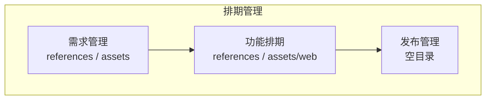
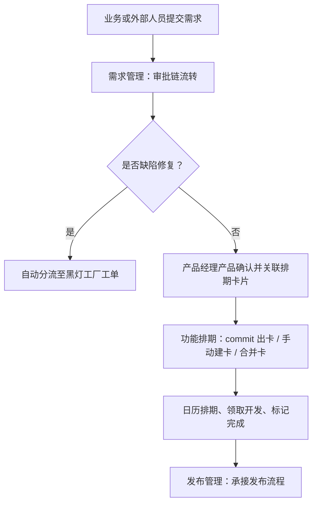
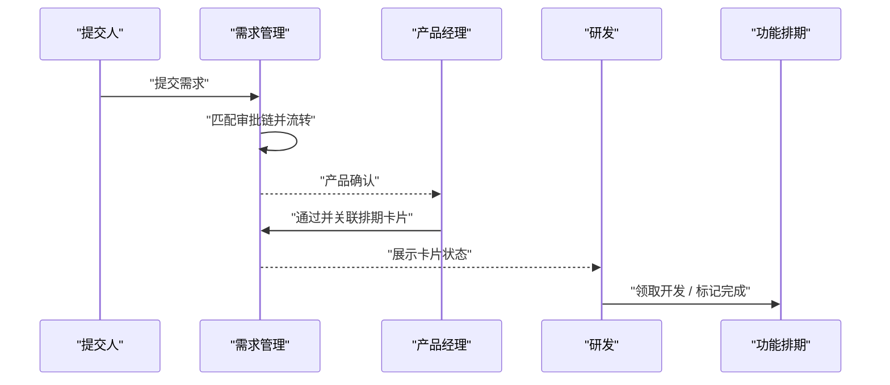
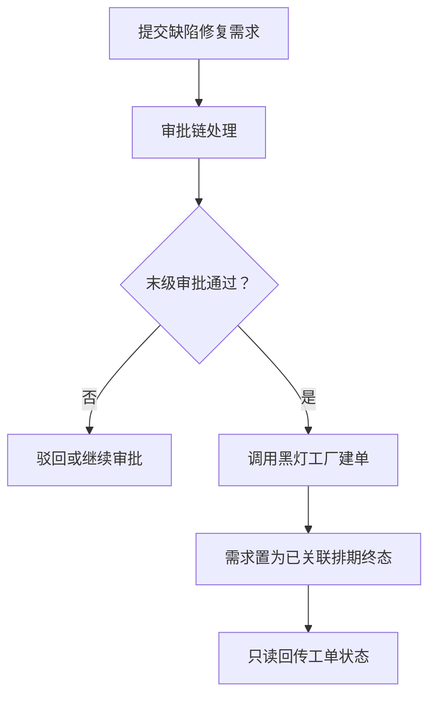
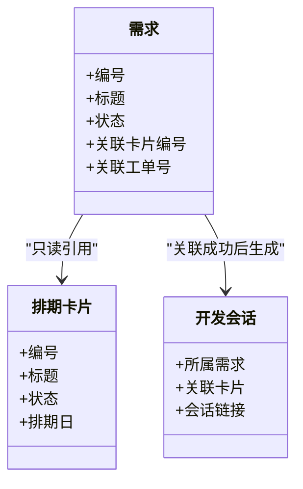
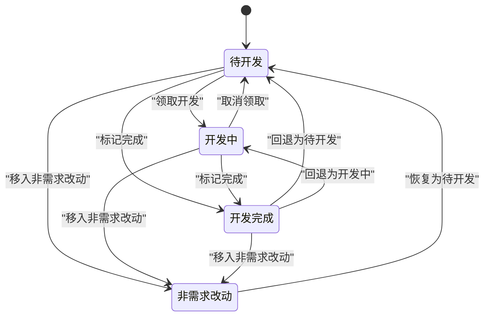
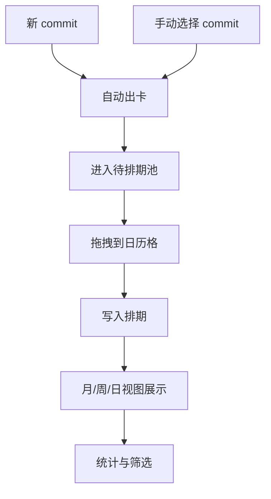
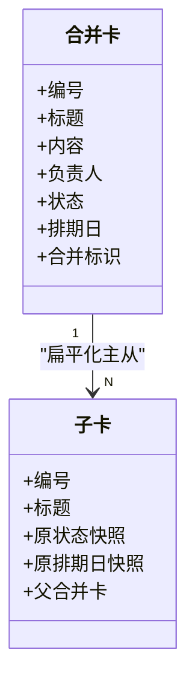
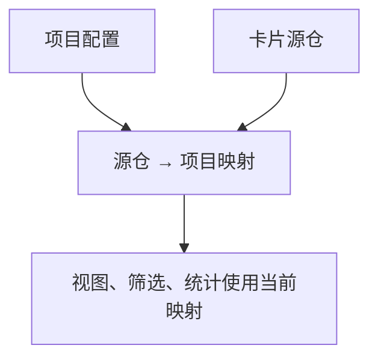
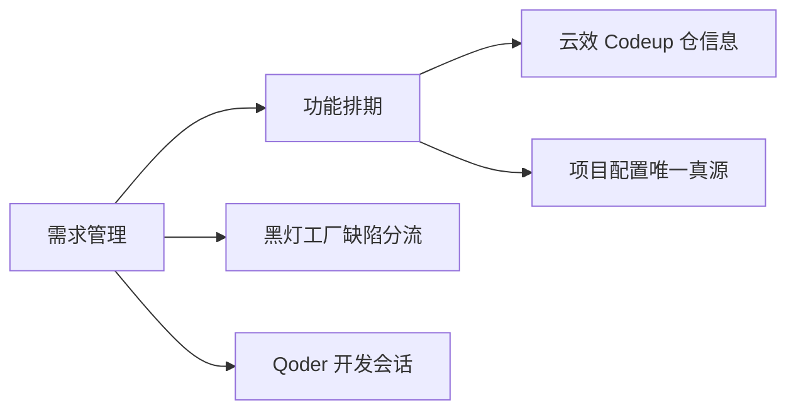

# 排期管理

<cite>
**本文引用的文件**   
- [功能排期 · 业务规则](file://排期管理/功能排期/references/business-rule.md)
- [功能排期 · 状态机](file://排期管理/功能排期/references/state-machine.md)
- [需求管理 · 业务规则](file://排期管理/需求管理/references/business-rule.md)
- [需求管理 · 数据定义](file://排期管理/需求管理/references/data.md)
</cite>

## 目录
1. [引言](#引言)
2. [项目结构](#项目结构)
3. [核心组件](#核心组件)
4. [架构总览](#架构总览)
5. [详细组件分析](#详细组件分析)
6. [依赖关系分析](#依赖关系分析)
7. [性能与可维护性考虑](#性能与可维护性考虑)
8. [故障排查指南](#故障排查指南)
9. [结论](#结论)

## 引言
本仓是鸣鸣很忙产研域 Harness 文档仓，不含可运行服务代码。排期管理子域聚焦“从需求到研发排期”的衔接面：需求管理负责需求提出、审批与方案确认；功能排期负责 commit 出卡、日历排期、合并卡与统计筛选；发布管理作为子域入口之一，承载发布相关流程（当前仓库中该模块尚未展开）。

根据作者说明，本文以各三级模块的 references 与 assets 为真源，仅描述当前生效的规则与流程；排期基线、产能参考等目标值不得写成已验证成果。

## 项目结构
排期管理子域按“需求 → 排期 → 发布”的职责切分：

**图示来源**
- [需求管理 · 业务规则:5-19](file://排期管理/需求管理/references/business-rule.md#L5-L19)
- [功能排期 · 业务规则:1-23](file://排期管理/功能排期/references/business-rule.md#L1-L23)

本节为结构概览，不直接分析具体实现细节，因此不附加“章节来源”。

## 核心组件
排期管理子域包含三个定位清晰的模块：

| 模块 | 定位 | 关键职责 | 主要真源 |
|------|------|----------|----------|
| 需求管理 | 需求入口与审批闭环 | 产品线/业务线归属、审批链匹配、缺陷分流、关联排期卡片、生成 Qoder 开发会话 | [需求管理 · 业务规则](file://排期管理/需求管理/references/business-rule.md)、[需求管理 · 数据定义](file://排期管理/需求管理/references/data.md) |
| 功能排期 | 研发排期工作台 | commit 自动出卡、月/周/日排期、合并卡、非需求改动、项目归属映射、统计与搜索筛选 | [功能排期 · 业务规则](file://排期管理/功能排期/references/business-rule.md)、[功能排期 · 状态机](file://排期管理/功能排期/references/state-machine.md) |
| 发布管理 | 发布流程入口 | 当前仓库未展开具体规则与页面资产 | 无 |

**章节来源**
- [需求管理 · 业务规则:5-19](file://排期管理/需求管理/references/business-rule.md#L5-L19)
- [功能排期 · 业务规则:1-23](file://排期管理/功能排期/references/business-rule.md#L1-L23)

## 架构总览
排期管理子域在“需求—排期—发布”链条中的位置如下：

**图示来源**
- [需求管理 · 业务规则:5-19](file://排期管理/需求管理/references/business-rule.md#L5-L19)
- [需求管理 · 业务规则:61-71](file://排期管理/需求管理/references/business-rule.md#L61-L71)
- [功能排期 · 业务规则:5-23](file://排期管理/功能排期/references/business-rule.md#L5-L23)

## 详细组件分析

### 需求管理：从提起到关联排期的上游
需求管理不是排期本身，而是排期的上游输入与责任主体：它决定“谁的需求、为什么做、由谁确认”，并在通过后把实施任务交给功能排期。

#### 角色与流程要点
- 内部提交先选定产品经理作为提交对象，走专属审批链；外部提交走默认链。
- 前 3 步在本模块内闭环：提交 → 前置审批 → 产品确认。
- 第 4 步“产品提交”由产品经理完成需求打磨并关联排期卡片。
- 第 5 步进入研发阶段，由研发在功能排期中领取卡片推进。

**图示来源**
- [需求管理 · 业务规则:5-19](file://排期管理/需求管理/references/business-rule.md#L5-L19)
- [需求管理 · 业务规则:167-176](file://排期管理/需求管理/references/business-rule.md#L167-L176)

#### 缺陷修复分流
缺陷修复需求是人工报 bug 的唯一入口，但审批通过后不走排期，而是自动创建黑灯工厂工单；需求详情页只读回传工单进展。

**图示来源**
- [需求管理 · 业务规则:61-71](file://排期管理/需求管理/references/business-rule.md#L61-L71)

#### 排期关联与单向契约
- 需求只能关联一张排期卡片，但一张卡片可被多条需求关联。
- 需求侧只读卡片状态，不回写卡片字段；卡片删除后需求侧提示失效。
- 关联成功后生成 Qoder 开发会话，会话挂载需求上下文与 harness 工程、代码仓清单。

**图示来源**
- [需求管理 · 数据定义:17-18](file://排期管理/需求管理/references/data.md#L17-L18)
- [需求管理 · 数据定义:169-177](file://排期管理/需求管理/references/data.md#L169-L177)
- [需求管理 · 业务规则:167-199](file://排期管理/需求管理/references/business-rule.md#L167-L199)

**章节来源**
- [需求管理 · 业务规则:5-19](file://排期管理/需求管理/references/business-rule.md#L5-L19)
- [需求管理 · 业务规则:61-71](file://排期管理/需求管理/references/business-rule.md#L61-L71)
- [需求管理 · 业务规则:167-199](file://排期管理/需求管理/references/business-rule.md#L167-L199)
- [需求管理 · 数据定义:17-18](file://排期管理/需求管理/references/data.md#L17-L18)
- [需求管理 · 数据定义:169-177](file://排期管理/需求管理/references/data.md#L169-L177)

### 功能排期：commit 出卡、排期与合并卡的工作台
功能排期是排期管理子域的核心执行面，围绕“卡片生命周期 × 日历视图 × 合并卡 × 项目归属”组织能力。

#### 卡片生命周期与状态机
功能排期卡片有明确的落库状态与展示态：

**图示来源**
- [功能排期 · 状态机:5-31](file://排期管理/功能排期/references/state-machine.md#L5-L31)

延期不是落库状态，而是基于截止日的展示态：待开发或开发中且截止日早于今天时呈现延期，不参与排期写入。

#### 出卡、排期与统计
- 自动出卡：启用中项目的 harness 工程仓每个新 commit 生成一张待开发卡片。
- 手动新建：从采集源仓选 commit 建卡，与自动出卡共用去重与默认值规则。
- 排期方式：拖拽、右键快捷改期、详情页调整起止日期与时长。
- 统计口径：待排期、待开发、开发中、已完成、延期均取真实数据，随筛选变化。

**图示来源**
- [功能排期 · 业务规则:5-23](file://排期管理/功能排期/references/business-rule.md#L5-L23)
- [功能排期 · 业务规则:24-53](file://排期管理/功能排期/references/business-rule.md#L24-L53)
- [功能排期 · 业务规则:60-76](file://排期管理/功能排期/references/business-rule.md#L60-L76)

#### 合并卡与子卡主从
合并卡用于把同模块的多张卡片聚合为一个排期单元，子卡在主从关系中受保护：

**图示来源**
- [功能排期 · 业务规则:120-176](file://排期管理/功能排期/references/business-rule.md#L120-L176)

#### 项目归属与配置
- 功能排期的项目配置是“项目 ↔ harness 工程 / 代码服务仓”映射的唯一真源。
- 卡片不存项目字段，查询时按源仓命中启用中项目即归属该项目。
- 未归属项目只是筛选兜底项；项目停用后其仓卡片自然回落。
- 项目标识色固定分配，不随停用释放；调色板循环复用。

**图示来源**
- [功能排期 · 业务规则:178-190](file://排期管理/功能排期/references/business-rule.md#L178-L190)

**章节来源**
- [功能排期 · 状态机:5-49](file://排期管理/功能排期/references/state-machine.md#L5-L49)
- [功能排期 · 业务规则:5-23](file://排期管理/功能排期/references/business-rule.md#L5-L23)
- [功能排期 · 业务规则:24-53](file://排期管理/功能排期/references/business-rule.md#L24-L53)
- [功能排期 · 业务规则:60-76](file://排期管理/功能排期/references/business-rule.md#L60-L76)
- [功能排期 · 业务规则:108-119](file://排期管理/功能排期/references/business-rule.md#L108-L119)
- [功能排期 · 业务规则:120-176](file://排期管理/功能排期/references/business-rule.md#L120-L176)
- [功能排期 · 业务规则:178-190](file://排期管理/功能排期/references/business-rule.md#L178-L190)

### 发布管理：当前为空白的下游入口
发布管理目录存在但尚未提供 references 与 assets 资产。按照子域命名逻辑，它应承接功能排期完成后的发布流程，但在本仓库中暂无规则与页面定义，不应据此推断已有发布基线或自动化能力。

本节为占位说明，不附加“章节来源”。

## 依赖关系分析
排期管理子域内部依赖方向明确，且对外部系统有清晰边界：

**图示来源**
- [需求管理 · 业务规则:61-71](file://排期管理/需求管理/references/business-rule.md#L61-L71)
- [需求管理 · 业务规则:195-199](file://排期管理/需求管理/references/business-rule.md#L195-L199)
- [功能排期 · 业务规则:178-190](file://排期管理/功能排期/references/business-rule.md#L178-L190)

### 耦合与内聚
- 需求管理与功能排期之间是“单向引用”：需求侧读取卡片状态，不写卡片字段。
- 功能排期对云效 Codeup 的依赖集中在仓名称、分支与可访问性，不复制仓信息。
- 项目归属映射由功能排期维护，并被需求管理在生成 Qoder 会话时复用。

**章节来源**
- [需求管理 · 业务规则:167-199](file://排期管理/需求管理/references/business-rule.md#L167-L199)
- [功能排期 · 业务规则:178-190](file://排期管理/功能排期/references/business-rule.md#L178-L190)

## 性能与可维护性考虑
- 服务端分页与排序：功能排期的待排期池与非需求改动列表采用服务端分页，避免前端一次性加载全部卡片。
- 本地筛选与搜索：月历与周视图在已载入数据上本地匹配，减少频繁请求；跨池搜索才走服务端分页。
- 实时数据与视觉标记分离：发版日仅作视觉标记，不参与状态与延期判定，降低状态计算复杂度。
- 合并卡扁平化：嵌套合并最终扁平为一层合并卡与原始子卡集合，查询与解散无需递归。
- 项目归属不快照：历史卡片归属随当前映射变化，这是刻意取舍，便于统一归集视角，但要求配置变更谨慎评估影响范围。

本节为通用建议与规则归纳，不直接分析具体实现细节，因此不附加“章节来源”。

## 故障排查指南
### 需求管理常见问题
- 外部提交不可用：若默认链未命中或未配置 L3，外部提交会被拒绝，同时向邀约人推送告警。
- 审批链重建：审批人离职或调岗时需重建审批链，只替换审批人，不增减级次。
- 群消息静默失败：新增业务线未同步企微群映射时，群消息可能静默失败，需检查事件审计与机器人 Webhook。

**章节来源**
- [需求管理 · 业务规则:118-126](file://排期管理/需求管理/references/business-rule.md#L118-L126)
- [需求管理 · 业务规则:133-138](file://排期管理/需求管理/references/business-rule.md#L133-L138)
- [需求管理 · 业务规则:148-165](file://排期管理/需求管理/references/business-rule.md#L148-L165)

### 功能排期常见问题
- 卡片无法拖拽：开发完成、非需求改动与子卡受锁定守卫限制，需先回到允许排期的状态。
- 延期未出现：延期仅对当月或当周视图计算，历史月/周不呈现；未排期卡也不参与延期判定。
- 合并卡解散失败：开发完成的合并卡不可解散，需先回退合并卡状态。
- 项目归属异常：项目配置变更后历史卡片归属会变化，排查时应以当前生效映射为准。

**章节来源**
- [功能排期 · 状态机:33-49](file://排期管理/功能排期/references/state-machine.md#L33-L49)
- [功能排期 · 业务规则:171-176](file://排期管理/功能排期/references/business-rule.md#L171-L176)
- [功能排期 · 业务规则:178-183](file://排期管理/功能排期/references/business-rule.md#L178-L183)

## 结论
排期管理子域以“需求管理”为上游、“功能排期”为核心、“发布管理”为潜在下游，形成从需求提出、审批确认到研发排期的完整链路。需求管理强调审批链、缺陷分流与单向关联；功能排期强调 commit 出卡、日历排期、合并卡与项目归属映射。两者通过“只读引用”和“唯一真源”保持边界清晰，便于后续扩展发布管理而不破坏既有契约。