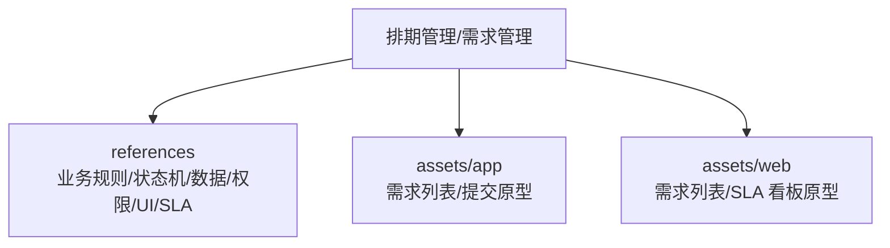
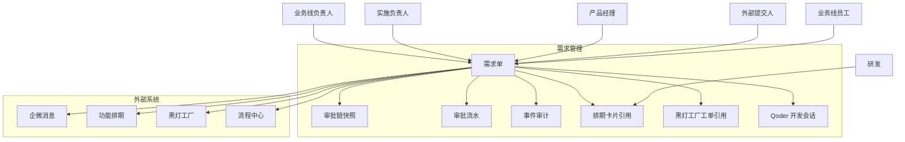
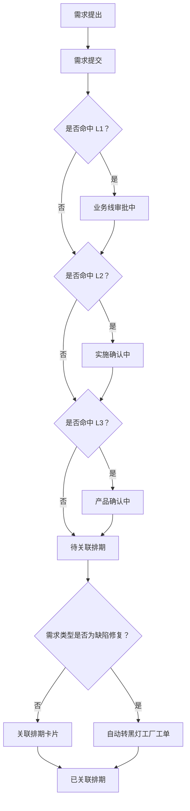
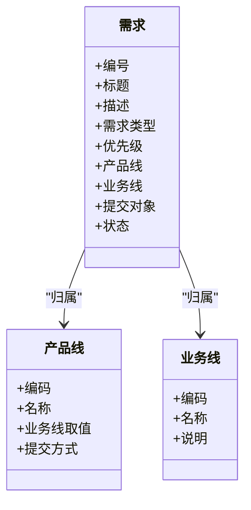
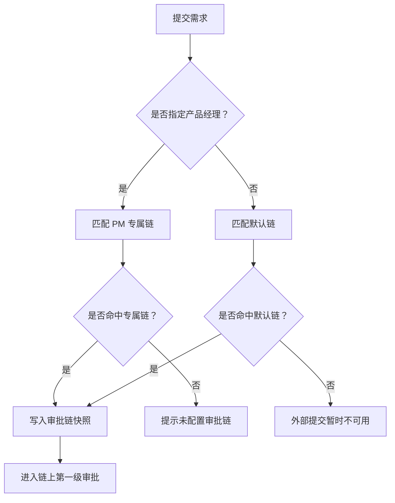
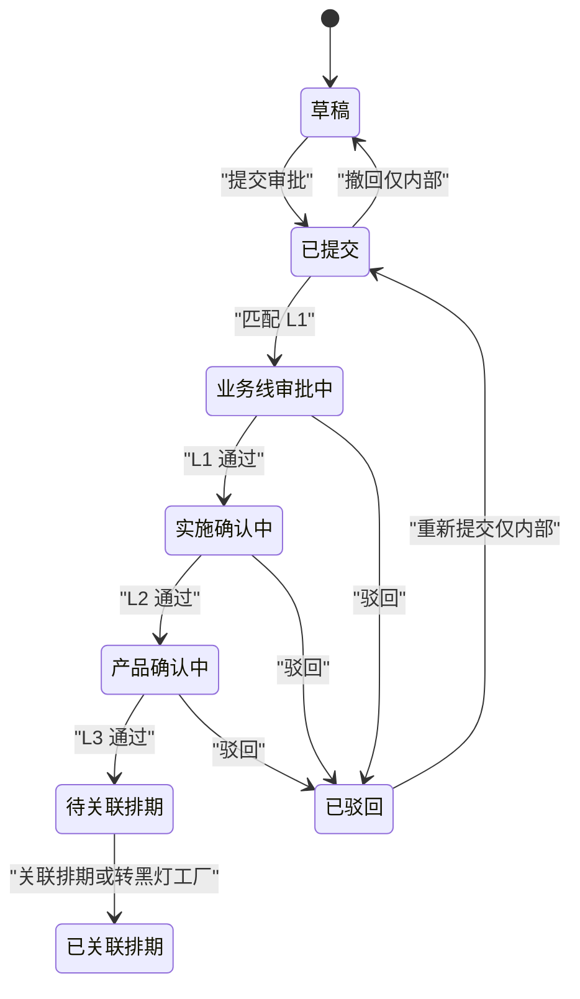
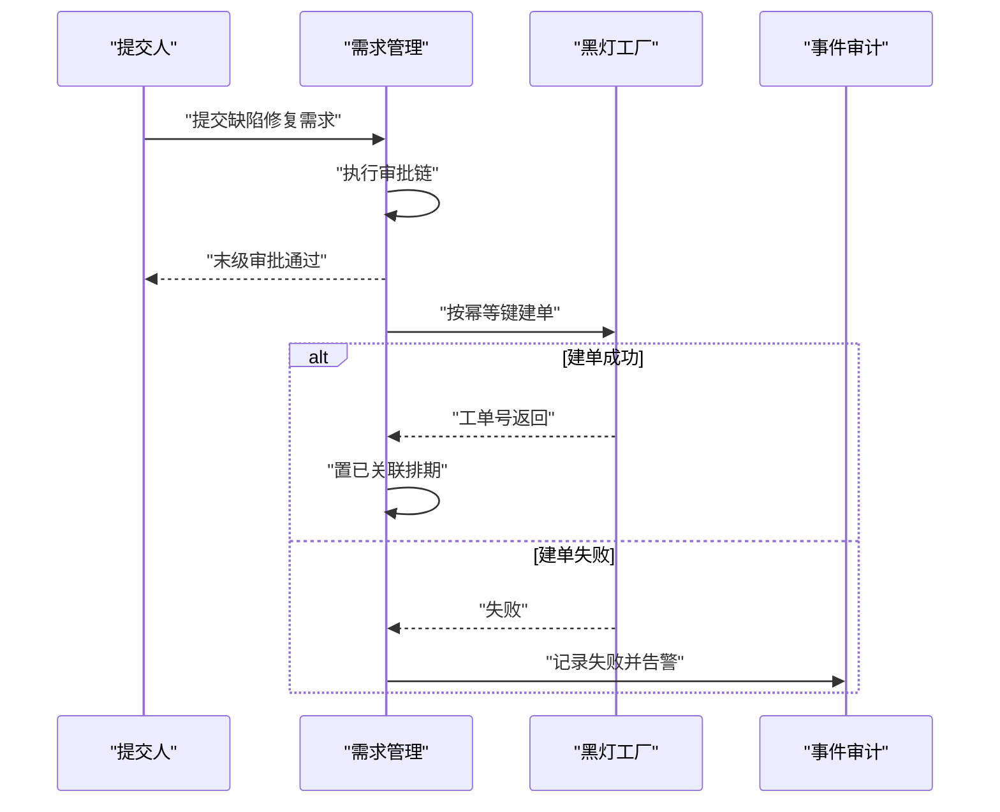
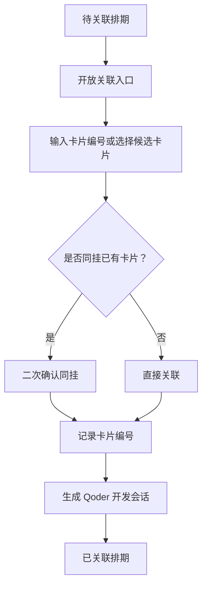
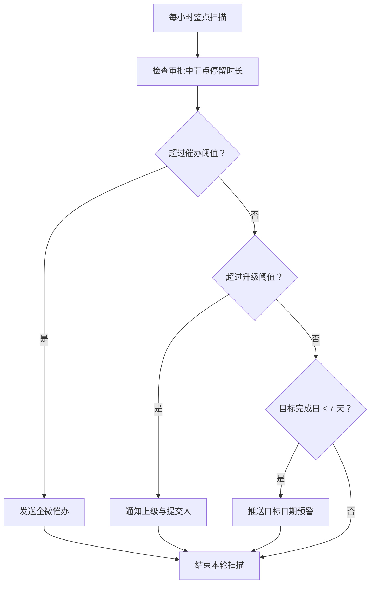
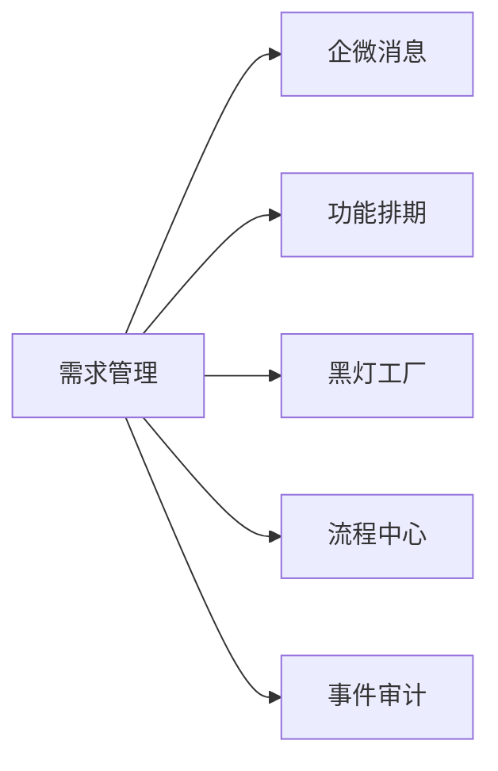

# 需求管理

<cite>
**本文引用的文件**   
- [业务规则](file://排期管理/需求管理/references/business-rule.md)
- [状态机](file://排期管理/需求管理/references/state-machine.md)
- [数据定义](file://排期管理/需求管理/references/data.md)
- [权限规则](file://排期管理/需求管理/references/permission-rules.md)
- [Web 端 UI 描述](file://排期管理/需求管理/references/web-ui.md)
- [审批时效与 SLA](file://排期管理/需求管理/references/other-rule-sla.md)
</cite>

## 目录
1. [引言](#引言)
2. [项目结构](#项目结构)
3. [核心组件](#核心组件)
4. [架构总览](#架构总览)
5. [详细组件分析](#详细组件分析)
6. [依赖关系分析](#依赖关系分析)
7. [性能与可靠性考虑](#性能与可靠性考虑)
8. [故障排查指南](#故障排查指南)
9. [结论](#结论)

## 引言
本模块面向业务、实施与运维的需求流转规则，覆盖从需求提出、审批确认、排期关联到下游承接的完整生命周期。文档以各三级模块 references 与 assets 为真源，聚焦当前生效的规则与流程，不描述尚未落地的目标值或假设性成果；实现细节（数据库表结构、接口契约、定时任务）以代码仓为准。

## 项目结构
需求管理位于「排期管理 / 需求管理」下，采用「references 规则 + assets 原型」的组织方式：
- references：业务规则、状态机、数据模型、权限、UI 与 SLA 等真源文档
- assets：Web 与 App 端原型页面，用于辅助理解交互与布局

**图示来源**
- [业务规则:1-10](file://排期管理/需求管理/references/business-rule.md#L1-L10)
- [Web 端 UI 描述:1-10](file://排期管理/需求管理/references/web-ui.md#L1-L10)

**章节来源**
- [业务规则:1-10](file://排期管理/需求管理/references/business-rule.md#L1-L10)
- [Web 端 UI 描述:1-10](file://排期管理/需求管理/references/web-ui.md#L1-L10)

## 核心组件
需求管理由以下关键能力构成：
- 需求提交流程：内部员工与外部外链两种入口，统一进入审批链
- 审批链配置：按「提交对象 → 产品线 × 业务线 × 需求类型 × 优先级」匹配专属链或默认链
- 状态机：草稿、已提交、各级审批中、待关联排期、已关联排期、已驳回等状态及跳转
- 排期关联：功能类需求关联排期卡片并生成 Qoder 开发会话
- 缺陷分流：缺陷修复单自动转黑灯工厂工单，不走排期关联
- 通知与企微推送：个人消息与业务群消息双通道
- SLA 时效治理：催办、升级、目标日期预警、滞留看板与仪表盘
- 权限与可见范围：角色、菜单按钮、数据裁剪与审批人校验

**章节来源**
- [业务规则:5-19](file://排期管理/需求管理/references/business-rule.md#L5-L19)
- [业务规则:73-137](file://排期管理/需求管理/references/business-rule.md#L73-L137)
- [状态机:5-39](file://排期管理/需求管理/references/state-machine.md#L5-L39)
- [业务规则:167-199](file://排期管理/需求管理/references/business-rule.md#L167-L199)
- [业务规则:139-166](file://排期管理/需求管理/references/business-rule.md#L139-L166)
- [审批时效与 SLA:5-92](file://排期管理/需求管理/references/other-rule-sla.md#L5-L92)
- [权限规则:49-82](file://排期管理/需求管理/references/permission-rules.md#L49-L82)

## 架构总览
需求管理在产研域 Harness 中的定位是「需求侧入口与审批中枢」：上游对接业务与外部伙伴，下游对接功能排期与黑灯工厂，横向联动企微消息、SLA 扫描与事件审计。

**图示来源**
- [数据定义:5-20](file://排期管理/需求管理/references/data.md#L5-L20)
- [业务规则:167-199](file://排期管理/需求管理/references/business-rule.md#L167-L199)
- [业务规则:139-166](file://排期管理/需求管理/references/business-rule.md#L139-L166)

## 详细组件分析

### 业务流程与角色
需求从提出到进入研发排期共 5 步：
1. 需求提交：内部先选定提交对象（产品经理），外部凭外链无提交对象
2. 前置审批：L1 业务线审批、L2 实施确认，未配置级次直接跳过
3. 产品确认：L3 产品经理终审
4. 产品提交：关联排期卡片，进入已关联排期终态
5. 研发开发：在功能排期中领取卡片开发，状态回传需求详情页

角色职责要点：
- 业务线员工：提出需求、撤回与修改草稿
- 外部提交人：凭外链提交，无账号、不可查进度
- 邀约人：对链接产生的需求负溯源责任
- 业务线负责人：L1 审批
- 实施负责人：L2 审批，负责归集与可行性判断
- 产品经理：提交对象与 L3 终审，负责方案确认与排期关联
- 研发：不参与审批，承接开发

**图示来源**
- [业务规则:5-19](file://排期管理/需求管理/references/business-rule.md#L5-L19)
- [业务规则:61-72](file://排期管理/需求管理/references/business-rule.md#L61-L72)
- [业务规则:167-177](file://排期管理/需求管理/references/business-rule.md#L167-L177)

**章节来源**
- [业务规则:5-19](file://排期管理/需求管理/references/business-rule.md#L5-L19)
- [业务规则:40-60](file://排期管理/需求管理/references/business-rule.md#L40-L60)

### 产品线、业务线与归属约束
- 产品线固定为鸣鸣很忙与有点推荐
- 鸣鸣很忙必选业务线：运营、财务、供应链、数字化
- 有点推荐不区分业务线，系统记为「不区分」
- 提交后产品线与业务线不可修改，变更需新建需求

**图示来源**
- [业务规则:20-39](file://排期管理/需求管理/references/business-rule.md#L20-L39)
- [数据定义:21-49](file://排期管理/需求管理/references/data.md#L21-L49)

**章节来源**
- [业务规则:20-39](file://排期管理/需求管理/references/business-rule.md#L20-L39)
- [数据定义:21-49](file://排期管理/需求管理/references/data.md#L21-L49)

### 审批链配置与匹配
审批链由提交对象驱动，优先匹配专属链；未命中专属链的内部单不得走默认链。外部单走默认链，且有点推荐默认链必须配齐 L1/L2/L3。

匹配维度与降级顺序：
- 第一优先：提交对象（专属链）
- 第二优先：产品线 × 业务线 × 需求类型 × 优先级四维降级
- 四级全等 → 优先级通配 → 需求类型通配 → 均通配

**图示来源**
- [业务规则:73-137](file://排期管理/需求管理/references/business-rule.md#L73-L137)

**章节来源**
- [业务规则:73-137](file://排期管理/需求管理/references/business-rule.md#L73-L137)

### 状态机与级次递进
状态包括草稿、已提交、业务线审批中、实施确认中、产品确认中、待关联排期、已关联排期、已驳回。瞬时态不展示为独立状态。

级次递进规则：
- 当前级次记录当前待审级次
- 最大级次由命中审批链决定
- 每级通过后流转到下一个已配置级次，未配置级次直接跳过

**图示来源**
- [状态机:5-39](file://排期管理/需求管理/references/state-machine.md#L5-L39)

**章节来源**
- [状态机:5-39](file://排期管理/需求管理/references/state-machine.md#L5-L39)
- [状态机:42-55](file://排期管理/需求管理/references/state-machine.md#L42-L55)

### 缺陷修复分流
缺陷修复需求是人工报 bug 的唯一入口，审批通过后自动转黑灯工厂工单，不占功能排期。

关键点：
- 建单幂等键为需求编号
- 级别映射：P0/P1 → P1，P2/P3 → P2
- 建单失败写事件审计并告警，安全重试
- 需求终态为已关联排期，但关联对象为黑灯工厂工单

**图示来源**
- [业务规则:61-72](file://排期管理/需求管理/references/business-rule.md#L61-L72)

**章节来源**
- [业务规则:61-72](file://排期管理/需求管理/references/business-rule.md#L61-L72)

### 排期关联与 Qoder 开发会话
功能类需求在全部审批通过后开放排期关联：
- 仅产品经理与管理员可操作
- 支持精确搜索或候选列表选择
- 单向关联：只读排期卡片信息，不回写卡片字段
- 关联成功后生成 Qoder 开发会话，挂载需求上下文与项目工程清单

**图示来源**
- [业务规则:167-199](file://排期管理/需求管理/references/business-rule.md#L167-L199)

**章节来源**
- [业务规则:167-199](file://排期管理/需求管理/references/business-rule.md#L167-L199)

### 通知与企微推送
双通道推送：
- 个人消息：下一级审批人或提交人，外部单改推邀约人
- 业务群消息：按产品线/业务线路由到对应企微群

触发事件包括需求提交、L1/L3 审批通过、驳回、关联排期等。推送去重与失败处理：
- 同一需求同类消息同一分钟内重复触发只推送一次
- 推送失败不回滚业务事务，写事件审计供人工重推

**章节来源**
- [业务规则:139-166](file://排期管理/需求管理/references/business-rule.md#L139-L166)

### SLA 时效治理
SLA 提供催办、升级、目标日期预警、滞留看板与仪表盘指标：
- 催办阈值与升级阈值可按产品线、优先级、级次差异化配置
- 滞留需求视角按停留时长倒序排序
- 每小时整点扫描，静默时段延后，去重窗口避免骚扰
- 仪表盘指标包含平均审批耗时、端到端周期、超时率与趋势图

**图示来源**
- [审批时效与 SLA:5-92](file://排期管理/需求管理/references/other-rule-sla.md#L5-L92)

**章节来源**
- [审批时效与 SLA:5-92](file://排期管理/需求管理/references/other-rule-sla.md#L5-L92)

### 权限与可见范围
权限控制覆盖菜单、按钮、数据可见范围与审批人校验：
- 管理员：配置审批链与 SLA、重建审批链、导出统计、查看与撤销外链
- 业务线负责人：L1 审批
- 实施负责人：L2 审批、滞留需求手动催办
- 产品经理：L3 审批、排期关联、AI 方案确认
- 外部提交人：仅外链提交，无查询与管理权限

审批操作服务端二次校验：当前登录人必须在快照当前级次审批人清单中；流程中心通道单豁免页内快照校验，以流程中心节点快照为准。

**章节来源**
- [权限规则:49-82](file://排期管理/需求管理/references/permission-rules.md#L49-L82)

## 依赖关系分析
需求管理与外部系统的依赖关系如下：

**图示来源**
- [数据定义:5-20](file://排期管理/需求管理/references/data.md#L5-L20)
- [业务规则:139-199](file://排期管理/需求管理/references/business-rule.md#L139-L199)

**章节来源**
- [数据定义:5-20](file://排期管理/需求管理/references/data.md#L5-L20)
- [业务规则:139-199](file://排期管理/需求管理/references/business-rule.md#L139-L199)

## 性能与可靠性考虑
- 审批类操作幂等：重复提交返回当前状态而非报错，前端按返回状态静默刷新详情
- 推送异步化：统一在业务事务提交后异步触发，禁止同步调用
- 推送去重：同一需求同类消息同一分钟内重复触发只推送一次
- 定时扫描幂等：每小时整点扫描，依赖去重标识避免重复发送
- 附件预览与下载链接有效期短，每次重新获取链接，避免缓存泄露
- 审批处理响应 ≤ 3 秒，超时不解锁按钮，防止连点导致重复推送

**章节来源**
- [Web 端 UI 描述:338-343](file://排期管理/需求管理/references/web-ui.md#L338-L343)
- [业务规则:139-166](file://排期管理/需求管理/references/business-rule.md#L139-L166)
- [审批时效与 SLA:85-92](file://排期管理/需求管理/references/other-rule-sla.md#L85-L92)

## 故障排查指南
常见问题与处理建议：
- 外部提交无法匹配审批链：提示「提交暂时不可用，请联系邀约人」，同时向邀约人推送企微告警；检查有点推荐默认链是否配齐 L1/L2/L3
- 内部单未命中专属链：提示「当前归属未配置审批链，请联系管理员」；检查专属链启用状态与四维匹配
- 黑灯工厂建单失败：查看事件审计，确认幂等键与级别映射；系统会安全重试
- 企微推送失败：查看事件审计，人工重推；注意静默时段与去重窗口
- SLA 催办未触发：检查 SLA 配置是否启用、阈值是否合理、静默时段是否延后、去重窗口是否占用
- 排期卡片失效：详情页提示「关联卡片已失效」，需重新关联

**章节来源**
- [业务规则:120-126](file://排期管理/需求管理/references/business-rule.md#L120-L126)
- [业务规则:61-72](file://排期管理/需求管理/references/business-rule.md#L61-L72)
- [业务规则:139-166](file://排期管理/需求管理/references/business-rule.md#L139-L166)
- [审批时效与 SLA:73-92](file://排期管理/需求管理/references/other-rule-sla.md#L73-L92)

## 结论
需求管理模块以「提交对象驱动的审批链」为核心，统一承载业务、实施与运维的需求流转；通过状态机、SLA 时效治理与外部系统对接，形成从需求提出到研发承接的闭环。规则强调可配置、可追溯、可审计，并在外部提交、缺陷分流、排期关联等场景提供明确边界与兜底策略。