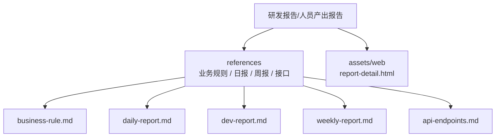
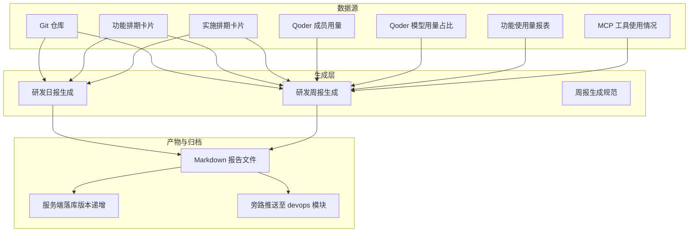
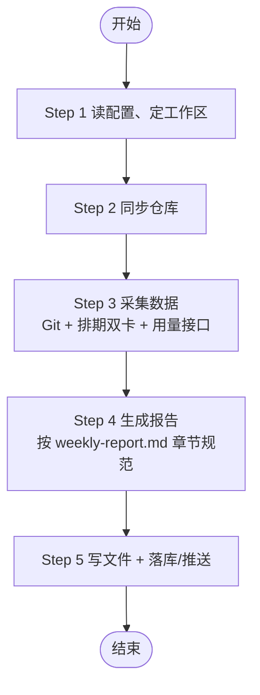
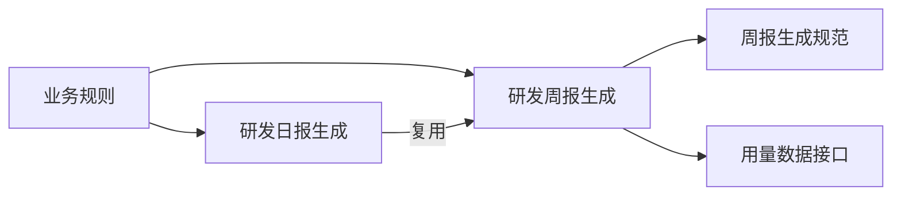

# 人员产出报告

<cite>
**本文引用的文件**   
- [业务规则](file://研发报告/人员产出报告/references/business-rule.md)
- [研发日报生成](file://研发报告/人员产出报告/references/daily-report.md)
- [研发周报生成](file://研发报告/人员产出报告/references/dev-report.md)
- [周报生成规范](file://研发报告/人员产出报告/references/weekly-report.md)
- [用量数据接口](file://研发报告/人员产出报告/references/api-endpoints.md)
</cite>

## 目录
1. [引言](#引言)
2. [项目结构](#项目结构)
3. [核心组件](#核心组件)
4. [架构总览](#架构总览)
5. [详细组件分析](#详细组件分析)
6. [依赖关系分析](#依赖关系分析)
7. [性能与可靠性考虑](#性能与可靠性考虑)
8. [故障排查指南](#故障排查指南)
9. [结论](#结论)

## 引言
本文件聚焦“人员产出报告”的统计口径、频率与生成规则，覆盖研发日报与研发周报两类产出。文档以各 references 为真源，说明：
- 统计范围与指标口径
- 日报与周报的触发频率、统计窗口与数据源差异
- 生成流程、输出章节、归档与版本策略
- 人员可见性与权限约束
- 数据缺失与异常处理原则

## 项目结构
人员产出报告位于“研发报告/人员产出报告”，其 references 目录承载业务规则、日报/周报生成规范与用量接口契约；assets 目录存放前端原型页面，不包含可运行服务代码。

图表来源
- [业务规则:1-23](file://研发报告/人员产出报告/references/business-rule.md#L1-L23)
- [研发日报生成:1-107](file://研发报告/人员产出报告/references/daily-report.md#L1-L107)
- [研发周报生成:1-90](file://研发报告/人员产出报告/references/dev-report.md#L1-L90)
- [周报生成规范:1-211](file://研发报告/人员产出报告/references/weekly-report.md#L1-L211)
- [用量数据接口:1-39](file://研发报告/人员产出报告/references/api-endpoints.md#L1-L39)

章节来源
- [业务规则:1-23](file://研发报告/人员产出报告/references/business-rule.md#L1-L23)
- [研发日报生成:1-107](file://研发报告/人员产出报告/references/daily-report.md#L1-L107)
- [研发周报生成:1-90](file://研发报告/人员产出报告/references/dev-report.md#L1-L90)
- [周报生成规范:1-211](file://研发报告/人员产出报告/references/weekly-report.md#L1-L211)
- [用量数据接口:1-39](file://研发报告/人员产出报告/references/api-endpoints.md#L1-L39)

## 核心组件
- 业务规则字典：定义产出量、时效、质量与纪律、人员透视、统计人员范围、归档版本等统一口径。
- 研发日报生成：当日实时快照，采集 Git 提交与排期卡片流转事实，不采集用量类维度。
- 研发周报生成：综合 Git、排期双卡、Qoder 用量、功能使用量、MCP 工具用量五项数据源，按周生成。
- 周报生成规范：明确章节顺序、模板、计数纪律、仓库分组与输出格式。
- 用量数据接口：定义 Qoder 成员用量、模型用量占比、功能使用量、MCP 工具用量的字段与调用约定。

章节来源
- [业务规则:5-22](file://研发报告/人员产出报告/references/business-rule.md#L5-L22)
- [研发日报生成:25-41](file://研发报告/人员产出报告/references/daily-report.md#L25-L41)
- [研发周报生成:39-64](file://研发报告/人员产出报告/references/dev-report.md#L39-L64)
- [周报生成规范:7-40](file://研发报告/人员产出报告/references/weekly-report.md#L7-L40)
- [用量数据接口:17-39](file://研发报告/人员产出报告/references/api-endpoints.md#L17-L39)

## 架构总览
人员产出报告由“配置与数据源 → 生成会话 → 报告产物 → 归档/推送”构成。外部会话通过 MCP 与 HTTP 拉取数据；服务端会话由调用方注入工作区、凭证与会话数据。

图表来源
- [研发日报生成:25-41](file://研发报告/人员产出报告/references/daily-report.md#L25-L41)
- [研发周报生成:39-64](file://研发报告/人员产出报告/references/dev-report.md#L39-L64)
- [周报生成规范:7-16](file://研发报告/人员产出报告/references/weekly-report.md#L7-L16)
- [用量数据接口:17-39](file://研发报告/人员产出报告/references/api-endpoints.md#L17-L39)

## 详细组件分析

### 统计口径与指标定义
- 产出量：统计区间内 commit 数、完成的功能卡数、完成的实施卡数；区分提交人与开发人/领取人双口径，避免代提交错记。
- 时效：卡片领取到完成的平均时长；需求关联卡的端到端周期。
- 质量与纪律：延期卡数与延期率、完成回退次数。
- 人员透视：人员 × 项目（模块）、人员 × 周期的产出矩阵。
- 统计人员范围：仅统计“报告配置 → 统计人员范围”启用名单内人员；名单外不计入、不点名。项目级数据保持全量，其中人员姓名按名单脱敏。
- 数据客观唯一：全部指标由 git 事实与排期卡片流水计算，不做主观评分与排名。
- 缺失数据静默省略：任一数据源无数据或失败时，对应章节、指标条目与人员字段直接省略，不写缺失说明，不以 0 或推测值代替。
- 旁路态不计入：NON_FEATURE / NON_IMPL 旁路态卡片不参与统计。
- 指标口径随报告附注，防止跨周期比较漂移；日报为当日实时截断窗口，不与完整周期报告直接比较。

章节来源
- [业务规则:5-22](file://研发报告/人员产出报告/references/business-rule.md#L5-L22)

### 频率与统计窗口
- 研发日报
  - 频率：按需单次生成，用于当日复盘（例会前、下班前快照）。
  - 统计窗口：当日 00:00 至生成时（东八区），生成时截断；起止同日保证可解析入库。
  - 数据源裁剪：采集 Git 提交记录与排期双卡当日流转事实；不采集 Qoder 用量、功能使用量、MCP 工具用量。
- 研发周报
  - 频率：每周一或周日复盘上一周产出；也可由用户主动触发。
  - 统计窗口：最近一个以周日收尾的周一~周日；今天是周日则含当天，否则不含当天。
  - 数据源：Git 提交、功能排期、实施排期、Qoder 成员用量、Qoder 模型用量占比、功能使用量、MCP 工具使用情况。

章节来源
- [研发日报生成:10-27](file://研发报告/人员产出报告/references/daily-report.md#L10-L27)
- [研发周报生成:10-38](file://研发报告/人员产出报告/references/dev-report.md#L10-L38)

### 人员范围与可见性
- 人员范围唯一口径：来自“报告配置 → 统计人员范围”。名单为空时拒绝生成人员产出报告。
- 匹配规则：姓名或别名去掉空白、忽略大小写、忽略括号内职级后缀后完全相等即视为同一人；同一提交命中多人时按名单顺序归入第一个命中人员。
- 提交统计必须按名单过滤：服务端会话逐仓采集并按名单作者过滤；外部会话引用权威脚本输出。
- 参与人数只计名单内有提交的人；名单内无提交/无卡片/无用量的人不出单独章节。
- 可见性收口：人员维度数据敏感，仅管理层与研发负责人角色可见；不向被统计人推送。
- 项目级数据（需求吞吐、仓库清单）保持全量，其中人员姓名按名单脱敏，名单外显示“—”。

章节来源
- [业务规则:11-20](file://研发报告/人员产出报告/references/business-rule.md#L11-L20)
- [周报生成规范:32-40](file://研发报告/人员产出报告/references/weekly-report.md#L32-L40)
- [研发周报生成:58-64](file://研发报告/人员产出报告/references/dev-report.md#L58-L64)

### 数据源与接口契约
- Git 提交记录
  - 外部会话：以 `collect_commits.sh` 输出为权威计数，严禁自行重新跑 git log 计数。
  - 服务端会话：agent 在工作区内自行采集，纪律同外部会话（全分支、SHA 去重、剔 merge、窗口过滤）。
- 排期双卡
  - 功能排期 / 实施排期：外部会话走 MCP 工具；服务端会话由调用方在会话数据中提供。
- 用量数据（周报专属）
  - Qoder 成员用量、Qoder 模型用量占比、功能使用量、MCP 工具使用情况：外部会话通过 HTTP 接口调用；服务端会话由调用方直接注入过滤后的数据。
  - 接口统一超时 30s；响应优先取 `data` 字段；大响应先落盘再读取分析。
  - 金额换算：Credits ÷ 2000 × 300，取整，单位元。
  - 人员范围：统一使用研发团队名单（scope=ROSTER），名单外成员不得出现在报告中。

章节来源
- [研发周报生成:56-64](file://研发报告/人员产出报告/references/dev-report.md#L56-L64)
- [用量数据接口:1-15](file://研发报告/人员产出报告/references/api-endpoints.md#L1-L15)
- [用量数据接口:17-39](file://研发报告/人员产出报告/references/api-endpoints.md#L17-L39)

### 生成流程与关键步骤

图表来源
- [研发周报生成:39-75](file://研发报告/人员产出报告/references/dev-report.md#L39-L75)
- [周报生成规范:50-110](file://研发报告/人员产出报告/references/weekly-report.md#L50-L110)

章节来源
- [研发周报生成:39-75](file://研发报告/人员产出报告/references/dev-report.md#L39-L75)

### 输出章节与命名
- 研发日报
  - 标题：`研发日报 - {yyyy-MM-dd}`
  - 章节顺序：统计摘要 → 按人员当日产出 → 各仓库提交分布 → 口径说明
  - 文件名：`daily_dev_yyyyMMdd.md`
- 研发周报
  - 标题：`研发周报 - {yyyy-MM-dd}`（生成当天日期）
  - 章节顺序：统计摘要 → AI 分析总结 → 按人员综合分析 → 功能进展追踪 → 各仓库提交分布 → 功能使用情况 → MCP 工具使用情况
  - 文件名：`weekly_dev_yyyyMMdd.md`
- 缺失章节处理：任一数据源无数据或拉取失败时，对应章节、指标条目与人员字段整体省略，不写缺失或失败说明，也不以 0 或推测值代替。

章节来源
- [研发日报生成:47-101](file://研发报告/人员产出报告/references/daily-report.md#L47-L101)
- [周报生成规范:50-110](file://研发报告/人员产出报告/references/weekly-report.md#L50-L110)
- [研发周报生成:71-75](file://研发报告/人员产出报告/references/dev-report.md#L71-L75)

### 归档、版本与索引
- 归档与版本：研发周报按发报日所在自然周（周一为起点）建周索引；研发日报按发报日建日索引。
- 重复入库：同类型同周期重复入库走版本递增而非覆盖，历史版本可追溯。
- 静态产物：报告为静态产物，归档后不重新计算指标。

章节来源
- [业务规则:20-22](file://研发报告/人员产出报告/references/business-rule.md#L20-L22)

### 计数纪律与仓库分组
- 计数纪律
  - 外部会话：直接引用 `collect_commits.sh` 输出，严禁自行重新计数。
  - 服务端会话：agent 自采需遵循全分支、SHA 全局去重、剔除 merge、窗口过滤；小计与总计必须打平。
  - 仓库清单覆盖每个仓库（含 0 提交仓标注 0）。
- 仓库归属分组
  - 按“报告项目配置”生效数据分组：启用项目、文档/SKILL 类仓库、未归类仓库。
  - 服务端会话直接采用会话数据“代码仓库清单”中的项目归属分组。

章节来源
- [周报生成规范:21-48](file://研发报告/人员产出报告/references/weekly-report.md#L21-L48)
- [研发周报生成:59-63](file://研发报告/人员产出报告/references/dev-report.md#L59-L63)

### 用量数据与章节呈现
- Qoder 成员用量：团队总 Credits（名单内成员合计），金额换算 Credits ÷ 2000 × 300，取整，单位元。
- Qoder 模型用量占比：按成员与等级矩阵汇总，用于“主要模型分布”。
- 功能使用量：聚合 KPI、趋势与路由点击，用于“功能使用情况”章节；不返回具体人名。
- MCP 工具使用情况：聚合 KPI、业务域分布、工具排行与零调用工具风险；工具名与业务域直接用接口返回中文名，禁止翻译改写。
- 独立章节：功能使用情况与 MCP 工具使用情况为独立章节，无数据则整节省略。

章节来源
- [用量数据接口:17-39](file://研发报告/人员产出报告/references/api-endpoints.md#L17-L39)
- [周报生成规范:78-108](file://研发报告/人员产出报告/references/weekly-report.md#L78-L108)

## 依赖关系分析
- 业务规则为所有子域共享口径真源；日报与周报生成 skill 复用该口径。
- 周报生成依赖“周报生成规范”与“用量数据接口”；日报生成复用周报的执行流程与纪律，但裁剪数据源与输出章节。
- 排期双卡与报告推送契约由“报告配置”共享契约承载，不在本仓复述细节。

图表来源
- [业务规则:1-3](file://研发报告/人员产出报告/references/business-rule.md#L1-L3)
- [研发日报生成:21-23](file://研发报告/人员产出报告/references/daily-report.md#L21-L23)
- [研发周报生成:85-89](file://研发报告/人员产出报告/references/dev-report.md#L85-L89)

章节来源
- [业务规则:1-3](file://研发报告/人员产出报告/references/business-rule.md#L1-L3)
- [研发日报生成:21-23](file://研发报告/人员产出报告/references/daily-report.md#L21-L23)
- [研发周报生成:85-89](file://研发报告/人员产出报告/references/dev-report.md#L85-L89)

## 性能与可靠性考虑
- 接口调用统一设置 30s 超时；大响应先落盘为临时文件再读取分析，避免内存压力。
- 单数据源失败不影响其它数据源；缺失章节、指标与人员字段直接省略，不阻塞整体生成。
- 工作区硬约束：只操作工作区绝对路径下的仓库子目录，避免误读开发者本地副本导致结论错误。
- 令牌安全：token 仅从会话配置读取并使用，禁止写入报告正文、日志或 skill 文件。

章节来源
- [用量数据接口:1-15](file://研发报告/人员产出报告/references/api-endpoints.md#L1-L15)
- [研发周报生成:45-54](file://研发报告/人员产出报告/references/dev-report.md#L45-L54)
- [研发周报生成:77-84](file://研发报告/人员产出报告/references/dev-report.md#L77-L84)

## 故障排查指南
- 无法获取统计人员范围：外部会话的人员范围必须与后台名单一致；无法获取时不得生成人员维度报告。
- 提交计数不一致：外部会话必须以 `collect_commits.sh` 输出为准；服务端会话需确保全分支、SHA 去重、剔 merge、窗口过滤，且小计与总计打平。
- 用量接口失败：检查基址、鉴权头与网络连通；确认 scope=ROSTER 的团队名单；若仍失败，对应章节省略，不编造数字。
- 报告未归档或版本异常：确认文件名符合 `daily_dev_yyyyMMdd.md` / `weekly_dev_yyyyMMdd.md`；服务端会话应回传最终输出并落库，外部会话应走旁路推送契约。

章节来源
- [研发周报生成:58-64](file://研发报告/人员产出报告/references/dev-report.md#L58-L64)
- [周报生成规范:21-30](file://研发报告/人员产出报告/references/weekly-report.md#L21-L30)
- [用量数据接口:1-15](file://研发报告/人员产出报告/references/api-endpoints.md#L1-L15)
- [研发周报生成:71-75](file://研发报告/人员产出报告/references/dev-report.md#L71-L75)

## 结论
人员产出报告以“业务规则”为统一口径，通过“研发日报”和“研发周报”两种频率与窗口，将 Git 事实与排期卡片流水转化为可追溯的 Markdown 报告。日报聚焦当日实时快照，周报综合五项数据源进行人员与项目维度的综合分析。系统强调数据客观唯一、人员范围唯一、缺失数据静默省略与归档版本可追溯，并通过工作区硬约束与 token 安全约束保障生成过程可靠与安全。