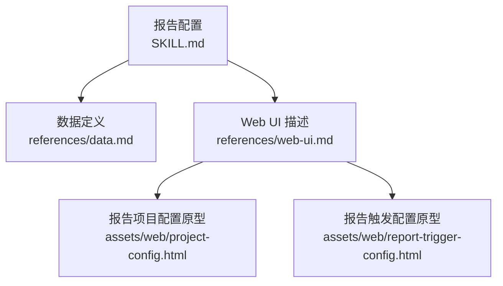
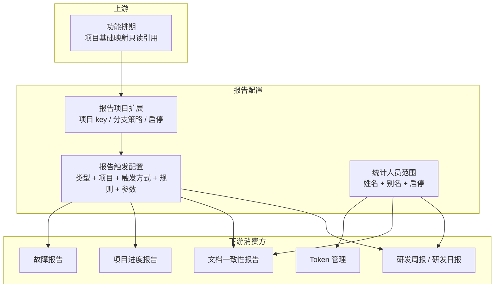
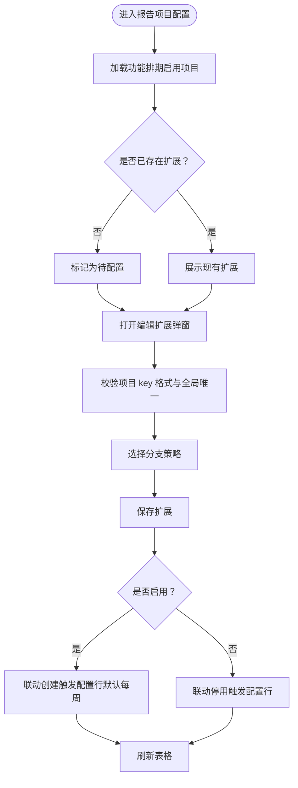
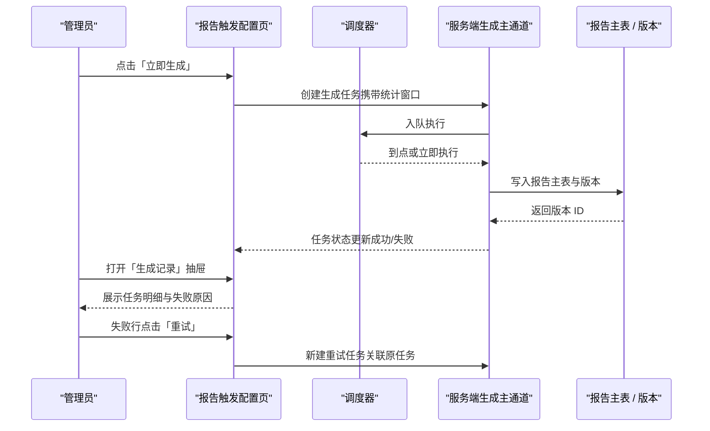
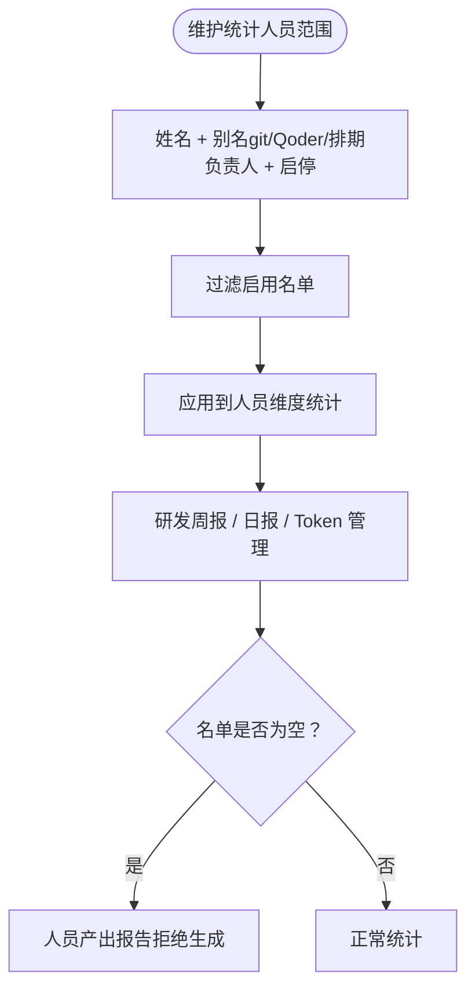
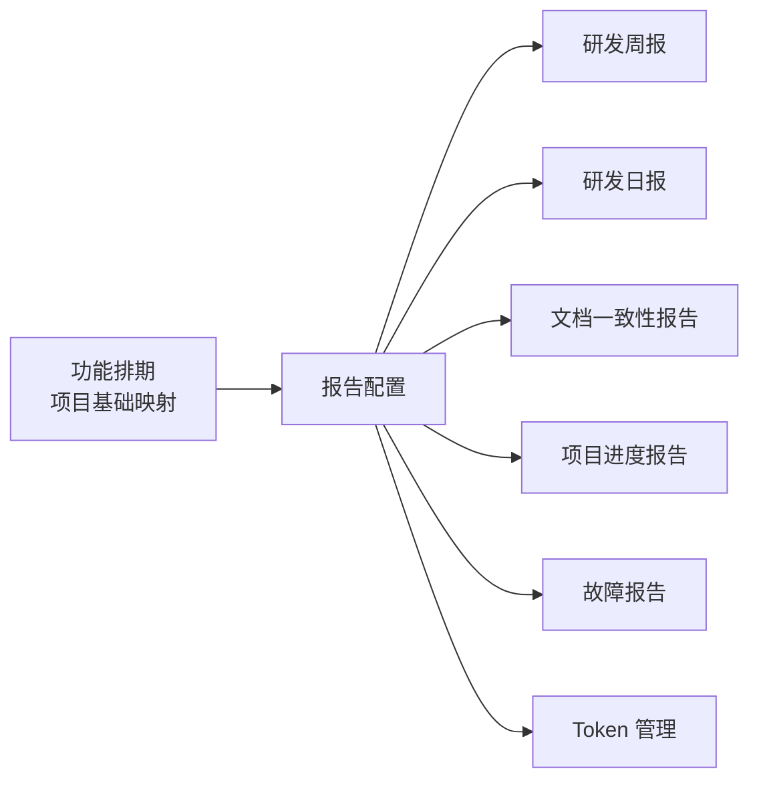

# 报告配置

<cite>
**本文引用的文件**   
- [SKILL.md](file://研发报告/报告配置/SKILL.md)
- [data.md](file://研发报告/报告配置/references/data.md)
- [web-ui.md](file://研发报告/报告配置/references/web-ui.md)
- [project-config.html](file://研发报告/报告配置/assets/web/project-config.html)
- [report-trigger-config.html](file://研发报告/报告配置/assets/web/report-trigger-config.html)
</cite>

## 目录
1. [引言](#引言)
2. [项目结构](#项目结构)
3. [核心组件](#核心组件)
4. [架构总览](#架构总览)
5. [详细组件分析](#详细组件分析)
6. [依赖关系分析](#依赖关系分析)
7. [性能与一致性考虑](#性能与一致性考虑)
8. [故障排查指南](#故障排查指南)
9. [结论](#结论)

## 引言
本文件聚焦“研发报告 · 报告配置”模块的规则，重点说明：
- 报告类型、命名、周期归属、索引、生成入库、版本、渲染、权限等共享规则由本模块托管；
- 报告侧项目映射扩展：在功能排期项目基础映射之上，维护项目 key 与分支策略，并联动触发配置；
- 报告触发配置：定时 / 手动、定时规则、类型参数、启停、立即生成、生成记录与失败重试；
- 统计人员范围：研发周报 / 日报与 Token 管理共用名单。

本仓为文档与原型资产仓，不含可运行服务代码；真源以各三级模块的 references 与 assets 为准。

**章节来源**
- [SKILL.md:1-53](file://研发报告/报告配置/SKILL.md#L1-L53)

## 项目结构
报告配置模块位于“研发报告/报告配置”，包含：
- SKILL.md：模块导航与职责边界；
- references/data.md：实体定义与字段语义；
- references/web-ui.md：Web 端页面元信息、交互与校验；
- assets/web/project-config.html：报告项目配置原型；
- assets/web/report-trigger-config.html：报告触发配置原型。

**图表来源**
- [SKILL.md:1-53](file://研发报告/报告配置/SKILL.md#L1-L53)
- [web-ui.md:10-116](file://研发报告/报告配置/references/web-ui.md#L10-L116)

**章节来源**
- [SKILL.md:1-53](file://研发报告/报告配置/SKILL.md#L1-L53)
- [web-ui.md:10-116](file://研发报告/报告配置/references/web-ui.md#L10-L116)

## 核心组件
报告配置模块承载三类配置能力：
1. 报告项目配置（映射扩展）
   - 只读引用功能排期的项目基础映射；
   - 维护报告侧扩展：项目 key、分支策略、启停；
   - 扩展随启用项目自动成行，不可手工新增或删除；
   - 扩展启停联动触发配置行。
2. 报告触发配置
   - 每个报告项（报告类型 + 项目标识）一条配置；
   - 支持定时 / 手动、定时规则、类型参数、启停；
   - 支持立即生成、生成记录查看与失败重试。
3. 统计人员范围
   - 研发周报 / 日报与 Token 管理共用名单；
   - 名单为空时人员产出报告拒绝生成；Token 管理默认按团队名单统计，可切换组织全量。

**章节来源**
- [SKILL.md:21-37](file://研发报告/报告配置/SKILL.md#L21-L37)
- [data.md:24-50](file://研发报告/报告配置/references/data.md#L24-L50)
- [data.md:120-135](file://研发报告/报告配置/references/data.md#L120-L135)

## 架构总览
报告配置作为研发报告子域的共享配置入口，向上承接功能排期的项目基础映射，向下驱动各报告类型的生成任务与归档。

**图表来源**
- [SKILL.md:21-37](file://研发报告/报告配置/SKILL.md#L21-L37)
- [data.md:8-21](file://研发报告/报告配置/references/data.md#L8-L21)

## 详细组件分析

### 报告项目配置（映射扩展）
- 数据来源：功能排期启用项目自动成行；
- 可编辑字段：项目 key（首次保存后不可改）、分支策略（master 或最近 release 且防回退落后主干）、启停；
- 联动行为：扩展启用自动生成对应项目维度触发配置行（默认定时每周），停用则同步停用关联配置行；
- 界面要点：列表含项目名称、项目 key、harness 工程（只读）、代码仓清单（只读数量徽标）、分支策略、启停、关联触发配置摘要、操作（编辑）。

**图表来源**
- [web-ui.md:10-53](file://研发报告/报告配置/references/web-ui.md#L10-L53)
- [data.md:24-34](file://研发报告/报告配置/references/data.md#L24-L34)

**章节来源**
- [web-ui.md:10-53](file://研发报告/报告配置/references/web-ui.md#L10-L53)
- [data.md:24-34](file://研发报告/报告配置/references/data.md#L24-L34)
- [project-config.html:236-311](file://研发报告/报告配置/assets/web/project-config.html#L236-L311)
- [project-config.html:316-368](file://研发报告/报告配置/assets/web/project-config.html#L316-L368)

### 报告触发配置
- 配置粒度：报告类型 + 项目标识；
- 触发方式：定时 / 手动至少一种；
- 定时规则：周期（每日 / 每周 / 每月）+ 星期或号（每日无需）+ 时间（东八区）；
- 类型参数：一致性校验为回看天数；项目进度报告为统计周期（周 / 月）；
- 联动：项目维度配置行随报告项目配置联动生成，不可手工新增或删除；
- 运维能力：立即生成、生成记录抽屉、失败重试。

**图表来源**
- [web-ui.md:56-100](file://研发报告/报告配置/references/web-ui.md#L56-L100)
- [data.md:37-73](file://研发报告/报告配置/references/data.md#L37-L73)

**章节来源**
- [web-ui.md:56-100](file://研发报告/报告配置/references/web-ui.md#L56-L100)
- [data.md:37-73](file://研发报告/报告配置/references/data.md#L37-L73)
- [report-trigger-config.html:271-400](file://研发报告/报告配置/assets/web/report-trigger-config.html#L271-L400)
- [report-trigger-config.html:405-454](file://研发报告/报告配置/assets/web/report-trigger-config.html#L405-L454)
- [report-trigger-config.html:456-492](file://研发报告/报告配置/assets/web/report-trigger-config.html#L456-L492)

### 统计人员范围
- 作用域：研发周报 / 日报的代码提交、排期卡片、Qoder 用量统计，以及 Token 管理看板；
- 名单外人员不计入任何人员维度，也不在报告中出现；
- 名单为空时人员产出报告拒绝生成；Token 管理「研发团队」范围返回空并提示去配置，可切换「全部成员」查看组织全量；
- 项目级数据（需求吞吐、仓库清单）不引用本名单，保持全量口径。

**图表来源**
- [SKILL.md:32-37](file://研发报告/报告配置/SKILL.md#L32-L37)
- [data.md:120-135](file://研发报告/报告配置/references/data.md#L120-L135)

**章节来源**
- [SKILL.md:32-37](file://研发报告/报告配置/SKILL.md#L32-L37)
- [data.md:120-135](file://研发报告/报告配置/references/data.md#L120-L135)

## 依赖关系分析
- 功能排期项目基础映射：本模块只读引用，不复制、不另建；
- 各报告模块（人员产出 / 文档一致性 / 项目进度 / 故障）：共享规则消费方，报告项、归档、版本、渲染与权限口径取自本模块真源；
- Token 管理：复用统计人员范围，默认按研发团队名单统计，可切换组织全量。

**图表来源**
- [SKILL.md:46-52](file://研发报告/报告配置/SKILL.md#L46-L52)

**章节来源**
- [SKILL.md:46-52](file://研发报告/报告配置/SKILL.md#L46-L52)

## 性能与一致性考虑
- 并发约束：同一报告项同时刻仅允许一个 RUNNING 任务，避免重复生成与覆盖；
- 幂等与审计：任务记录不允许删除；版本从属于报告，删除报告版本不被允许；
- 存储与渲染：原始 .md 与渲染产物 HTML 分别落对象存储，哈希用于推送上报幂等判重；
- 时间与时区：所有时间字段统一东八区，发报日与所属周起/止用于周索引；
- 文件大小限制：报告版本文件大小 ≤ 2MB。

**章节来源**
- [data.md:69-73](file://研发报告/报告配置/references/data.md#L69-L73)
- [data.md:112-117](file://研发报告/报告配置/references/data.md#L112-L117)
- [data.md:95-117](file://研发报告/报告配置/references/data.md#L95-L117)

## 故障排查指南
常见问题与定位要点：
- 项目 key 冲突或格式非法：检查编辑扩展弹窗校验与全局唯一性提示；
- 分支策略未选：确保启用前选择 master 或最近 release 且防回退；
- 定时规则缺失或未选触发方式：检查编辑配置弹窗必填项；
- 立即生成被拒：确认是否存在进行中任务、配置是否停用、是否有权限；
- 生成失败重试：在生成记录抽屉中查看失败原因，点击重试新建任务并关联原任务；
- 人员范围导致报告为空：检查统计人员范围是否维护启用名单。

**章节来源**
- [web-ui.md:33-52](file://研发报告/报告配置/references/web-ui.md#L33-L52)
- [web-ui.md:78-99](file://研发报告/报告配置/references/web-ui.md#L78-L99)
- [web-ui.md:125-142](file://研发报告/报告配置/references/web-ui.md#L125-L142)

## 结论
报告配置模块通过“项目映射扩展 + 触发配置 + 统计人员范围”三件套，将功能排期的项目基础映射转化为报告侧可执行的生成计划，并为各报告类型提供统一的规则、版本、渲染与权限口径。其设计强调：
- 上游只读引用，避免重复维护；
- 扩展与触发联动，降低人工遗漏；
- 任务并发控制与审计留痕，保障一致性与可追溯；
- 人员范围跨模块复用，保证统计口径一致。