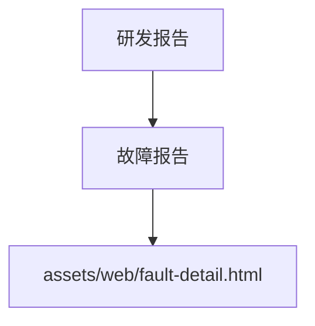
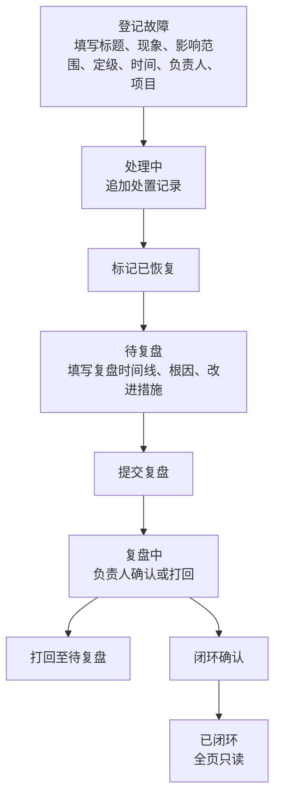
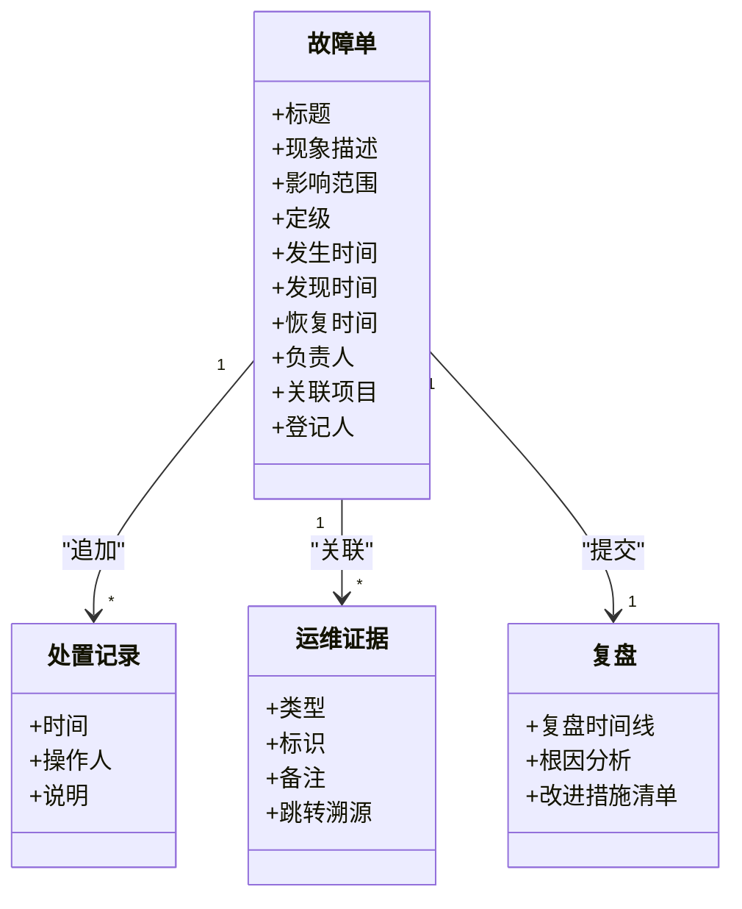
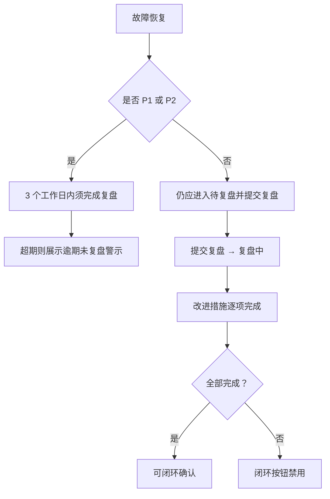
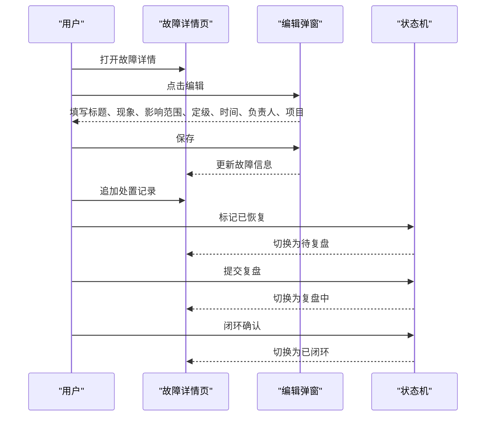
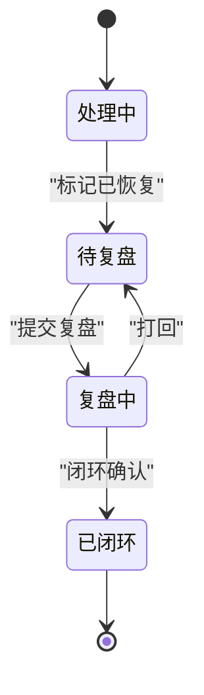
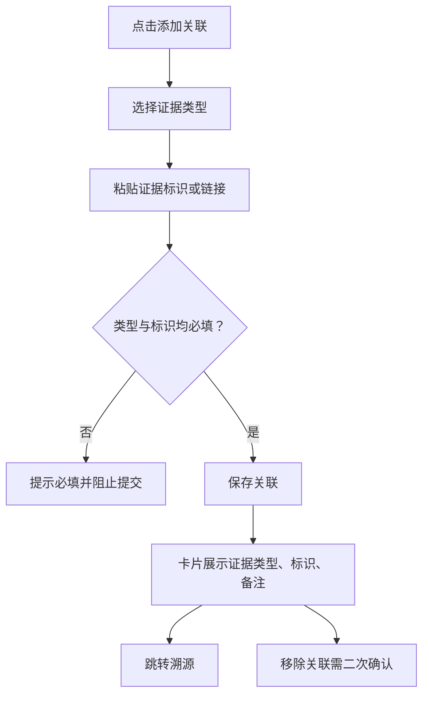
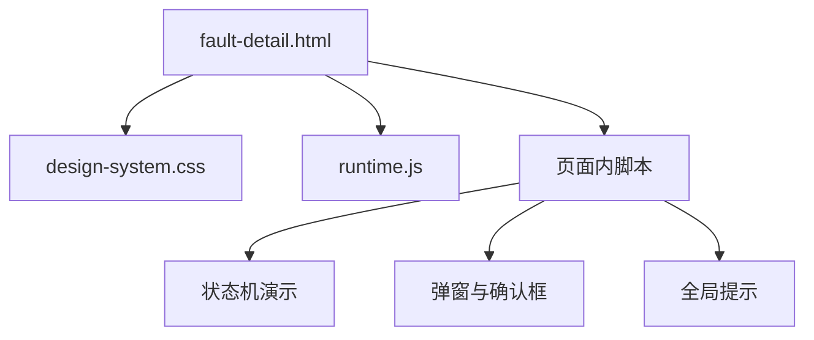

# 故障报告

<cite>
**本文引用的文件**   
- [fault-detail.html](file://研发报告/故障报告/assets/web/fault-detail.html)
</cite>

## 目录
1. [引言](#引言)
2. [项目结构](#项目结构)
3. [核心组件](#核心组件)
4. [架构总览](#架构总览)
5. [详细组件分析](#详细组件分析)
6. [依赖关系分析](#依赖关系分析)
7. [性能与可用性考虑](#性能与可用性考虑)
8. [排障指南](#排障指南)
9. [结论](#结论)

## 引言
本文件聚焦“故障报告”在鸣鸣很忙产研域中的分级分类口径、频率要求与生成规则，并基于仓库中“研发报告/故障报告”的原型资产进行说明。该模块属于文档仓的静态原型与规则描述资产，不包含可运行服务代码；其业务规则通过 Web 原型页面体现，尤其是故障详情页的状态机、定级选项、复盘流程与逾期警示。

## 项目结构
“故障报告”位于“研发报告”子模块下，当前仓库中直接可见的资产为：
- 原型页面：`assets/web/fault-detail.html`
- references 目录为空，未提供独立的业务规则 Markdown

因此，故障报告的规则主要来源于该 HTML 原型的页面结构、表单字段、状态标签、操作按钮与交互提示。

**图示来源**
- [fault-detail.html:1-15](file://研发报告/故障报告/assets/web/fault-detail.html#L1-L15)

**章节来源**
- [fault-detail.html:1-15](file://研发报告/故障报告/assets/web/fault-detail.html#L1-L15)

## 核心组件
从故障详情原型页面可以提取出以下关键能力，它们共同构成故障报告的分级分类、频率与生成规则载体：

| 维度 | 原型体现 | 规则含义 |
|---|---|---|
| 分级 | 编辑弹窗中的单选分组包含 P1、P2、P3、P4 四个等级 | 故障按影响程度分为重大、严重、一般、轻微四级 |
| 分类 | 处置过程时间线、运维证据关联、复盘时间线 | 故障以“发生-发现-处置-恢复”为主线，并可关联错误日志、监控快照、黑灯工单等运维证据 |
| 频率 | 逾期未复盘警示、状态机流转、改进措施跟踪 | 恢复后需进入待复盘并在限定时间内完成复盘；改进措施逐项跟踪至全部完成方可闭环 |
| 生成 | 登记人、负责人、关联项目、现象描述、影响范围 | 故障由登记人创建，明确责任人与影响面，作为后续处置与复盘的基础数据 |

**章节来源**
- [fault-detail.html:319-340](file://研发报告/故障报告/assets/web/fault-detail.html#L319-L340)
- [fault-detail.html:63-74](file://研发报告/故障报告/assets/web/fault-detail.html#L63-L74)
- [fault-detail.html:57-61](file://研发报告/故障报告/assets/web/fault-detail.html#L57-L61)
- [fault-detail.html:111-136](file://研发报告/故障报告/assets/web/fault-detail.html#L111-L136)
- [fault-detail.html:139-284](file://研发报告/故障报告/assets/web/fault-detail.html#L139-L284)

## 架构总览
故障报告在原型中的整体流程围绕“故障单 + 状态机 + 复盘 + 改进措施”展开。用户可在详情页编辑故障信息、追加处置记录、关联运维证据，并按状态机推进到复盘与闭环。

**图示来源**
- [fault-detail.html:287-308](file://研发报告/故障报告/assets/web/fault-detail.html#L287-L308)
- [fault-detail.html:575-606](file://研发报告/故障报告/assets/web/fault-detail.html#L575-L606)
- [fault-detail.html:700-738](file://研发报告/故障报告/assets/web/fault-detail.html#L700-L738)

## 详细组件分析

### 故障分级分类口径
故障分级在编辑弹窗中以单选形式呈现，并提供帮助文本说明各级别的影响语义。分类则体现在处置过程、运维证据与复盘结构中。

| 级别 | 显示文本 | 语义说明（来自帮助文本） |
|---|---|---|
| P1 | P1 重大 | 核心链路不可用或资损 |
| P2 | P2 严重 | 主要功能受损 |
| P3 | P3 一般 | 局部影响 |
| P4 | P4 轻微 | 无实质影响但需复盘 |

分类口径通过以下结构体现：
- 处置过程：以倒序时间线记录发现、定位、止血、修复、观察恢复等步骤。
- 运维证据关联：支持错误日志指纹报表项、服务器监控快照、黑灯工厂工单三类证据，仅做只读引用与跳转溯源。
- 复盘时间线：统一按“发生、发现、处置、恢复”四阶段结构化复盘。

**图示来源**
- [fault-detail.html:319-378](file://研发报告/故障报告/assets/web/fault-detail.html#L319-L378)
- [fault-detail.html:77-109](file://研发报告/故障报告/assets/web/fault-detail.html#L77-L109)
- [fault-detail.html:111-136](file://研发报告/故障报告/assets/web/fault-detail.html#L111-L136)
- [fault-detail.html:139-284](file://研发报告/故障报告/assets/web/fault-detail.html#L139-L284)

**章节来源**
- [fault-detail.html:319-340](file://研发报告/故障报告/assets/web/fault-detail.html#L319-L340)
- [fault-detail.html:77-109](file://研发报告/故障报告/assets/web/fault-detail.html#L77-L109)
- [fault-detail.html:111-136](file://研发报告/故障报告/assets/web/fault-detail.html#L111-L136)
- [fault-detail.html:139-284](file://研发报告/故障报告/assets/web/fault-detail.html#L139-L284)

### 频率与逾期规则
原型页面明确体现了两类频率相关规则：

1. **复盘频率要求**  
   - 故障恢复后进入“待复盘”，随后进入“复盘中”，最终由研发负责人确认闭环。
   - 对于 P1、P2 故障，恢复后超过 3 个工作日未完成复盘时，页面会展示“逾期未复盘”警示。

2. **改进措施频率要求**  
   - 改进措施需要逐项勾选完成，只有全部完成后，“闭环确认”按钮才可用。
   - 若措施期限已到但未完成，会在列表中显示“已逾期”。

**图示来源**
- [fault-detail.html:57-61](file://研发报告/故障报告/assets/web/fault-detail.html#L57-L61)
- [fault-detail.html:575-582](file://研发报告/故障报告/assets/web/fault-detail.html#L575-L582)
- [fault-detail.html:677-698](file://研发报告/故障报告/assets/web/fault-detail.html#L677-L698)
- [fault-detail.html:700-738](file://研发报告/故障报告/assets/web/fault-detail.html#L700-L738)

**章节来源**
- [fault-detail.html:57-61](file://研发报告/故障报告/assets/web/fault-detail.html#L57-L61)
- [fault-detail.html:677-698](file://研发报告/故障报告/assets/web/fault-detail.html#L677-L698)
- [fault-detail.html:700-738](file://研发报告/故障报告/assets/web/fault-detail.html#L700-L738)

### 故障报告生成规则
故障报告的生成入口体现在编辑弹窗与详情页信息头中，核心生成字段包括：

| 字段 | 是否必填 | 说明 |
|---|---:|---|
| 标题 | 是 | 故障主题，最多 50 字符 |
| 现象描述 | 是 | 故障表现与异常现象 |
| 影响范围 | 否 | 受影响业务、团队或决策延迟情况 |
| 定级 | 是 | P1/P2/P3/P4 四级 |
| 发生时间 | 是 | 使用日期时间选择器，不得晚于当前时间 |
| 发现时间 | 否 | 首次发现异常的时间 |
| 负责人 | 否 | 可选人员 |
| 关联项目 | 否 | 单选项目，可空 |

生成后的故障单在详情页展示“负责人、发生时间、发现时间、恢复时间、关联项目、登记人、现象描述、影响范围”，并允许追加处置记录、关联运维证据、提交复盘与闭环。

**图示来源**
- [fault-detail.html:311-387](file://研发报告/故障报告/assets/web/fault-detail.html#L311-L387)
- [fault-detail.html:608-620](file://研发报告/故障报告/assets/web/fault-detail.html#L608-L620)
- [fault-detail.html:622-638](file://研发报告/故障报告/assets/web/fault-detail.html#L622-L638)
- [fault-detail.html:700-738](file://研发报告/故障报告/assets/web/fault-detail.html#L700-L738)

**章节来源**
- [fault-detail.html:319-378](file://研发报告/故障报告/assets/web/fault-detail.html#L319-L378)
- [fault-detail.html:63-74](file://研发报告/故障报告/assets/web/fault-detail.html#L63-L74)
- [fault-detail.html:608-620](file://研发报告/故障报告/assets/web/fault-detail.html#L608-L620)
- [fault-detail.html:622-638](file://研发报告/故障报告/assets/web/fault-detail.html#L622-L638)
- [fault-detail.html:700-738](file://研发报告/故障报告/assets/web/fault-detail.html#L700-L738)

### 状态机与操作权限
故障报告采用四态状态机：**处理中 → 待复盘 → 复盘中 → 已闭环**。不同状态下，页面展示不同的操作按钮与提示信息。

| 状态 | 主要操作 | 页面行为 |
|---|---|---|
| 处理中 | 返回列表、标记已恢复 | 不展示复盘表单；恢复后进入待复盘 |
| 待复盘 | 返回列表、提交复盘 | 展示复盘表单；校验根因与分析齐备 |
| 复盘中 | 返回列表、打回、闭环确认 | 展示已提交复盘内容；全部改进措施完成才可闭环 |
| 已闭环 | 返回列表 | 全页只读；复盘与改进措施沉淀为资产 |

**图示来源**
- [fault-detail.html:287-308](file://研发报告/故障报告/assets/web/fault-detail.html#L287-L308)
- [fault-detail.html:575-606](file://研发报告/故障报告/assets/web/fault-detail.html#L575-L606)
- [fault-detail.html:700-738](file://研发报告/故障报告/assets/web/fault-detail.html#L700-L738)

**章节来源**
- [fault-detail.html:287-308](file://研发报告/故障报告/assets/web/fault-detail.html#L287-L308)
- [fault-detail.html:575-606](file://研发报告/故障报告/assets/web/fault-detail.html#L575-L606)
- [fault-detail.html:700-738](file://研发报告/故障报告/assets/web/fault-detail.html#L700-L738)

### 运维证据关联规则
运维证据关联遵循“只读引用、不回写、仅跳转溯源”的原则。支持的证据类型包括：
- 错误日志指纹报表项
- 服务器监控快照
- 黑灯工厂工单

添加证据时需要填写证据类型与证据标识，备注可选。移除证据时需要二次确认，且仅移除关联，不影响来源模块数据。

**图示来源**
- [fault-detail.html:389-426](file://研发报告/故障报告/assets/web/fault-detail.html#L389-L426)
- [fault-detail.html:640-675](file://研发报告/故障报告/assets/web/fault-detail.html#L640-L675)

**章节来源**
- [fault-detail.html:389-426](file://研发报告/故障报告/assets/web/fault-detail.html#L389-L426)
- [fault-detail.html:640-675](file://研发报告/故障报告/assets/web/fault-detail.html#L640-L675)

## 依赖关系分析
故障报告原型页面的依赖主要集中在 UI 组件库与页面内脚本：

- 样式依赖设计系统 CSS。
- 图标注入依赖 runtime.js。
- 页面内脚本负责事件委托、浮层控制、下拉选择、状态机演示、表单校验与提示。

**图示来源**
- [fault-detail.html:16-17](file://研发报告/故障报告/assets/web/fault-detail.html#L16-L17)
- [fault-detail.html:474-475](file://研发报告/故障报告/assets/web/fault-detail.html#L474-L475)
- [fault-detail.html:475-800](file://研发报告/故障报告/assets/web/fault-detail.html#L475-L800)

**章节来源**
- [fault-detail.html:16-17](file://研发报告/故障报告/assets/web/fault-detail.html#L16-L17)
- [fault-detail.html:474-800](file://研发报告/故障报告/assets/web/fault-detail.html#L474-L800)

## 性能与可用性考虑
从原型实现角度，故障报告页面采用轻量级前端逻辑，适合快速演示与规则验证：

- 使用 body 事件委托减少重复绑定。
- 浮层与弹窗通过统一的 show/hide 管理，避免重复 DOM 操作。
- 下拉选择与 Popconfirm 通过通用函数复用交互逻辑。
- 状态切换通过 setState 集中处理，保证 Tag、按钮、提示与复盘区块一致性。

这些实现方式有利于降低原型维护成本，但在正式系统中仍需结合后端接口、权限控制与数据一致性进行扩展。

[本节为通用建议，不直接分析具体文件]

## 排障指南
当故障报告原型出现交互异常时，可优先检查以下方面：

| 问题现象 | 可能原因 | 排查建议 |
|---|---|---|
| 状态切换无效 | setState 未正确更新 Tag、按钮或复盘区块 | 检查 data-review 与 data-bar 属性匹配 |
| 提交复盘失败 | 根因分析为空或未触发校验 | 查看根因输入框与帮助文本区域 |
| 闭环按钮不可用 | 改进措施未全部完成 | 检查改进措施表格中的完成状态与进度文本 |
| 证据关联无法添加 | 证据类型或标识为空 | 查看证据弹窗的帮助文本与必填校验 |
| 弹窗不关闭 | 遮罩或关闭事件未触发 | 检查 data-close 与 ESC 键处理逻辑 |

**章节来源**
- [fault-detail.html:575-606](file://研发报告/故障报告/assets/web/fault-detail.html#L575-L606)
- [fault-detail.html:708-720](file://研发报告/故障报告/assets/web/fault-detail.html#L708-L720)
- [fault-detail.html:677-698](file://研发报告/故障报告/assets/web/fault-detail.html#L677-L698)
- [fault-detail.html:640-675](file://研发报告/故障报告/assets/web/fault-detail.html#L640-L675)
- [fault-detail.html:750-791](file://研发报告/故障报告/assets/web/fault-detail.html#L750-L791)

## 结论
故障报告在仓库中以“故障详情”原型为核心载体，明确了以下规则要点：

- **分级口径**：P1 重大、P2 严重、P3 一般、P4 轻微，依据核心链路可用性、功能受损程度、局部影响与是否需要复盘来划分。
- **分类口径**：以处置时间线、运维证据关联与复盘时间线结构化表达故障生命周期。
- **频率要求**：恢复后进入待复盘并提交复盘；P1/P2 超 3 个工作日未复盘将触发逾期警示；改进措施必须全部完成才能闭环。
- **生成规则**：登记人创建故障单，填写标题、现象、影响范围、定级、时间与责任人，并关联项目；后续可追加处置记录、关联运维证据、提交复盘与闭环。

由于该模块为文档仓原型资产，实际落地时需结合后端数据模型、权限体系与告警机制进一步实现。

[本节为总结性内容，不直接分析具体文件]