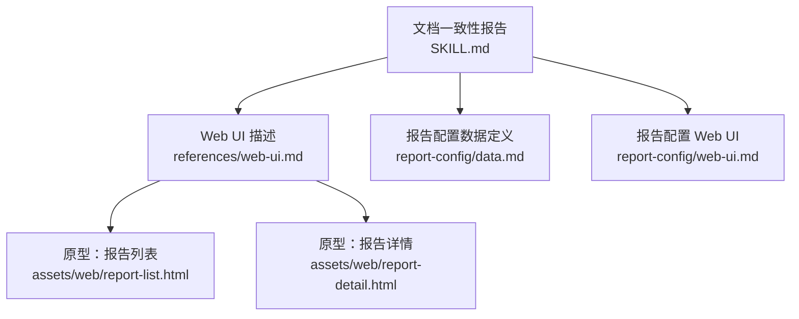
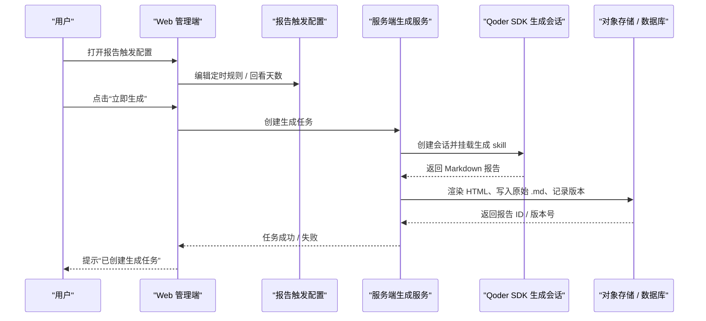
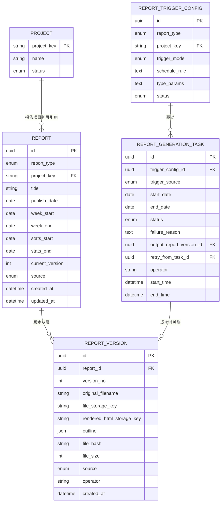

# 文档一致性报告

<cite>
**本文引用的文件**   
- [SKILL.md](file://研发报告/文档一致性报告/SKILL.md)
- [web-ui.md（文档一致性报告）](file://研发报告/文档一致性报告/references/web-ui.md)
- [data.md（报告配置数据定义）](file://研发报告/报告配置/references/data.md)
- [web-ui.md（报告配置）](file://研发报告/报告配置/references/web-ui.md)
</cite>

## 目录
1. [引言](#引言)
2. [项目结构与定位](#项目结构与定位)
3. [一致性校验口径](#一致性校验口径)
4. [报告生成流程](#报告生成流程)
5. [归档、版本与查阅规则](#归档版本与查阅规则)
6. [Web 端页面职责与交互](#web-端页面职责与交互)
7. [关键数据模型关系](#关键数据模型关系)
8. [依赖与边界](#依赖与边界)
9. [性能与可观测性](#性能与可观测性)
10. [常见问题排查](#常见问题排查)
11. [结论](#结论)

## 引言
本文件聚焦“文档一致性报告”这一研发报告子域能力，说明其**代码一致性校验的口径**与**报告生成、归档、查阅规则**。该模块面向管理层、项目经理与研发人员，按项目周期性生成“文档 ↔ 代码”一致性检查报告，替代人工抽查；报告以 Markdown 静态产物形式归档，支持按周索引、版本回溯与手动补传。

需要特别强调：本仓是鸣鸣很忙产研域 Harness 文档仓，不含可运行服务代码；功能正文以各三级模块的 `references/` 与 `assets/` 为真源，AGENTS.md 与各层 SKILL.md 仅作导航与定位，不复述规则细节。

## 项目结构与定位
“文档一致性报告”位于研发报告子域下，属于四类报告之一（研发周报、研发日报、文档一致性校验、项目进度报告）。其核心资产包括：
- 模块入口与范围说明：`研发报告/文档一致性报告/SKILL.md`
- Web 端页面描述：`研发报告/文档一致性报告/references/web-ui.md`
- 原型页面：`研发报告/文档一致性报告/assets/app/` 与 `assets/web/`
- 通用报告配置与数据模型：`研发报告/报告配置/references/data.md`、`references/web-ui.md`

**图表来源**
- [SKILL.md:1-52](file://研发报告/文档一致性报告/SKILL.md#L1-L52)
- [web-ui.md（文档一致性报告）:1-86](file://研发报告/文档一致性报告/references/web-ui.md#L1-L86)
- [data.md（报告配置数据定义）:1-135](file://研发报告/报告配置/references/data.md#L1-L135)
- [web-ui.md（报告配置）:1-143](file://研发报告/报告配置/references/web-ui.md#L1-L143)

**章节来源**
- [SKILL.md:1-52](file://研发报告/文档一致性报告/SKILL.md#L1-L52)

## 一致性校验口径
### 1. 检查范围与项目边界
- 按项目独立生成，一项目一份报告。
- 项目集合以「报告项目配置」生效数据为准；跨项目同名实现不得混比，否则会产生假缺失。
- 范围由“回看天数”参数控制：仅检查最近 N 天 SKILL 仓库发生变更的模块（增量），或全量扫描。

### 2. 五维检查维度
一致性报告的核心检查维度包括：
1. **文档三件套对齐**：SKILL.md、references、assets 三者之间是否一致。
2. **代码实现完整性**：文档中描述的字段、状态、权限、接口等是否在代码中存在对应实现。
3. **SKILL 与 references 重复冗余**：是否存在内容重复、冲突或过时描述。
4. **SKILL 长度**：SKILL.md 是否过长或过短，影响可读性与维护成本。
5. **代码 → 文档反向偏差**：代码已变更但文档未同步更新的情况。

上述检查维度、执行步骤与输出模板以本模块生成规范为唯一真源；当前仓库中并未包含 `consistency-check.md` 与 `consistency-report.md` 的具体内容，因此本文不展开具体算法实现，只说明其业务约束与输入输出契约。

### 3. 输入与输出契约
- **输入**：项目标识、回看天数、项目映射、SKILL 仓库变更集。
- **输出**：Markdown 格式的一致性检查报告，包含检查范围明细、统计概览、文档三件套对齐表、功能覆盖度分析、总体摘要等章节。

**章节来源**
- [SKILL.md:16-21](file://研发报告/文档一致性报告/SKILL.md#L16-L21)

## 报告生成流程
### 1. 触发方式
- 在 Web 端“报告触发配置”页维护每项目一条配置行，包含定时规则、手动“立即生成”开关与类型参数（回看天数）。
- 触发后，服务端通过 Qoder SDK 创建生成会话，挂载本模块内置的生成 skill，入参携带项目、回看天数与项目映射。

### 2. 生成主通道
- 服务端生成会话产出直接落库归档，渲染、版本递增、周索引均由服务端完成。
- 外部生成会话产出可通过推送上报旁路入库，作为兜底机制。
- 生成任务全程留痕，记录触发来源、状态、耗时、失败原因；失败可在生成记录中重试。

**图表来源**
- [SKILL.md:23-28](file://研发报告/文档一致性报告/SKILL.md#L23-L28)
- [web-ui.md（报告配置）:56-99](file://研发报告/报告配置/references/web-ui.md#L56-L99)
- [data.md（报告配置数据定义）:37-73](file://研发报告/报告配置/references/data.md#L37-L73)

**章节来源**
- [SKILL.md:23-28](file://研发报告/文档一致性报告/SKILL.md#L23-L28)
- [web-ui.md（报告配置）:56-99](file://研发报告/报告配置/references/web-ui.md#L56-L99)
- [data.md（报告配置数据定义）:37-73](file://研发报告/报告配置/references/data.md#L37-L73)

## 归档、版本与查阅规则
### 1. 归档键与版本策略
- 报告按“类型 + 项目”成行，类型固定为“文档一致性校验”，项目随“报告项目配置”生效数据。
- 报告按发报日所在自然周索引；同报告项同发报日重复入库走版本递增而非覆盖，历史版本可溯。
- 报告为静态产物：归档后只做渲染呈现，不重新执行检查；检查口径问题回溯至生成侧。

### 2. 来源分类
- `GENERATED`：服务端生成
- `PUSH`：推送上报
- `MANUAL`：手动补传

### 3. 查阅与回溯
- Web 端支持按周索引、项目 / 日期 / 关键词筛选。
- 报告详情页支持大纲锚点导航、版本切换回溯、获取原件下载。
- App 端支持按周分组浏览与渲染阅读。

**章节来源**
- [SKILL.md:30-34](file://研发报告/文档一致性报告/SKILL.md#L30-L34)
- [web-ui.md（文档一致性报告）:10-31](file://研发报告/文档一致性报告/references/web-ui.md#L10-L31)
- [data.md（报告配置数据定义）:76-117](file://研发报告/报告配置/references/data.md#L76-L117)

## Web 端页面职责与交互
### 1. 报告列表页
- 路径：`/rnd-report/consistency/list`
- 权限编码：路由 `devhubConsistencyReport`，按钮 `devhubReportUpload`（手动补传）、`devhubReportTrigger`（立即生成）。
- 双视角 Tab：按周索引（默认）与报告明细。
- 工具栏：项目、发报日期范围、关键词筛选。
- KPI 区：本周已入库、累计报告、最近发报日、历史版本总数。
- 主体区：
  - 按周索引：周分组手风琴，组头展示齐全度徽标；启用项目逐行成行，未入库行灰显并提供“立即生成”或“补传”。
  - 报告明细：平铺表格，空态提示。
- 弹窗：手动补传弹窗，支持文件名识别项目与发报日。

**章节来源**
- [web-ui.md（文档一致性报告）:10-56](file://研发报告/文档一致性报告/references/web-ui.md#L10-L56)

### 2. 报告详情页
- 路径：`/rnd-report/consistency/detail/:id`
- 权限编码：路由 `devhubConsistencyReport`。
- 元信息头：报告标题、项目、发报日、所属周、来源、当前版本、文件大小、入库时间、操作。
- 阅读区：Markdown 渲染正文，章节口径包括检查范围明细、统计概览、文档三件套对齐表、功能覆盖度分析、总体摘要。
- 侧边栏：h2/h3 锚点目录，当前阅读章节高亮，点击平滑滚动定位。
- 版本切换：下拉选择历史版本，URL 带 `?v=N` 可分享。

**章节来源**
- [web-ui.md（文档一致性报告）:59-86](file://研发报告/文档一致性报告/references/web-ui.md#L59-L86)

### 3. 报告触发配置页
- 路径：`/rnd-report/trigger-config`
- 权限编码：路由 `devhubReportTriggerConfig`，按钮 `devhubReportTrigger`。
- 功能：编辑触发方式、定时规则、类型参数（一致性校验为回看天数）、启停；查看生成记录与失败重试。
- 联动：扩展启用后自动生成项目维度配置行；停用扩展时同步停用关联配置行。

**章节来源**
- [web-ui.md（报告配置）:56-99](file://研发报告/报告配置/references/web-ui.md#L56-L99)

## 关键数据模型关系
### 1. 实体关系总览
- 功能排期的启用项目自动对应一条“报告项目扩展”。
- 报告项（报告类型 + 项目标识）对应一条“触发配置”，驱动定时 / 手动“生成任务”。
- 一份“报告”由（报告类型 + 项目标识 + 发报日）唯一确定；同唯一键重复入库产生新“版本”，报告默认指向最新版本。

**图表来源**
- [data.md（报告配置数据定义）:8-21](file://研发报告/报告配置/references/data.md#L8-L21)
- [data.md（报告配置数据定义）:24-117](file://研发报告/报告配置/references/data.md#L24-L117)

### 2. 关键字段语义
- **报告类型**：`WEEKLY_DEV` / `DAILY_DEV` / `CONSISTENCY` / `PROJECT_PROGRESS`。
- **触发来源**：`SCHEDULED`（定时到点）/ `MANUAL`（手动立即生成）。
- **任务状态**：`RUNNING`（生成中）/ `SUCCESS`（成功）/ `FAILED`（失败）。
- **报告来源**：`GENERATED`（服务端生成）/ `PUSH`（推送上报）/ `MANUAL`（手动补传）。
- **版本来源**：同上，用于区分每个版本的入库通道。

**章节来源**
- [data.md（报告配置数据定义）:37-117](file://研发报告/报告配置/references/data.md#L37-L117)

## 依赖与边界
### 1. 内部依赖
- 文档一致性报告依赖“报告配置”子域的统一规则：归档、版本、渲染、权限、触发配置。
- 生成逻辑真源位于本模块引用的生成 skill（当前仓库未包含具体文件），服务端生成会话挂载该 skill 执行检查。

### 2. 外部依赖
- Qoder SDK：用于创建生成会话并执行一致性检查。
- 对象存储：用于存储原始 `.md` 与渲染后的 HTML 产物。
- 功能排期：提供启用项目映射，作为报告项目扩展的数据来源。

### 3. 边界约束
- 跨项目同名实现不算数，避免假缺失。
- 报告归档后不重新执行检查，检查口径问题回溯生成侧。
- 同一报告项同时刻仅允许一个 RUNNING 任务，防止并发重复生成。

**章节来源**
- [SKILL.md:18-21](file://研发报告/文档一致性报告/SKILL.md#L18-L21)
- [SKILL.md:23-34](file://研发报告/文档一致性报告/SKILL.md#L23-L34)
- [data.md（报告配置数据定义）:69-73](file://研发报告/报告配置/references/data.md#L69-L73)

## 性能与可观测性
### 1. 性能考虑
- 增量检查：通过“回看天数”限制变更模块范围，降低扫描成本。
- 静态渲染：归档后仅渲染呈现，不重复执行检查，减少服务端压力。
- 版本化归档：同报告项同发报日重复入库走版本递增，避免覆盖导致的历史丢失。

### 2. 可观测性
- 生成任务留痕：记录触发来源、状态、耗时、失败原因。
- 失败重试：生成记录抽屉支持失败任务重试，形成重试链。
- 版本回溯：报告详情页支持历史版本切换，便于问题定位。

**章节来源**
- [SKILL.md:23-34](file://研发报告/文档一致性报告/SKILL.md#L23-L34)
- [web-ui.md（报告配置）:63-68](file://研发报告/报告配置/references/web-ui.md#L63-L68)

## 常见问题排查
### 1. 报告未入库
- 检查“报告触发配置”是否启用，定时规则是否正确。
- 检查生成任务状态是否为 FAILED，查看失败原因。
- 确认项目是否在“报告项目配置”中启用。

### 2. 生成任务卡住
- 检查是否存在 RUNNING 状态的任务，避免并发重复生成。
- 检查 Qoder SDK 会话是否正常创建与返回。
- 检查对象存储写入权限与空间。

### 3. 报告内容异常
- 检查生成 skill 的输入参数（项目、回看天数、项目映射）是否正确。
- 检查 SKILL.md、references、assets 三者是否一致。
- 检查代码实现是否与文档描述对齐。

**章节来源**
- [web-ui.md（报告配置）:80-99](file://研发报告/报告配置/references/web-ui.md#L80-L99)
- [data.md（报告配置数据定义）:54-73](file://研发报告/报告配置/references/data.md#L54-L73)

## 结论
“文档一致性报告”通过结构化文档与代码实现的五维检查，替代人工抽查，提升研发质量与文档可维护性。其核心在于：
- 明确的检查口径：项目边界、增量范围、五维维度。
- 规范的生成流程：触发配置、服务端生成、直接落库归档。
- 完善的归档与查阅：按周索引、版本回溯、手动补传。
- 清晰的 Web 端职责：列表、详情、触发配置、生成记录。

未来若补充 `consistency-check.md` 与 `consistency-report.md` 的具体实现，可进一步细化算法细节与输出模板；当前阶段应以现有 SKILL.md 与 references 为真源，确保规则一致性与可追溯性。