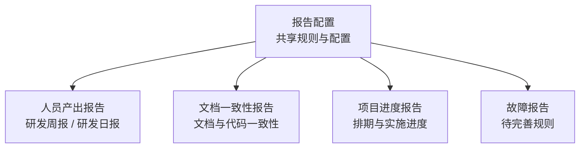
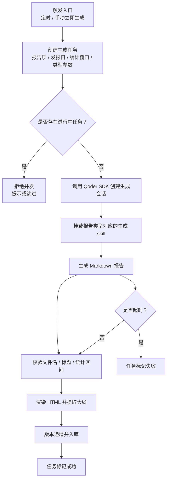
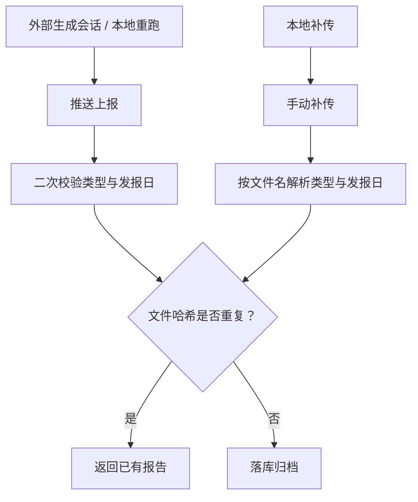
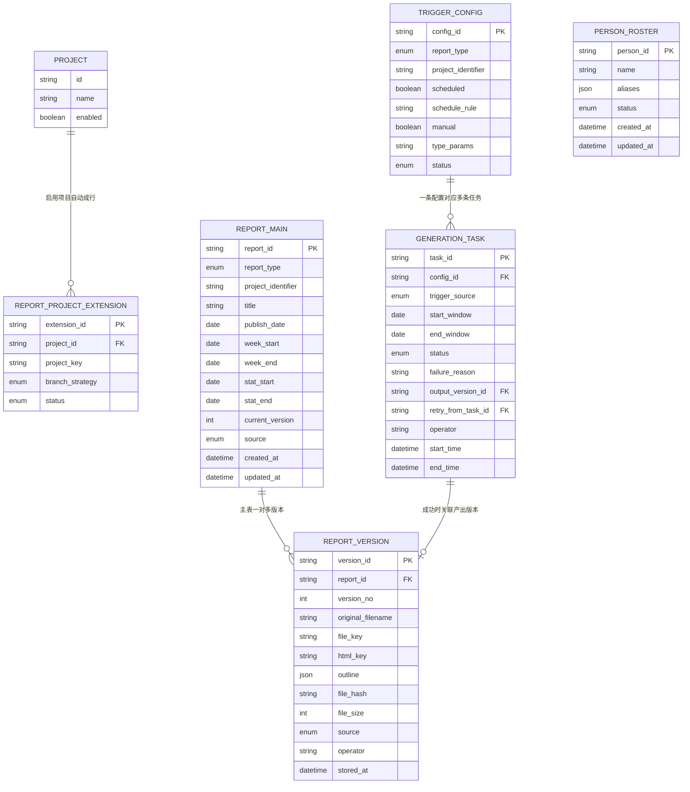
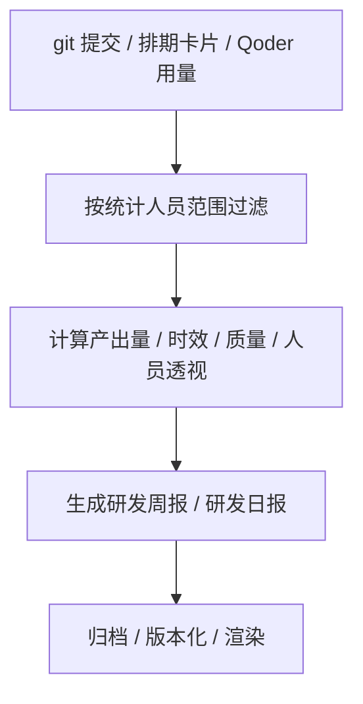
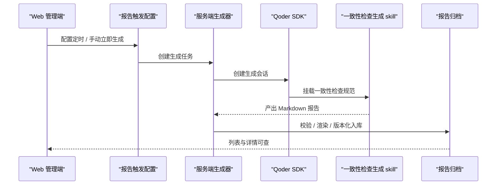
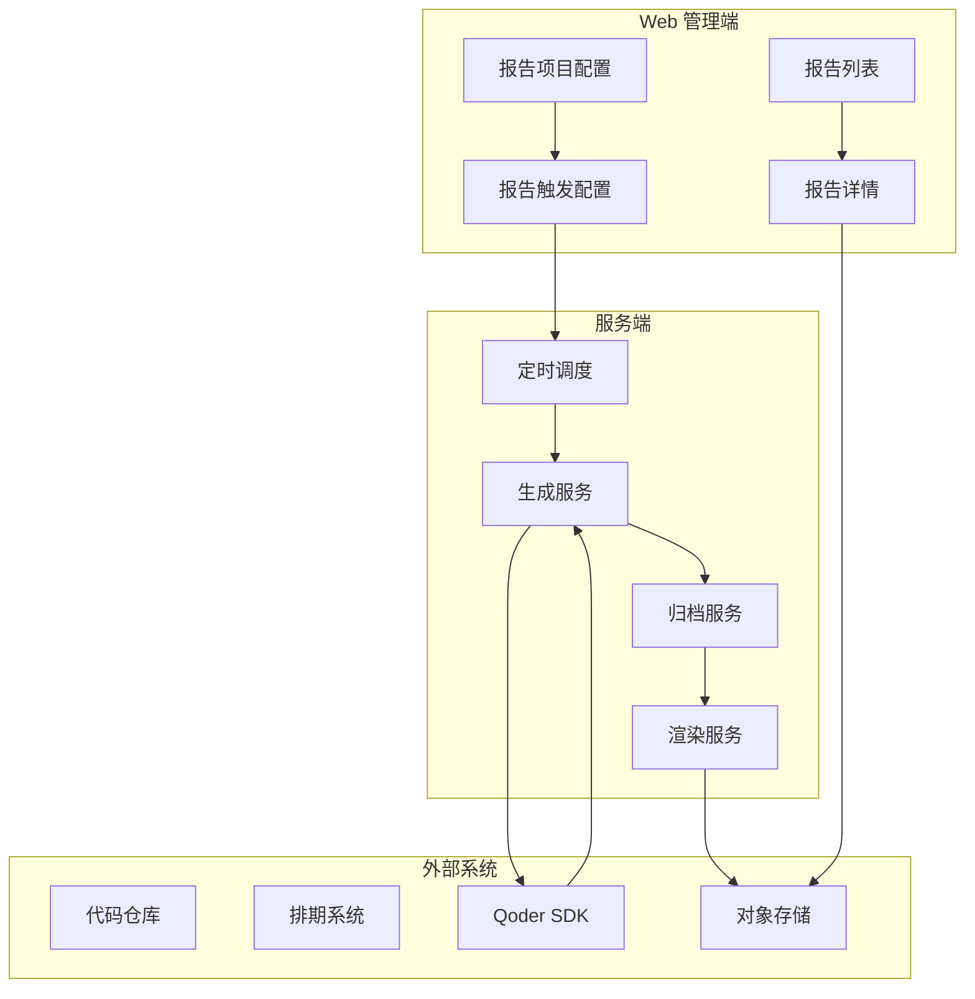
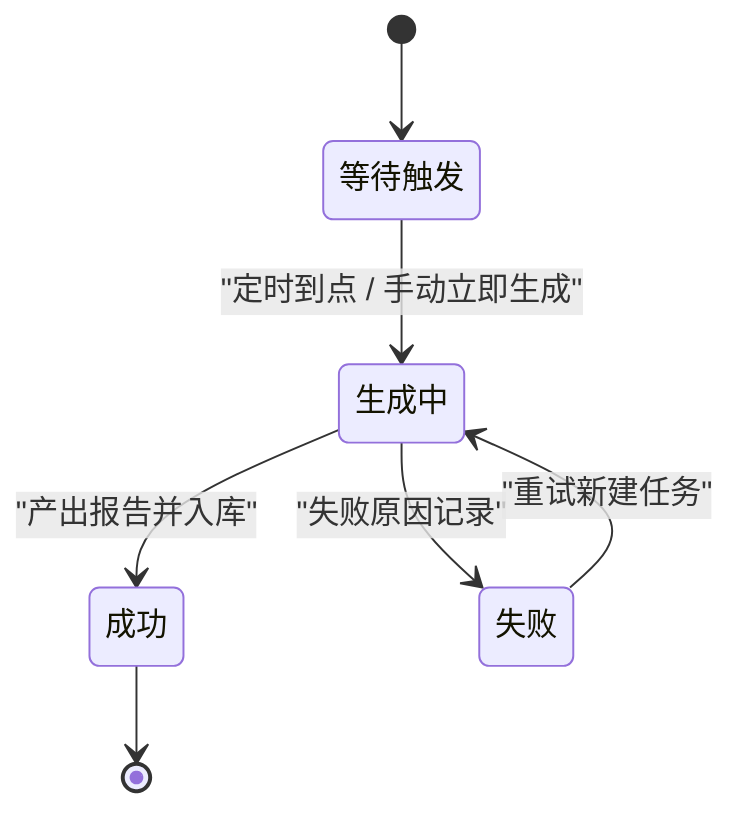
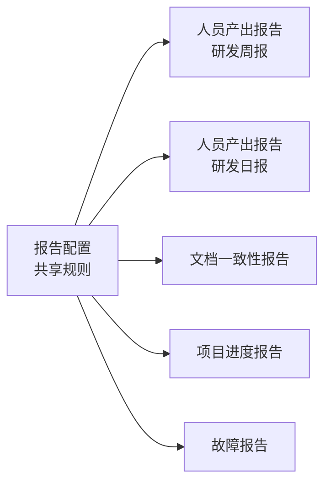

# 研发报告

<cite>
**本文引用的文件**   
- [报告配置/SKILL.md](file://研发报告/报告配置/SKILL.md)
- [报告配置/references/business-rule.md](file://研发报告/报告配置/references/business-rule.md)
- [报告配置/references/data.md](file://研发报告/报告配置/references/data.md)
- [人员产出报告/references/business-rule.md](file://研发报告/人员产出报告/references/business-rule.md)
- [文档一致性报告/SKILL.md](file://研发报告/文档一致性报告/SKILL.md)
- [文档一致性报告/references/web-ui.md](file://研发报告/文档一致性报告/references/web-ui.md)
- [项目进度报告/references/web-ui.md](file://研发报告/项目进度报告/references/web-ui.md)
</cite>

## 目录
1. [引言](#引言)
2. [子域定位与范围](#子域定位与范围)
3. [报告体系总览](#报告体系总览)
4. [生成机制总览](#生成机制总览)
5. [核心组件分析](#核心组件分析)
6. [架构与数据流图](#架构与数据流图)
7. [依赖关系分析](#依赖关系分析)
8. [性能与可靠性要点](#性能与可靠性要点)
9. [故障排查指南](#故障排查指南)
10. [结论](#结论)

## 引言
本研发报告子域是鸣鸣很忙产研域 Harness 文档仓中，面向“研发过程可观测、可归档、可回溯”的报告能力集合。它不承载可运行服务代码，而是以各模块的 references 与 assets 为真源，统一描述四类报告（研发周报、研发日报、文档一致性校验、项目进度报告）的类型命名、周期归属、触发配置、生成入库、版本渲染、权限与异常处理规则。

从整体看，该子域由“共享配置层 + 具体报告类型层”构成：
- 共享配置层负责报告类型字典、周期索引、触发配置、统计人员范围、归档版本、渲染与权限等公共规则；
- 具体报告类型层只承载自身生成规范与查阅页面，复用共享层的归档、版本、渲染与权限口径。

因此，理解本子的关键在于先掌握“报告配置”这一共享真源，再分别理解三类已落地的报告类型（人员产出、文档一致性、项目进度），以及尚未落地但纳入枚举的“故障报告”。

**章节来源**
- [报告配置/SKILL.md:1-53](file://研发报告/报告配置/SKILL.md#L1-L53)

## 子域定位与范围
### 定位
研发报告子域的定位是“报告类型的定义者、生成通道的组织者、归档与渲染的统一提供者”，而不是某个单一报告的实现仓库。其核心价值在于：
- 用一份业务规则字典约束所有报告的类型、命名、周期、索引、版本与渲染；
- 用统一的触发配置驱动定时与手动生成；
- 用统一的归档模型承载 Markdown 原始文件、HTML 渲染产物、大纲目录与版本历史；
- 用统一的权限矩阵控制菜单、按钮与 App 端入口。

### 范围边界
- 包含：四类报告类型、报告项目扩展、报告触发配置、统计人员范围、生成任务、报告主表与版本、Markdown 渲染、权限与异常场景。
- 不包含：具体数据源拉取逻辑（如 git、排期卡片、Qoder 用量接口）、外部生成会话的具体 Prompt 内容、前端 UI 组件实现细节。这些内容由对应报告类型或公共模块另行维护。

**章节来源**
- [报告配置/SKILL.md:6-19](file://研发报告/报告配置/SKILL.md#L6-L19)
- [报告配置/references/business-rule.md:1-10](file://研发报告/报告配置/references/business-rule.md#L1-L10)

## 报告体系总览
### 四类报告
| 类型编码 | 报告名称 | 是否项目维度 | 标准文件命名 | 主要用途 |
|---------|---------|-------------|-------------|---------|
| `WEEKLY_DEV` | 研发周报 | 否 | `weekly_dev_{yyyyMMdd}.md` | 提交统计、AI 总结、按人员分析、功能进展追踪、仓库分布、可用用量指标 |
| `DAILY_DEV` | 研发日报 | 否 | `daily_dev_{yyyyMMdd}.md` | 当日实时产出摘要，不含当天未入库的用量类指标 |
| `CONSISTENCY` | 文档一致性校验 | 是 | `consistency_{yyyyMMdd}_{项目key}.md` | 检查 SKILL 文档三件套与代码实现对齐程度 |
| `PROJECT_PROGRESS` | 项目进度报告 | 是 | `progress_{yyyyMMdd}_{项目key}.md` | 排期进度、需求吞吐、实施进度、延期清单、发版回顾 |

此外，`PROJECT_PROGRESS` 支持虚拟项目标识 `_all`，表示全部启用项目的汇总；真实项目 key 天然不含下划线，因此 `_all` 不会被真实项目占用。

**章节来源**
- [报告配置/references/business-rule.md:7-26](file://研发报告/报告配置/references/business-rule.md#L7-L26)

### 周期与索引
- **报告项**：报告类型 + 项目标识，是触发配置与齐全度统计的最小单位。
- **发报日**：报告生成日期，不是统计区间。
- **所属周**：发报日所在自然周（周一 00:00 ~ 周日 24:00，东八区），用于周索引分组。
- **所属日**：发报日当日，仅用于 `DAILY_DEV` 的日索引。
- **统计区间**：正文首部声明的统计窗口，不参与分组，仅在详情页元信息展示。

周索引按所属周倒序分组，组内顺序固定为：`WEEKLY_DEV` → `CONSISTENCY` → `PROJECT_PROGRESS`；同类型多份报告中 `_all` 汇总报告固定最前，其余按项目 key 字典序排列。`DAILY_DEV` 不入周索引，走日索引逐日成行。

**章节来源**
- [报告配置/references/business-rule.md:29-47](file://研发报告/报告配置/references/business-rule.md#L29-L47)

### 报告类型在子域中的职责划分
- **报告配置**：共享规则真源，承载报告项目配置、报告触发配置、统计人员范围。
- **人员产出报告**：专注研发周报与研发日报的内容口径、指标计算与查阅页导航。
- **文档一致性报告**：专注文档与代码一致性检查的生成规范、检查范围与查阅页导航。
- **项目进度报告**：专注排期维度的进度报告内容与 Web/App 查阅页描述。
- **故障报告**：当前仓库结构中存在目录与原型，但尚未形成完整 references 规则，仍属于子域枚举类型之一。

**图表来源**
- [报告配置/SKILL.md:6-19](file://研发报告/报告配置/SKILL.md#L6-L19)
- [人员产出报告/references/business-rule.md:1-23](file://研发报告/人员产出报告/references/business-rule.md#L1-L23)
- [文档一致性报告/SKILL.md:1-52](file://研发报告/文档一致性报告/SKILL.md#L1-L52)
- [项目进度报告/references/web-ui.md:1-73](file://研发报告/项目进度报告/references/web-ui.md#L1-L73)

## 生成机制总览
### 触发入口
生成入口只有两类：
1. **定时到点**：根据报告触发配置的周期、星期或号、时间自动创建生成任务。
2. **手动立即生成**：Web 端对未命中或需要补跑的报告项发起一次生成任务。

触发配置本身是生成流程的唯一输入，不读取仓库内或本机配置文件。

**章节来源**
- [报告配置/references/business-rule.md:81-110](file://研发报告/报告配置/references/business-rule.md#L81-L110)

### 服务端生成主通道
服务端生成主通道是研发报告子域的核心流水线：
1. 触发后创建生成任务，入参包括报告项、计划发报日、统计窗口、类型参数与项目映射。
2. 服务端通过 Qoder SDK 创建生成会话，挂载对应报告类型的生成 skill。
3. 生成会话产出 Markdown 文件后，由服务端直接落库：校验命名、解析标题与统计区间、渲染 HTML、提取大纲、递增版本并入库。
4. 生成任务状态机为“生成中 → 成功 / 失败”；同一报告项同时刻只允许一个进行中任务。
5. 生成耗时超过上限（2 小时）判定失败，不产生报告版本。

**图表来源**
- [报告配置/references/business-rule.md:112-120](file://研发报告/报告配置/references/business-rule.md#L112-L120)

### 旁路与兜底通道
除了服务端生成主通道，还有两条补充通道：
- **推送上报旁路**：外部生成会话产出的报告经推送上报入库，携带 md 文件、报告类型与发报日；幂等判重依据为文件哈希。
- **手动补传兜底**：仅 Web 端开放，上传时系统尝试按文件名识别类型与发报日，识别失败则人工指定；记录上传人与来源。

**图表来源**
- [报告配置/references/business-rule.md:121-135](file://研发报告/报告配置/references/business-rule.md#L121-L135)

### 版本与归档
- 唯一键为“报告类型 + 项目标识 + 发报日”。
- 重复入库不会覆盖，而是版本号递增，旧版本保留可查。
- 列表与详情默认展示最新版本；详情页支持切换历史版本。
- 报告不允许删除，错误入库的报告以新版本修正。

**章节来源**
- [报告配置/references/business-rule.md:136-142](file://研发报告/报告配置/references/business-rule.md#L136-L142)

## 核心组件分析
### 报告配置：共享规则与配置中心
报告配置是研发报告子域的“中枢”，承担以下职责：
- 定义报告类型枚举与文件命名；
- 定义周期归属、周索引与日索引；
- 维护报告项目扩展（项目 key、分支策略、启停）；
- 维护报告触发配置（定时规则、手动触发、类型参数、启停）；
- 维护统计人员范围（姓名、别名、启停）；
- 定义生成任务、报告主表、报告版本的实体关系；
- 定义 Markdown 渲染、权限矩阵与异常场景。

#### 实体关系

**图表来源**
- [报告配置/references/data.md:8-21](file://研发报告/报告配置/references/data.md#L8-L21)
- [报告配置/references/data.md:24-135](file://研发报告/报告配置/references/data.md#L24-L135)

#### 关键规则要点
- 报告项目扩展随功能排期启用项目自动成行，不可手工新增或删除；基础映射停用则扩展同步停用。
- 项目 key 首次保存后不可改，避免历史归档无法识别。
- 统计人员范围是研发周报、研发日报与 Token 管理共用的唯一人员口径；名单为空时人员产出报告拒绝生成。
- 触发配置联动规则：项目维度报告类型随扩展启用自动生成配置行；`WEEKLY_DEV` 与 `DAILY_DEV` 各内置唯一行；`PROJECT_PROGRESS` 另内置 `_all` 汇总行。
- 生成任务并发限制：同一报告项同时刻仅允许一个 RUNNING 任务。
- Markdown 渲染在入库时一次性完成，Web 端详情页为前端实时渲染，App 端消费服务端渲染产物。

**章节来源**
- [报告配置/references/business-rule.md:50-78](file://研发报告/报告配置/references/business-rule.md#L50-L78)
- [报告配置/references/business-rule.md:81-120](file://研发报告/报告配置/references/business-rule.md#L81-L120)
- [报告配置/references/business-rule.md:153-160](file://研发报告/报告配置/references/business-rule.md#L153-L160)

### 人员产出报告：研发周报与研发日报
人员产出报告聚焦“人”的研发产出，核心关注：
- 产出量：commit 数、完成的功能卡数、完成的实施卡数；
- 时效：卡片领取到完成的平均时长、需求关联卡的端到端周期；
- 质量与纪律：延期卡数与延期率、完成回退次数；
- 人员透视：人员 × 项目、人员 × 周期的产出矩阵；
- 数据客观唯一：指标来自 git 事实与排期卡片流水，不引入主观评分；
- 缺失数据静默省略：任一数据源无数据或拉取失败时，对应章节直接省略，不写缺失说明，也不用 0 或推测值代替；
- 日报裁剪：当日实时截断窗口，不含当天未入库的用量类指标。

**图表来源**
- [人员产出报告/references/business-rule.md:5-23](file://研发报告/人员产出报告/references/business-rule.md#L5-L23)

**章节来源**
- [人员产出报告/references/business-rule.md:1-23](file://研发报告/人员产出报告/references/business-rule.md#L1-L23)

### 文档一致性报告：文档与代码对齐检查
文档一致性报告面向管理层、PM 与研发，按项目独立生成，核心目标是替代人工抽查，输出偏差清单与修复方向。

关键点：
- 项目边界严格：跨项目同名实现不算数，避免假缺失；
- 检查范围由“回看天数”参数控制，支持增量扫描或全量扫描；
- 五维检查：文档三件套对齐、代码实现完整性、SKILL 与 references 重复冗余、SKILL 长度、代码到文档反向偏差；
- 生成方式：Web 端配置触发后，服务端通过 Qoder SDK 创建会话，挂载一致性检查生成 skill，产出直接落库归档；
- 归档与查阅：按类型 + 项目成行，按发报日所在自然周索引，同报告项同发报日重复入库走版本递增。

**图表来源**
- [文档一致性报告/SKILL.md:23-34](file://研发报告/文档一致性报告/SKILL.md#L23-L34)
- [报告配置/references/business-rule.md:112-142](file://研发报告/报告配置/references/business-rule.md#L112-L142)

**章节来源**
- [文档一致性报告/SKILL.md:1-52](file://研发报告/文档一致性报告/SKILL.md#L1-L52)
- [文档一致性报告/references/web-ui.md:1-86](file://研发报告/文档一致性报告/references/web-ui.md#L1-L86)

### 项目进度报告：排期与实施进度
项目进度报告聚焦项目维度的排期与实施情况，涵盖统计概览、进度总览、需求吞吐、实施进度、延期清单与发版回顾。

Web 端提供双视角列表：
- 按周索引：周分组手风琴，含齐全度徽标、缺项快捷入口；
- 按项目分组：项目手风琴，组内按发报日倒序列报告行。

详情页支持：
- 元信息头展示报告标题、项目、统计周期、发报日、所属周、统计区间、来源、版本、文件大小、入库时间；
- Markdown 正文前端实时渲染；
- 侧边栏大纲锚点导航；
- 历史版本切换。

**章节来源**
- [项目进度报告/references/web-ui.md:1-73](file://研发报告/项目进度报告/references/web-ui.md#L1-L73)

## 架构与数据流图
### 子系统交互图

**图表来源**
- [报告配置/references/business-rule.md:106-160](file://研发报告/报告配置/references/business-rule.md#L106-L160)
- [报告配置/references/data.md:8-21](file://研发报告/报告配置/references/data.md#L8-L21)

### 生成任务状态流转

**图表来源**
- [报告配置/references/business-rule.md:112-120](file://研发报告/报告配置/references/business-rule.md#L112-L120)
- [报告配置/references/data.md:54-73](file://研发报告/报告配置/references/data.md#L54-L73)

## 依赖关系分析
### 模块间依赖
- 报告配置是所有报告类型的共享依赖；
- 人员产出报告依赖 git、排期卡片、Qoder 用量等数据源；
- 文档一致性报告依赖 SKILL 文档三件套与代码实现；
- 项目进度报告依赖排期管理与发布管理相关数据；
- 故障报告当前尚未形成完整规则，但仍作为子域枚举类型存在。

**图表来源**
- [报告配置/SKILL.md:6-19](file://研发报告/报告配置/SKILL.md#L6-L19)

### 数据依赖
- 报告项目扩展依赖功能排期的启用项目；
- 报告触发配置依赖报告类型与项目标识；
- 报告主表依赖发报日、统计区间、来源与版本；
- 报告版本依赖原始文件、渲染产物、文件哈希与入库时间；
- 统计人员范围依赖姓名、别名与启停状态。

**章节来源**
- [报告配置/references/data.md:8-21](file://研发报告/报告配置/references/data.md#L8-L21)
- [报告配置/references/data.md:24-135](file://研发报告/报告配置/references/data.md#L24-L135)

## 性能与可靠性要点
### 性能要点
- Markdown 渲染在入库时一次性完成，避免大文件卡顿与渲染口径分叉；
- Web 端详情页为前端实时渲染，但与服务端渲染产物保持一致的安全与大纲口径；
- 报告列表与详情默认展示最新版本，减少历史版本查询开销；
- 生成任务超 2 小时判定失败，防止长时间占用资源。

### 可靠性要点
- 同一报告项同时刻仅允许一个进行中任务，避免并发冲突；
- 定时到点时若上一任务未完成，本次不并发，后续扫描继续尝试；
- 调度服务短暂不可用时，恢复后在下一计划点前补跑最近一次；
- 推送上报与手动补传均支持幂等与审计留痕；
- 报告不允许删除，错误入库以新版本修正。

**章节来源**
- [报告配置/references/business-rule.md:112-120](file://研发报告/报告配置/references/business-rule.md#L112-L120)
- [报告配置/references/business-rule.md:121-142](file://研发报告/报告配置/references/business-rule.md#L121-L142)
- [报告配置/references/business-rule.md:194-218](file://研发报告/报告配置/references/business-rule.md#L194-L218)

## 故障排查指南
### 常见问题与处理
| 问题现象 | 可能原因 | 处理建议 |
|---------|---------|---------|
| 某周部分报告项未入库 | 触发配置停用、生成失败、数据源缺失 | 检查触发配置启停、生成记录失败原因、立即生成或手动补传 |
| 日报当日未入库 | 当日实时窗口数据持续产生中 | 不渲染“待补”，昨日及更早缺失日灰显“待补”并提供快捷入口 |
| 生成任务失败 | 生成会话异常、超时、数据源不可用 | 查看失败原因，重试生成任务 |
| 定时到点未执行 | 调度服务不可用或并发冲突 | 等待下一计划点补跑，确认无进行中任务 |
| 项目 key 重复或格式非法 | 配置保存校验失败 | 修改为小写字母 / 数字 / 连字符，确保全局唯一 |
| 统计人员范围为空 | 人员产出报告拒绝生成 | 先维护统计人员范围名单 |
| 补传文件无法识别 | 文件名不符合标准命名规则 | 手动指定类型与发报日 |
| 发报日落在未来 | 防文件名笔误 | 拒绝入库，提示发报日不可晚于今天 |

**章节来源**
- [报告配置/references/business-rule.md:194-218](file://研发报告/报告配置/references/business-rule.md#L194-L218)

## 结论
研发报告子域通过“报告配置”这一共享真源，将四类报告的类型、命名、周期、索引、触发、生成、归档、版本、渲染与权限统一到一套规则之下。具体报告类型只需专注自身生成规范与查阅体验，无需重复定义公共机制。

对于使用者而言：
- 配置人员应优先维护“报告项目配置”“报告触发配置”和“统计人员范围”；
- 研发与管理层可通过报告列表与详情查阅归档后的静态报告；
- 运维与平台侧需关注生成任务状态、失败重试、渲染安全与版本追溯。

未来若新增报告类型，应先更新报告配置的业务规则字典，再在子域中新增对应报告模块，保持“共享规则集中、类型规则分散”的架构一致性。