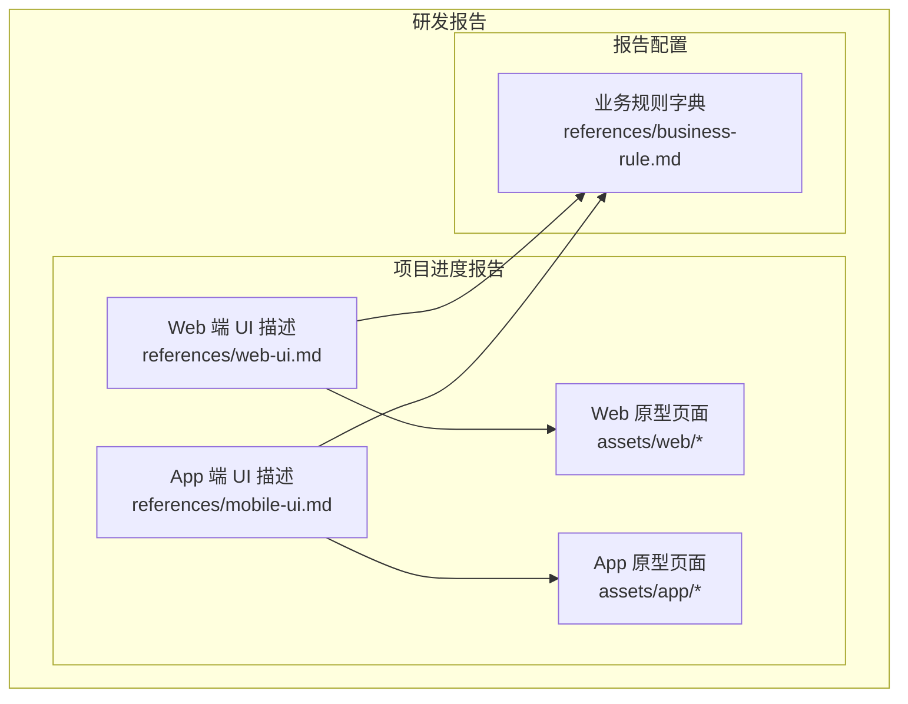
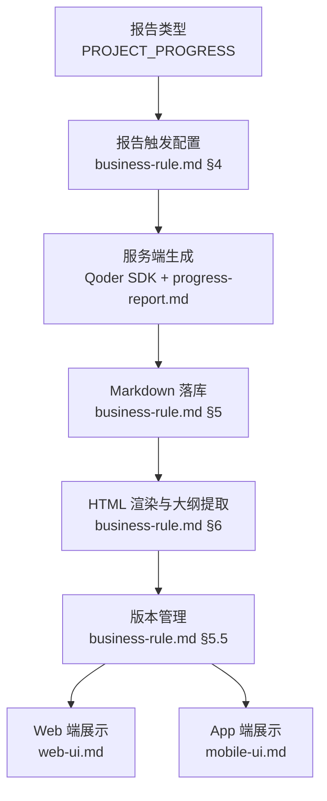
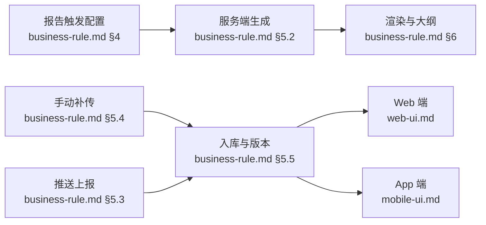
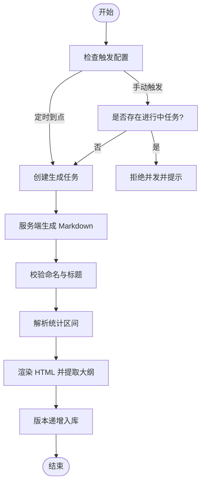

# 项目进度报告

<cite>
**本文引用的文件**   
- [web-ui.md](file://研发报告/项目进度报告/references/web-ui.md)
- [mobile-ui.md](file://研发报告/项目进度报告/references/mobile-ui.md)
- [business-rule.md](file://研发报告/报告配置/references/business-rule.md)
</cite>

## 目录
1. [引言](#引言)
2. [项目结构](#项目结构)
3. [核心组件](#核心组件)
4. [架构总览](#架构总览)
5. [详细规则分析](#详细规则分析)
6. [依赖关系分析](#依赖关系分析)
7. [性能与可用性考虑](#性能与可用性考虑)
8. [故障排查指南](#故障排查指南)
9. [结论](#结论)

## 引言
本文件聚焦「项目进度报告」的口径、频率与生成规则，并给出 Web 端与 App 端的呈现差异。需要特别说明：
- 本项目仓为文档与原型资产仓，不含可运行服务代码；业务真源位于各模块的 `references/` 与 `assets/`。
- 「项目进度报告」属于研发报告子域中的四类固定报告之一，其类型编码为 `PROJECT_PROGRESS`，标准命名形如 `progress_{yyyyMMdd}_{项目key}.md`。
- 报告章节内容（统计概览、进度总览、需求吞吐、实施进度、延期清单、发版回顾）以该子域的章节规范为准；归档、版本、渲染与异常口径以报告配置子域的业务规则为真源。

本节不直接分析具体代码文件，因此无“章节来源”。

## 项目结构
围绕「项目进度报告」的相关资产分布如下：
- 产品与交互说明：`研发报告/项目进度报告/references/web-ui.md`、`mobile-ui.md`
- 通用业务规则（类型、周期、触发、版本、渲染、权限、异常等）：`研发报告/报告配置/references/business-rule.md`
- 前端原型页面：`研发报告/项目进度报告/assets/app/*`、`assets/web/*`

**图表来源**
- [web-ui.md:1-73](file://研发报告/项目进度报告/references/web-ui.md#L1-L73)
- [mobile-ui.md:1-70](file://研发报告/项目进度报告/references/mobile-ui.md#L1-L70)
- [business-rule.md:1-218](file://研发报告/报告配置/references/business-rule.md#L1-L218)

**章节来源**
- [web-ui.md:1-73](file://研发报告/项目进度报告/references/web-ui.md#L1-L73)
- [mobile-ui.md:1-70](file://研发报告/项目进度报告/references/mobile-ui.md#L1-L70)
- [business-rule.md:1-218](file://研发报告/报告配置/references/business-rule.md#L1-L218)

## 核心组件
「项目进度报告」在系统中的关键角色包括：
- 报告类型与命名：`PROJECT_PROGRESS`，标准文件名为 `progress_{yyyyMMdd}_{项目key}.md`；保留虚拟项目 `_all` 表示全部启用项目汇总。
- 周期与归属：支持周、月两种统计周期；发报日决定所属自然周，用于周索引分组。
- 触发与生成：通过「报告触发配置」定时或手动创建生成任务；服务端通过 Qoder SDK 调用对应生成 skill 产出 Markdown，再落库、渲染 HTML、提取大纲并递增版本。
- 入库通道：主通道为服务端生成；旁路通道为推送上报；兜底通道为 Web 端手动补传。
- 展示层：Web 端列表与详情；App 端列表与详情。

本节为概念性总结，未直接分析具体代码片段，因此无“章节来源”。

## 架构总览
下图从“报告类型 → 触发 → 生成 → 入库 → 展示”的角度，映射到仓库中的真实文档位置。

**图表来源**
- [business-rule.md:81-151](file://研发报告/报告配置/references/business-rule.md#L81-L151)
- [business-rule.md:153-160](file://研发报告/报告配置/references/business-rule.md#L153-L160)
- [web-ui.md:11-43](file://研发报告/项目进度报告/references/web-ui.md#L11-L43)
- [mobile-ui.md:10-39](file://研发报告/项目进度报告/references/mobile-ui.md#L10-L39)

**章节来源**
- [business-rule.md:81-151](file://研发报告/报告配置/references/business-rule.md#L81-L151)
- [business-rule.md:153-160](file://研发报告/报告配置/references/business-rule.md#L153-L160)
- [web-ui.md:11-43](file://研发报告/项目进度报告/references/web-ui.md#L11-L43)
- [mobile-ui.md:10-39](file://研发报告/项目进度报告/references/mobile-ui.md#L10-L39)

## 详细规则分析

### 一、报告口径

#### 1. 报告类型与命名
- 类型编码：`PROJECT_PROGRESS`
- 标准文件名：`progress_{yyyyMMdd}_{项目key}.md`
- 虚拟项目：`_all` 表示全部启用项目汇总，不参与「报告项目配置」命中校验。
- 发报日：文件名中的 `yyyyMMdd` 是报告生成日期，不是统计区间。

**章节来源**
- [business-rule.md:7-26](file://研发报告/报告配置/references/business-rule.md#L7-L26)

#### 2. 统计周期与统计区间
- 统计周期：周 / 月，由「报告触发配置」的类型参数控制。
- 统计区间：仅周报、日报与项目进度报告有；从 Markdown 正文首部引用块解析，格式形如“统计区间：YYYY-MM-DD ~ YYYY-MM-DD”。
- 解析失败时，详情页元信息降级为“—”，但不阻断入库。

**章节来源**
- [business-rule.md:29-47](file://研发报告/报告配置/references/business-rule.md#L29-L47)
- [web-ui.md:46-57](file://研发报告/项目进度报告/references/web-ui.md#L46-L57)

#### 3. 项目维度与齐全度
- 项目维度报告项由「报告项目配置」生效数据驱动。
- 某周齐全度 = 已入库份数 / 应入库份数；缺失项标记“待补”，Web 端提供“立即生成”或“补传”快捷入口。
- 周标签按 ISO 8601 计算，例如“2026 年第 36 周（08-31 ~ 09-06）”。

**章节来源**
- [business-rule.md:29-47](file://研发报告/报告配置/references/business-rule.md#L29-L47)
- [web-ui.md:11-25](file://研发报告/项目进度报告/references/web-ui.md#L11-L25)
- [mobile-ui.md:10-22](file://研发报告/项目进度报告/references/mobile-ui.md#L10-L22)

#### 4. 本周可见性与周中收敛
- 本周行仅在周日当天起展示；周中窗口上界收敛至上周，避免进行态噪音。
- 周中最晚只到上周；周日到来后，之前提前入库的本周报告自然可见。

**章节来源**
- [business-rule.md:29-47](file://研发报告/报告配置/references/business-rule.md#L29-L47)
- [web-ui.md:11-25](file://研发报告/项目进度报告/references/web-ui.md#L11-L25)
- [mobile-ui.md:10-22](file://研发报告/项目进度报告/references/mobile-ui.md#L10-L22)

#### 5. 报告章节与阅读体验
- 章节顺序：统计概览 / 进度总览 / 需求吞吐 / 实施进度 / 延期清单 / 发版回顾。
- Web 端详情页为前端实时渲染 Markdown，带大纲侧边栏；App 端 WebView 消费服务端渲染产物，带底部大纲抽屉。

**章节来源**
- [web-ui.md:46-57](file://研发报告/项目进度报告/references/web-ui.md#L46-L57)
- [mobile-ui.md:42-55](file://研发报告/项目进度报告/references/mobile-ui.md#L42-L55)

### 二、报告频率

#### 1. 触发方式
- 触发方式：定时 / 手动，至少启用一种，可同时启用。
- 定时规则：周期（每日 / 每周 / 每月）+ 星期或号 + 时间（东八区）。
- 对于项目进度报告，类型参数为“统计周期（周 / 月）”。

**章节来源**
- [business-rule.md:81-97](file://研发报告/报告配置/references/business-rule.md#L81-L97)

#### 2. 默认频率
- 项目维度报告（含 `PROJECT_PROGRESS`）扩展启用时，默认联动生成一条“每周”触发的配置行。
- 另内置一条 `_all`（全部项目汇总）配置行，默认定时每周，不可删除，仅可编辑规则、参数与启停。

**章节来源**
- [business-rule.md:95-97](file://研发报告/报告配置/references/business-rule.md#L95-L97)

#### 3. 计划点变更与补跑
- 计划点短暂不可用：恢复后在下一计划点之前补跑最近一次，补跑报告的发报日与统计窗口仍按原计划点计算。
- 调度服务恢复后不回溯多个周期，仅补跑最近一次。
- 触发配置在计划点之后变更：本周期不补跑，变更从下一个计划点起生效。

**章节来源**
- [business-rule.md:87-93](file://研发报告/报告配置/references/business-rule.md#L87-L93)
- [business-rule.md:194-218](file://研发报告/报告配置/references/business-rule.md#L194-L218)

#### 4. 手动触发
- Web 端“立即生成”会创建生成任务；同一报告项存在进行中任务时拒绝并发。
- 成功跳转生成记录；失败提示进行中任务或无权限。

**章节来源**
- [business-rule.md:99-103](file://研发报告/报告配置/references/business-rule.md#L99-L103)
- [web-ui.md:34-43](file://研发报告/项目进度报告/references/web-ui.md#L34-L43)

### 三、生成规则

#### 1. 生成主通道（服务端生成）
- 触发后创建生成任务，入参包含报告项、计划发报日、统计窗口、类型参数、项目映射。
- 服务端通过 Qoder SDK 创建生成会话，挂载项目进度报告对应的生成 skill。
- 会话产出 Markdown 后，服务端直接落库：校验命名 → 解析标题与统计区间 → 渲染 HTML 并提取大纲 → 版本递增入库。
- 任务状态机：生成中 → 成功 / 失败；失败可重试；同一报告项同时刻仅允许一个进行中任务；耗时超 2 小时判定失败。

**章节来源**
- [business-rule.md:106-120](file://研发报告/报告配置/references/business-rule.md#L106-L120)

#### 2. 旁路通道（推送上报）
- 外部生成会话产出的报告经推送上报入库。
- 携带 md 文件、报告类型、发报日（项目类报告带项目标识）。
- 服务端二次校验类型与发报日，不一致时以文件名为准并记录告警日志。
- 幂等：同报告项、同发报日、同内容重复上报不产生新版本，直接返回已有报告。
- 鉴权失败：401（token 不匹配）/ 403（服务端未配置 token，fail-closed）。

**章节来源**
- [business-rule.md:121-129](file://研发报告/报告配置/references/business-rule.md#L121-L129)

#### 3. 兜底通道（手动补传）
- 仅 Web 端开放，需具备上传权限。
- 系统按文件名自动识别类型与发报日；识别失败时需人工指定。
- 手动补传记录上传人，来源标记为“手动补传”。

**章节来源**
- [business-rule.md:130-135](file://研发报告/报告配置/references/business-rule.md#L130-L135)
- [web-ui.md:11-25](file://研发报告/项目进度报告/references/web-ui.md#L11-L25)

#### 4. 版本与归档
- 唯一键：报告类型 + 项目标识 + 发报日。
- 重复入库版本号递增，旧版本保留可查；列表与详情默认展示最新版本。
- 版本内记录文件名、哈希、来源、入库时间、操作人。
- 报告不允许删除；错误入库的报告以新版本修正。

**章节来源**
- [business-rule.md:136-142](file://研发报告/报告配置/references/business-rule.md#L136-L142)

#### 5. 文件约束
- 仅接受 `.md`（UTF-8），大小 ≤ 2MB。
- 标题取首个一级标题；缺失时以“类型名 + 发报日”兜底。

**章节来源**
- [business-rule.md:143-150](file://研发报告/报告配置/references/business-rule.md#L143-L150)

#### 6. Markdown 渲染与大纲
- 入库时一次性渲染为 HTML 并随版本持久化；App 端 WebView 直接消费。
- Web 端详情页为前端实时渲染 Markdown，带大纲侧边栏。
- 安全过滤：XSS 白名单、外链图片替换为占位“[图片已移除]”。
- 表格横向滚动、代码块等宽不换行。

**章节来源**
- [business-rule.md:153-160](file://研发报告/报告配置/references/business-rule.md#L153-L160)
- [web-ui.md:46-57](file://研发报告/项目进度报告/references/web-ui.md#L46-L57)
- [mobile-ui.md:42-55](file://研发报告/项目进度报告/references/mobile-ui.md#L42-L55)

### 四、Web 端与 App 端差异

| 维度 | Web 端 | App 端 |
|---|---|---|
| 列表路径 | `/rnd-report/progress/list` | `/rnd-report/progress/home` |
| 视角组织 | Tab 双视角：按周索引 / 按项目分组 | 项目筛选 chip + 周分组卡片流 |
| 齐全度展示 | 组头徽标 + 缺失行灰显“未入库” + 操作入口 | 组头徽标 + 未入库占位卡（不可点） |
| 详情路径 | `/rnd-report/progress/detail/:id` | `/rnd-report/progress/detail` |
| 渲染方式 | 前端实时渲染 Markdown + 大纲侧边栏 | WebView 加载服务端渲染产物 + 底部大纲抽屉 |
| 版本切换 | 元信息头下拉切换历史版本 | 元信息区版本行弹 ActionSheet 切换 |

**章节来源**
- [web-ui.md:11-43](file://研发报告/项目进度报告/references/web-ui.md#L11-L43)
- [web-ui.md:46-73](file://研发报告/项目进度报告/references/web-ui.md#L46-L73)
- [mobile-ui.md:10-39](file://研发报告/项目进度报告/references/mobile-ui.md#L10-L39)
- [mobile-ui.md:42-70](file://研发报告/项目进度报告/references/mobile-ui.md#L42-L70)

## 依赖关系分析

**图表来源**
- [business-rule.md:81-151](file://研发报告/报告配置/references/business-rule.md#L81-L151)
- [business-rule.md:153-160](file://研发报告/报告配置/references/business-rule.md#L153-L160)
- [web-ui.md:11-43](file://研发报告/项目进度报告/references/web-ui.md#L11-L43)
- [mobile-ui.md:10-39](file://研发报告/项目进度报告/references/mobile-ui.md#L10-L39)

**章节来源**
- [business-rule.md:81-151](file://研发报告/报告配置/references/business-rule.md#L81-L151)
- [business-rule.md:153-160](file://研发报告/报告配置/references/business-rule.md#L153-L160)
- [web-ui.md:11-43](file://研发报告/项目进度报告/references/web-ui.md#L11-L43)
- [mobile-ui.md:10-39](file://研发报告/项目进度报告/references/mobile-ui.md#L10-L39)

## 性能与可用性考虑
- 渲染策略：入库时一次性渲染 HTML 并持久化，避免 App 端大文件卡顿与渲染口径分叉；Web 端详情页为例外，采用前端实时渲染。
- 并发控制：同一报告项同时刻仅允许一个进行中任务，防止重复生成与资源争用。
- 超时保护：生成耗时超过 2 小时判定失败，不产出报告版本。
- 幂等入库：推送上报对相同内容重复上报不产生新版本，减少冗余存储。
- 周中收敛：周中不渲染“待补”，降低进行态噪音，提升列表可读性。

本节为通用建议与规则归纳，未直接分析具体代码片段，因此无“章节来源”。

## 故障排查指南

### 常见问题定位
- 报告未入库：检查是否命中「报告项目配置」；若项目 key 未配置或停用，将按“无法识别”处理。
- 发报日未来：手动补传或推送上报时，发报日不可晚于今天，否则拒绝入库。
- 生成任务失败：查看生成记录中的失败原因；可重试，重试即新建任务并关联原任务。
- 周齐全度不足：确认触发配置是否启用；缺失项在 Web 端可通过“立即生成”或“补传”补齐。
- 渲染异常：检查 Markdown 是否满足标题、表格、代码块等要求；外链图片会被替换为占位。

**章节来源**
- [business-rule.md:194-218](file://研发报告/报告配置/references/business-rule.md#L194-L218)
- [web-ui.md:34-43](file://研发报告/项目进度报告/references/web-ui.md#L34-L43)
- [mobile-ui.md:31-39](file://研发报告/项目进度报告/references/mobile-ui.md#L31-L39)

### 流程决策图（生成与入库）

**图表来源**
- [business-rule.md:106-142](file://研发报告/报告配置/references/business-rule.md#L106-L142)

**章节来源**
- [business-rule.md:106-142](file://研发报告/报告配置/references/business-rule.md#L106-L142)

## 结论
- 项目进度报告的口径由类型编码 `PROJECT_PROGRESS`、标准命名、统计周期与统计区间共同定义。
- 频率由「报告触发配置」决定：默认每周，可叠加手动触发；计划点短暂不可用会补跑最近一次，不回溯多周期。
- 生成规则以服务端生成为主通道，辅以推送上报与手动补传；所有通道最终统一入库、渲染、版本管理与展示。
- Web 端与 App 端在列表组织、齐全度展示与渲染方式上存在差异，但共享同一套业务规则与版本体系。

本节为总结性内容，未直接分析具体代码文件，因此无“章节来源”。