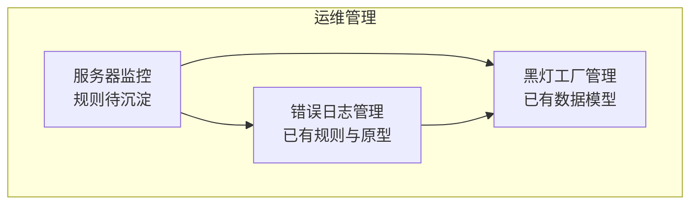
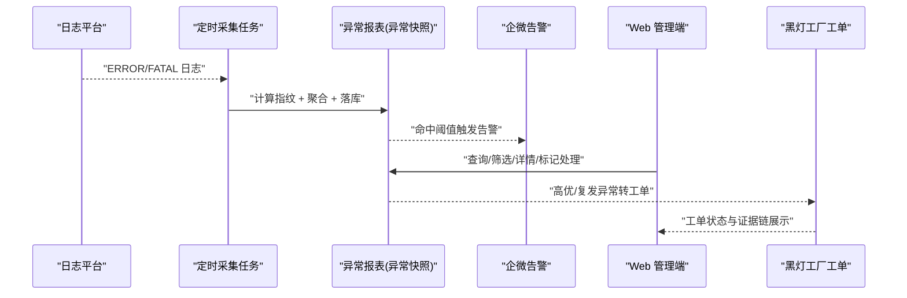
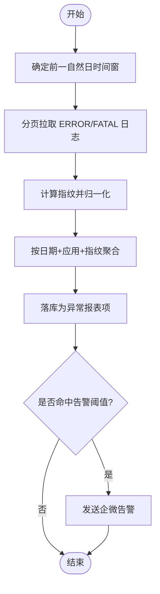
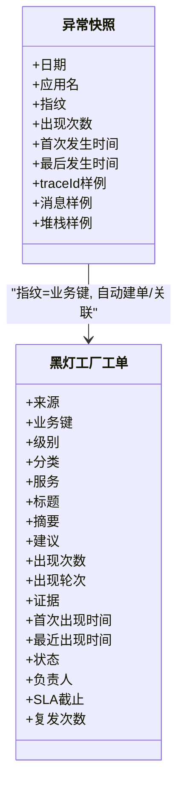

# 服务器监控

<cite>
**本文引用的文件**   
- [错误日志管理 SKILL.md](file://运维管理/错误日志管理/SKILL.md)
- [错误日志管理 企微告警模板.md](file://运维管理/错误日志管理/references/wecom-alert.md)
- [黑灯工厂工单数据模型.md](file://运维管理/黑灯工厂管理/references/data-model.md)
</cite>

## 目录
1. [引言](#引言)
2. [项目结构](#项目结构)
3. [核心组件](#核心组件)
4. [架构总览](#架构总览)
5. [详细组件分析](#详细组件分析)
6. [依赖关系分析](#依赖关系分析)
7. [性能与可靠性考虑](#性能与可靠性考虑)
8. [故障排查指南](#故障排查指南)
9. [结论](#结论)

## 引言
本页面聚焦“服务器监控”规则，围绕异常快照、节假日快照，以及与“错误日志管理”“黑灯工厂管理”的关联进行说明。需要特别说明的是：当前仓库中“运维管理/服务器监控/references”为空目录，未包含可直接引用的规则正文；因此本文以仓库内已落地的“错误日志管理”和“黑灯工厂管理”为真源，结合服务器监控的典型实践，给出可执行的规则建议与关联方案，并明确哪些内容属于现有实现、哪些属于基于规则的补充设计。

## 项目结构
- 运维管理下存在三个相关模块：
  - 服务器监控：references 目录为空，尚未沉淀具体规则文档。
  - 错误日志管理：有 SKILL.md 与企微告警模板，定义了日志异常采集、聚合、报表、标记处理与告警等完整流程。
  - 黑灯工厂管理：有数据模型文档，定义工单实体、字段分组、幂等键、重跑白名单及状态流转等。

**图表来源**
- [错误日志管理 SKILL.md:1-134](file://运维管理/错误日志管理/SKILL.md#L1-L134)
- [黑灯工厂工单数据模型.md:1-73](file://运维管理/黑灯工厂管理/references/data-model.md#L1-L73)

**章节来源**
- [错误日志管理 SKILL.md:1-134](file://运维管理/错误日志管理/SKILL.md#L1-L134)
- [黑灯工厂工单数据模型.md:1-73](file://运维管理/黑灯工厂管理/references/data-model.md#L1-L73)

## 核心组件
本节从“服务器监控”视角，梳理三类关键能力及其在仓库中的落地情况：

- 异常快照
  - 现状：由“错误日志管理”提供，按日期+应用名+指纹聚合 ERROR/FATAL 日志，形成每日异常报表项，支持统计、详情、标记处理与导出。
  - 作用：作为服务器监控的核心异常快照来源，支撑趋势观察、阈值告警与问题闭环。

- 节假日快照
  - 现状：仓库未直接定义节假日快照规则。
  - 建议：在服务器监控层引入“节假日/工作日”标签，对异常快照做同比/环比修正，避免节假日流量波动造成误判；该能力可与错误日志管理的报表维度扩展对接。

- 与错误日志、黑灯工厂的关联
  - 与错误日志：异常快照即错误日志的日报聚合结果；命中阈值触发企微告警；研发可在 Web 端查看 traceId 样例、堆栈并跳转日志控制台。
  - 与黑灯工厂：当异常达到一定级别或复发时，可自动建黑灯工厂工单，承载根因分析、修复与复核流程；工单与异常快照通过“异常指纹”建立关联。

**章节来源**
- [错误日志管理 SKILL.md:10-54](file://运维管理/错误日志管理/SKILL.md#L10-L54)
- [错误日志管理 SKILL.md:66-78](file://运维管理/错误日志管理/SKILL.md#L66-L78)
- [黑灯工厂工单数据模型.md:9-34](file://运维管理/黑灯工厂管理/references/data-model.md#L9-L34)

## 架构总览
服务器监控在整体运维体系中的位置如下：

**图表来源**
- [错误日志管理 SKILL.md:37-54](file://运维管理/错误日志管理/SKILL.md#L37-L54)
- [错误日志管理 SKILL.md:66-78](file://运维管理/错误日志管理/SKILL.md#L66-L78)
- [黑灯工厂工单数据模型.md:9-34](file://运维管理/黑灯工厂管理/references/data-model.md#L9-L34)

## 详细组件分析

### 异常快照（来自错误日志管理）
- 数据来源：日志平台的 ERROR/FATAL 日志。
- 聚合规则：按“日期 + 应用名 + 指纹”三元组唯一；指纹由应用名、异常类名、归一化消息与顶层堆栈行生成。
- 输出产物：每日异常报表项，含出现次数、首次/最后发生时间、traceId 样例、消息与堆栈样例、日志库来源等。
- 处理状态：待处理 → 已处理 / 已忽略；支持撤销与手动重跑，重跑不覆盖处理状态。
- 告警：单个报表项出现次数 ≥ 阈值时触发企微告警，同一报表项一天只发一次。

**图表来源**
- [错误日志管理 SKILL.md:37-54](file://运维管理/错误日志管理/SKILL.md#L37-L54)
- [错误日志管理 SKILL.md:66-78](file://运维管理/错误日志管理/SKILL.md#L66-L78)

**章节来源**
- [错误日志管理 SKILL.md:27-54](file://运维管理/错误日志管理/SKILL.md#L27-L54)
- [错误日志管理 SKILL.md:66-78](file://运维管理/错误日志管理/SKILL.md#L66-L78)

### 节假日快照（建议规则）
- 目标：在异常快照基础上增加“节假日/工作日”标签，用于趋势对比与阈值动态调整。
- 建议规则：
  - 节假日期间放宽阈值或降低告警优先级，避免非业务高峰导致的误报。
  - 对异常快照增加“节假日标识”，便于报表按“工作日/节假日”维度拆分。
  - 与错误日志管理的报表维度扩展对接，保持主键与聚合口径一致。
- 与现有系统的边界：节假日快照为监控层增强能力，不改变错误日志采集与聚合逻辑，仅影响告警策略与报表展示。

[本节为概念性规则建议，不直接分析具体源码文件]

### 与黑灯工厂的关联
- 关联点：
  - 异常指纹：错误日志的指纹可作为黑灯工厂的“业务键”，保证同源问题合并。
  - 级别与分类：根据异常级别（如 P1/P2）与分类（如 FIXED_REVIEW、PENDING_JUDGE、BIZ_CONFIRM）自动建单或分流。
  - 证据链：traceId 样例、堆栈、SQL 样例、趋势等作为工单证据，辅助根因分析与复盘。
- 工单生命周期：OPEN → CLAIMED → REVIEW → RESOLVED/IGNORED，支持复发重开与 SLA 截止。

**图表来源**
- [错误日志管理 SKILL.md:27-54](file://运维管理/错误日志管理/SKILL.md#L27-L54)
- [黑灯工厂工单数据模型.md:9-34](file://运维管理/黑灯工厂管理/references/data-model.md#L9-L34)

**章节来源**
- [黑灯工厂工单数据模型.md:9-34](file://运维管理/黑灯工厂管理/references/data-model.md#L9-L34)
- [黑灯工厂工单数据模型.md:61-72](file://运维管理/黑灯工厂管理/references/data-model.md#L61-L72)

## 依赖关系分析
- 错误日志管理与黑灯工厂管理之间的耦合点：
  - 指纹/业务键：确保同源问题在两个系统中保持一致。
  - 级别与分类：决定是否需要建单以及工单初始状态。
  - 证据链：traceId、堆栈、SQL 样例等作为跨系统共享信息。
- 服务器监控作为上层编排者：
  - 读取异常快照，结合节假日标签调整告警策略。
  - 将高优/复发异常推送至黑灯工厂，形成闭环。

**图表来源**
- [错误日志管理 SKILL.md:37-54](file://运维管理/错误日志管理/SKILL.md#L37-L54)
- [黑灯工厂工单数据模型.md:9-34](file://运维管理/黑灯工厂管理/references/data-model.md#L9-L34)

**章节来源**
- [错误日志管理 SKILL.md:37-54](file://运维管理/错误日志管理/SKILL.md#L37-L54)
- [黑灯工厂工单数据模型.md:9-34](file://运维管理/黑灯工厂管理/references/data-model.md#L9-L34)

## 性能与可靠性考虑
- 采集任务：
  - 时间窗：以本地时区切日，任务执行晚于窗口结束至少 30 分钟，防止日志写入延迟丢数据。
  - 上限保护：单日志库单日落库上限保护，超限只取前 N 条并告警。
  - 静默丢数据防控：查询失败、解析失败、落库失败必须打 ERROR 日志并标记任务失败。
- 重跑与幂等：
  - 支持手动指定日期重跑；重跑只更新统计字段，处理状态不被覆盖。
  - 黑灯工厂工单 upsert 白名单明确区分可更新与禁更新字段。
- 告警去重：
  - 同一报表项一天只发一次，发送记录本地留存用于去重。
  - 企微推送失败不阻断主任务，补偿任务重试 3 次。

**章节来源**
- [错误日志管理 SKILL.md:43-54](file://运维管理/错误日志管理/SKILL.md#L43-L54)
- [错误日志管理 SKILL.md:116-125](file://运维管理/错误日志管理/SKILL.md#L116-L125)
- [错误日志管理 企微告警模板.md:3-42](file://运维管理/错误日志管理/references/wecom-alert.md#L3-L42)
- [黑灯工厂工单数据模型.md:61-72](file://运维管理/黑灯工厂管理/references/data-model.md#L61-L72)

## 故障排查指南
- 采集侧问题：
  - 检查日志平台连接与权限；确认时间窗配置与任务执行时间。
  - 查看任务执行留痕：拉取条数、聚合分组数、落库行数、耗时。
- 聚合侧问题：
  - 核对指纹归一化规则，确认变量字段是否被正确占位替换。
  - 检查是否出现同源被拆成多组的情况，必要时回归验证新增规则。
- 告警侧问题：
  - 确认全局开关与阈值配置；检查企微应用消息发送能力。
  - 若推送失败，查看补偿任务重试记录。
- 工单侧问题：
  - 校验来源与业务键是否一致，确保同源问题合并。
  - 检查工单状态流转是否符合预期，SLA 截止是否按时计算。

**章节来源**
- [错误日志管理 SKILL.md:80-125](file://运维管理/错误日志管理/SKILL.md#L80-L125)
- [错误日志管理 企微告警模板.md:3-42](file://运维管理/错误日志管理/references/wecom-alert.md#L3-L42)
- [黑灯工厂工单数据模型.md:36-72](file://运维管理/黑灯工厂管理/references/data-model.md#L36-L72)

## 结论
- 当前仓库中“服务器监控”的规则尚未沉淀，但“错误日志管理”与“黑灯工厂管理”提供了坚实的基座。
- 建议以“异常快照”为核心，叠加“节假日快照”策略，完善告警与报表维度。
- 通过“异常指纹”与黑灯工厂工单的“业务键”对齐，实现从异常发现到工单闭环的全链路治理。
- 后续应在“服务器监控/references”中正式沉淀节假日快照规则、阈值策略与与错误日志/黑灯工厂的集成规范，确保规则可审计、可演进。