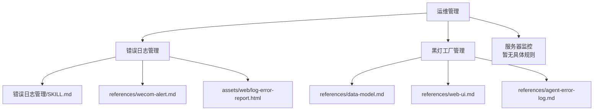
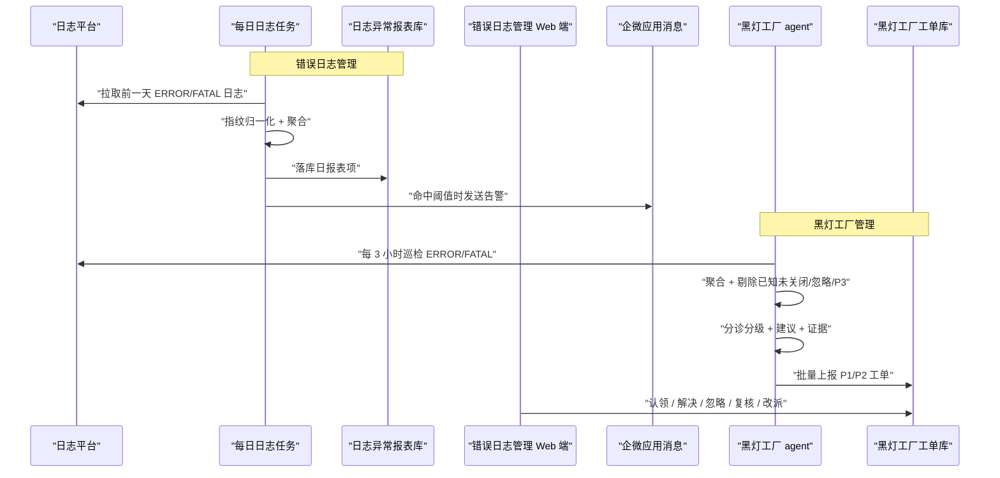
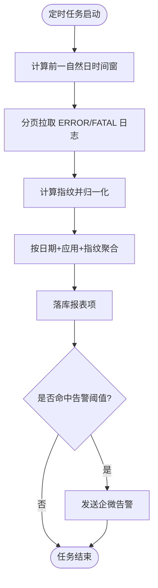
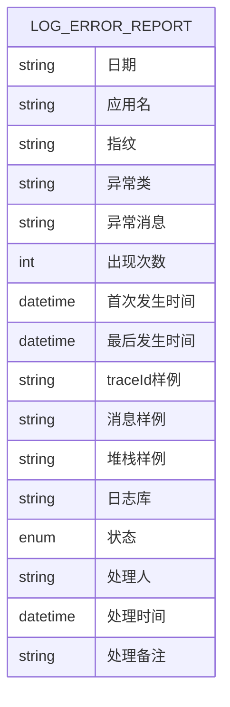
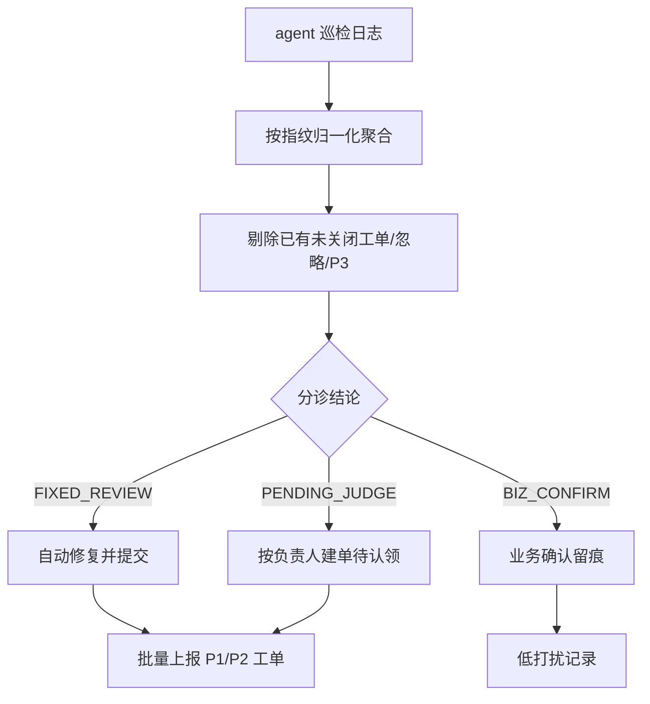
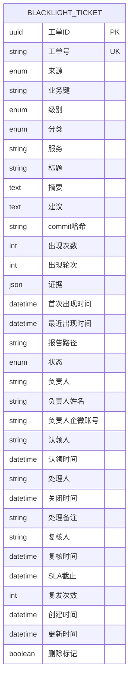
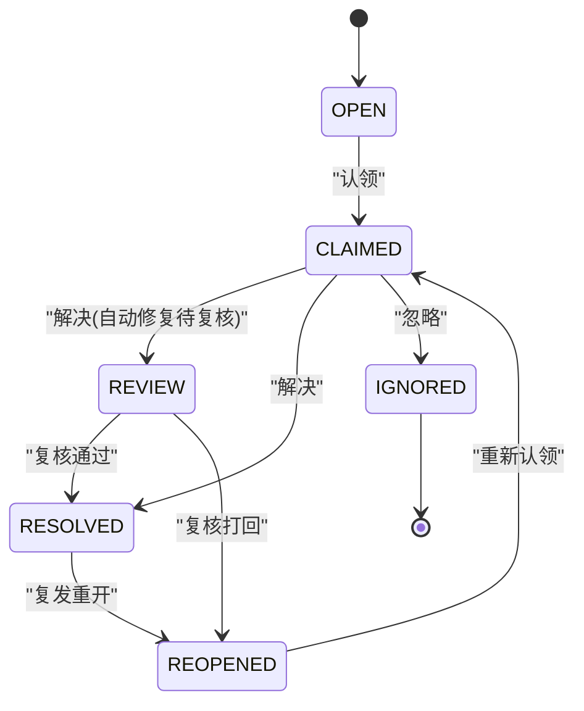
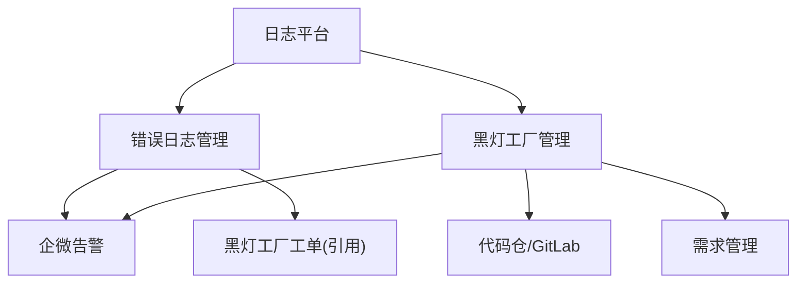

# 运维管理

<cite>
**本文引用的文件**   
- [错误日志管理/SKILL.md](file://运维管理/错误日志管理/SKILL.md)
- [错误日志管理/references/wecom-alert.md](file://运维管理/错误日志管理/references/wecom-alert.md)
- [错误日志管理/assets/web/log-error-report.html](file://运维管理/错误日志管理/assets/web/log-error-report.html)
- [黑灯工厂管理/references/data-model.md](file://运维管理/黑灯工厂管理/references/data-model.md)
- [黑灯工厂管理/references/web-ui.md](file://运维管理/黑灯工厂管理/references/web-ui.md)
- [黑灯工厂管理/references/agent-error-log.md](file://运维管理/黑灯工厂管理/references/agent-error-log.md)
</cite>

## 目录
1. [引言](#引言)
2. [项目结构](#项目结构)
3. [核心组件](#核心组件)
4. [架构总览](#架构总览)
5. [详细组件分析](#详细组件分析)
6. [依赖关系分析](#依赖关系分析)
7. [性能与可靠性考虑](#性能与可靠性考虑)
8. [故障排查指南](#故障排查指南)
9. [结论](#结论)

## 引言
本仓库是鸣鸣很忙产研域 Harness 文档仓，不含可运行服务代码。运维管理子域聚焦“系统稳定性与问题闭环”，以结构化 Markdown 文档与 Web 原型资产描述当前生效的规则、流程与界面锚点。根据作者说明，功能正文以各三级模块的 references/ 与 assets/ 为真源；SKILL.md 与各层 SKILL.md 仅作导航与定位，不复述规则细节。

本页面作为运维管理子域的总览，明确：
- 子域定位：面向研发与运维的内部能力，不挂租户字段，通过权限控制访问范围。
- 下辖模块：错误日志管理与黑灯工厂管理（服务器监控目录目前仅有空 references 目录，未提供具体规则）。
- 关键边界：错误日志管理侧重“日志异常报表与趋势分析”，黑灯工厂管理侧重“自动分诊、修复与工单闭环”。

## 项目结构
运维管理子域下包含三个二级目录：
- 服务器监控：references 目录为空，暂无具体规则或资产。
- 错误日志管理：包含 Web 端原型与企微告警参考文档，以及 SKILL.md 导航。
- 黑灯工厂管理：包含数据模型、Web UI 描述与 agent 手册，形成从采集到工单闭环的完整链路。

**图表来源**
- [错误日志管理/SKILL.md:1-10](file://运维管理/错误日志管理/SKILL.md#L1-L10)
- [错误日志管理/references/wecom-alert.md:1-12](file://运维管理/错误日志管理/references/wecom-alert.md#L1-L12)
- [错误日志管理/assets/web/log-error-report.html](file://运维管理/错误日志管理/assets/web/log-error-report.html)
- [黑灯工厂管理/references/data-model.md:1-10](file://运维管理/黑灯工厂管理/references/data-model.md#L1-L10)
- [黑灯工厂管理/references/web-ui.md:1-12](file://运维管理/黑灯工厂管理/references/web-ui.md#L1-L12)
- [黑灯工厂管理/references/agent-error-log.md:1-10](file://运维管理/黑灯工厂管理/references/agent-error-log.md#L1-L10)

**章节来源**
- [错误日志管理/SKILL.md:1-10](file://运维管理/错误日志管理/SKILL.md#L1-L10)
- [黑灯工厂管理/references/web-ui.md:5-12](file://运维管理/黑灯工厂管理/references/web-ui.md#L5-L12)

## 核心组件
运维管理子域的核心由两个相互协同的子系统构成：
- 错误日志管理：基于日志平台 ERROR/FATAL 日志，每日聚合指纹异常，提供报表、详情、标记处理与阈值告警。
- 黑灯工厂管理：对同一类异常进行实时巡检、分诊分级、自动修复与工单流转，形成问题闭环。

二者共享“指纹归一化”“traceId 样例”“堆栈样例”等关键概念，但职责不同：
- 错误日志管理偏“只读 + 手工处置 + 趋势统计”。
- 黑灯工厂管理偏“自动分诊 + 修复 + 工单流转 + SLA 管控”。

**章节来源**
- [错误日志管理/SKILL.md:10-21](file://运维管理/错误日志管理/SKILL.md#L10-L21)
- [黑灯工厂管理/references/agent-error-log.md:5-10](file://运维管理/黑灯工厂管理/references/agent-error-log.md#L5-L10)

## 架构总览
运维管理的整体架构围绕“日志采集 → 指纹聚合 → 报表与告警 → 自动分诊 → 工单闭环”展开。

**图表来源**
- [错误日志管理/SKILL.md:37-54](file://运维管理/错误日志管理/SKILL.md#L37-L54)
- [错误日志管理/references/wecom-alert.md:3-11](file://运维管理/错误日志管理/references/wecom-alert.md#L3-L11)
- [黑灯工厂管理/references/agent-error-log.md:11-24](file://运维管理/黑灯工厂管理/references/agent-error-log.md#L11-L24)
- [黑灯工厂管理/references/web-ui.md:69-80](file://运维管理/黑灯工厂管理/references/web-ui.md#L69-L80)

## 详细组件分析

### 错误日志管理
错误日志管理以“日志异常报表”为核心，承担以下职责：
- 每日凌晨定时扫描前一自然日 ERROR/FATAL 日志。
- 按指纹归一化折叠同类报错，生成报表项。
- 提供 Web 端列表、详情抽屉、标记处理与导出。
- 在报表项出现次数达到阈值时触发企微告警。

#### 业务流程

**图表来源**
- [错误日志管理/SKILL.md:37-54](file://运维管理/错误日志管理/SKILL.md#L37-L54)
- [错误日志管理/references/wecom-alert.md:3-8](file://运维管理/错误日志管理/references/wecom-alert.md#L3-L8)

#### 数据模型要点
错误日志管理的核心实体是“日志异常日报表”，字段分为三组：
- 业务幂等键：日期 + 应用名 + 指纹。
- 统计快照：异常类、异常消息、出现次数、首次/最后发生时间、traceId 样例、消息与堆栈样例、日志库。
- 处理快照：状态、处理人、处理时间、处理备注。

重跑仅更新统计字段，不覆盖处理状态；保留期默认 90 天，超期由独立清理任务删除。

**图表来源**
- [错误日志管理/SKILL.md:56-65](file://运维管理/错误日志管理/SKILL.md#L56-L65)

#### 页面与权限
- 菜单位置：运维管理 → 错误日志管理。
- 端型：仅 Web。
- 主要页面：报表列表、详情抽屉、标记弹窗。
- 权限：菜单可见性受权限控制；标记已处理/撤销、忽略、手动重跑、导出分别受按钮权限控制，默认授予管理员与研发负责人角色。

**章节来源**
- [错误日志管理/SKILL.md:19-25](file://运维管理/错误日志管理/SKILL.md#L19-L25)
- [错误日志管理/SKILL.md:66-78](file://运维管理/错误日志管理/SKILL.md#L66-L78)
- [错误日志管理/assets/web/log-error-report.html](file://运维管理/错误日志管理/assets/web/log-error-report.html)

### 黑灯工厂管理
黑灯工厂管理以“工单”为核心实体，承接错误日志、大 SQL 结果集修复、服务端 bug 扫描、需求缺陷分流等多来源问题，实现自动分诊、修复与工单闭环。

#### 数据来源与 agent 流程
- 来源标识包括 blacklight、bigsqlfix、bugscan、reqdefect。
- agent 每 3 小时一轮巡检 SLS ERROR/FATAL 日志，按指纹聚合后分诊：能安全修复则自动提交，不能判断则建单指派，属业务口径则知会留痕。
- P1/P2 统一上报为黑灯工厂工单；P3/噪声仅计数。

**图表来源**
- [黑灯工厂管理/references/agent-error-log.md:11-24](file://运维管理/黑灯工厂管理/references/agent-error-log.md#L11-L24)
- [黑灯工厂管理/references/agent-error-log.md:26-43](file://运维管理/黑灯工厂管理/references/agent-error-log.md#L26-L43)

#### 工单数据模型
黑灯工厂工单字段分为四组：
- 业务幂等键：来源 + 业务键全局唯一。
- 内容快照：级别、分类、服务、标题、摘要、建议、commit 哈希、出现次数、出现轮次、证据、首末次时间、报告路径。
- 流程状态：状态、负责人、认领人、处理人、复核人、SLA 截止、复发次数。
- 审计：工单 ID、工单号、创建/更新信息、删除标记。

upsert 白名单区分“可更新快照”与“禁更新流程字段”，避免重复上报覆盖关键流程信息。

**图表来源**
- [黑灯工厂管理/references/data-model.md:9-59](file://运维管理/黑灯工厂管理/references/data-model.md#L9-L59)

#### Web 端交互与权限
- 菜单位置：运维管理 → 黑灯工厂工单（二级，错误日志管理之后）。
- 页面区块：KPI 卡、筛选 + 表格、详情抽屉、处理弹窗。
- 动作闭环：认领、解决、忽略、复核通过、复核打回、改派、导出。
- 按钮权限：认领/解决/忽略、复核、改派、导出分别有权限码，默认授予超级管理员、研发负责人；普通研发可认领与复核自己名下工单。

**图表来源**
- [黑灯工厂管理/references/web-ui.md:69-80](file://运维管理/黑灯工厂管理/references/web-ui.md#L69-L80)
- [黑灯工厂管理/references/data-model.md:36-49](file://运维管理/黑灯工厂管理/references/data-model.md#L36-L49)

**章节来源**
- [黑灯工厂管理/references/agent-error-log.md:5-24](file://运维管理/黑灯工厂管理/references/agent-error-log.md#L5-L24)
- [黑灯工厂管理/references/data-model.md:1-73](file://运维管理/黑灯工厂管理/references/data-model.md#L1-L73)
- [黑灯工厂管理/references/web-ui.md:5-12](file://运维管理/黑灯工厂管理/references/web-ui.md#L5-L12)
- [黑灯工厂管理/references/web-ui.md:69-91](file://运维管理/黑灯工厂管理/references/web-ui.md#L69-L91)

## 依赖关系分析
运维管理子域内部存在清晰的依赖方向：
- 错误日志管理依赖日志平台与企微告警通道。
- 黑灯工厂管理依赖日志平台、代码仓、GitLab、需求管理系统与企微应用消息。
- 两者共享“指纹归一化”“traceId 样例”“堆栈样例”等概念，但不直接耦合；错误日志管理提供趋势与报表，黑灯工厂管理提供自动分诊与工单闭环。

**图表来源**
- [错误日志管理/SKILL.md:37-54](file://运维管理/错误日志管理/SKILL.md#L37-L54)
- [错误日志管理/references/wecom-alert.md:9-11](file://运维管理/错误日志管理/references/wecom-alert.md#L9-L11)
- [黑灯工厂管理/references/agent-error-log.md:11-24](file://运维管理/黑灯工厂管理/references/agent-error-log.md#L11-L24)
- [黑灯工厂管理/references/web-ui.md:34-40](file://运维管理/黑灯工厂管理/references/web-ui.md#L34-L40)

**章节来源**
- [错误日志管理/SKILL.md:37-54](file://运维管理/错误日志管理/SKILL.md#L37-L54)
- [黑灯工厂管理/references/agent-error-log.md:11-24](file://运维管理/黑灯工厂管理/references/agent-error-log.md#L11-L24)

## 性能与可靠性考虑
- 错误日志管理：
  - 时间窗与延迟防护：任务执行晚于窗口结束至少 30 分钟，避免日志写入延迟丢数据。
  - 静默丢数据防控：查询失败、解析失败、落库失败必须打 ERROR 日志并标记任务失败。
  - 重跑幂等：支持手动指定日期重跑，仅更新统计字段，不覆盖处理状态。
  - 保留期与清理：报表项保留 90 天，超期由独立清理任务删除。
- 黑灯工厂管理：
  - 增量深析：剔除已有未关闭工单、同键已忽略、P3/噪声指纹，避免刷屏与无效建单。
  - 自动修复边界：仅允许局部防御性改动，不改变业务口径与数据语义。
  - 负责人判定与兜底：依据代码提交记录判负责人；采集/建单失败发群机器人简报并下轮重试。

**章节来源**
- [错误日志管理/SKILL.md:43-54](file://运维管理/错误日志管理/SKILL.md#L43-L54)
- [黑灯工厂管理/references/agent-error-log.md:21-24](file://运维管理/黑灯工厂管理/references/agent-error-log.md#L21-L24)
- [黑灯工厂管理/references/agent-error-log.md:44-49](file://运维管理/黑灯工厂管理/references/agent-error-log.md#L44-L49)
- [黑灯工厂管理/references/agent-error-log.md:58-61](file://运维管理/黑灯工厂管理/references/agent-error-log.md#L58-L61)

## 故障排查指南
- 错误日志管理常见问题：
  - 单日 ERROR 爆量拖垮任务：单日志库单日落库上限保护，超限只取前 N 条并告警。
  - 指纹归一化漏掉变量字段导致同源被拆分：归一化规则统一维护，新增规则需回归测试。
  - 历史日志无结构化堆栈：以消息样例兼容。
- 黑灯工厂管理常见问题：
  - 每轮全量新建而不走同键追加：应遵循 upsert 白名单，避免刷屏根因。
  - 自动修复越界改业务口径：必须转人工，不得越界。
  - 分诊结论缺少“建议：”人话：认领人无法接手，需补充证据与建议。

**章节来源**
- [错误日志管理/SKILL.md:116-133](file://运维管理/错误日志管理/SKILL.md#L116-L133)
- [黑灯工厂管理/references/agent-error-log.md:63-69](file://运维管理/黑灯工厂管理/references/agent-error-log.md#L63-L69)

## 结论
运维管理子域以“错误日志管理”和“黑灯工厂管理”为核心，形成从日志异常报表到自动分诊与工单闭环的完整体系。前者提供趋势分析与手工处置入口，后者提供自动化分诊、修复与 SLA 管控。两者共享指纹与证据链概念，但职责清晰、边界明确，共同支撑研发与运维的系统稳定性目标。服务器监控目录目前尚未提供具体规则与资产，后续可按同样规范补充。