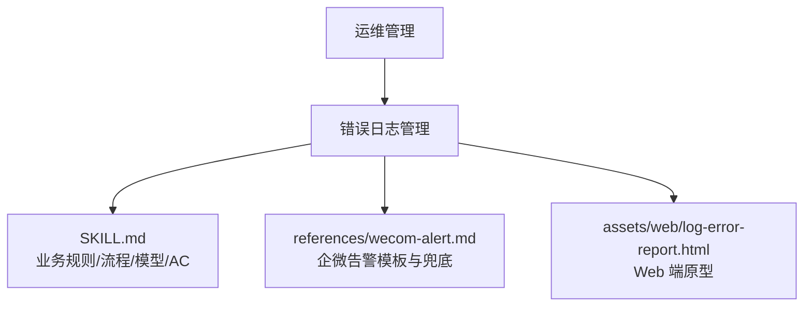
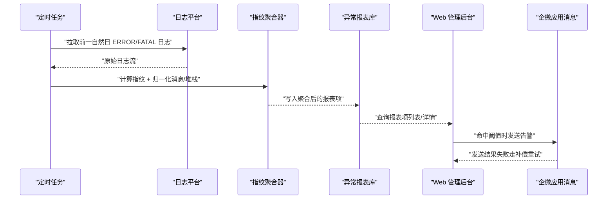
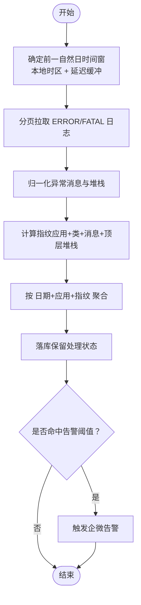
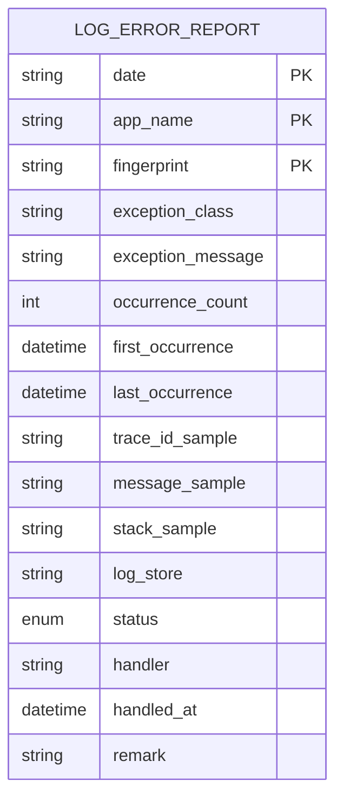
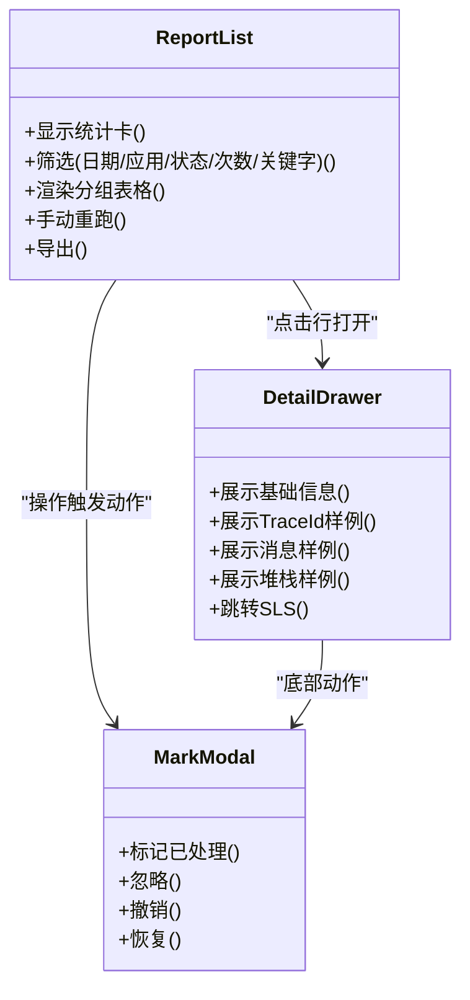
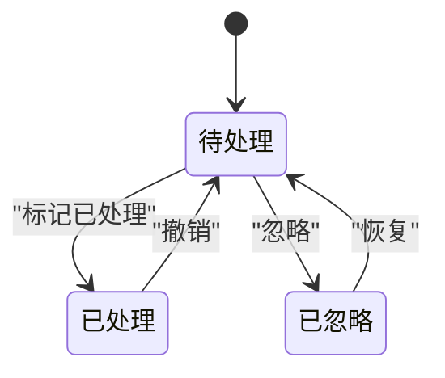
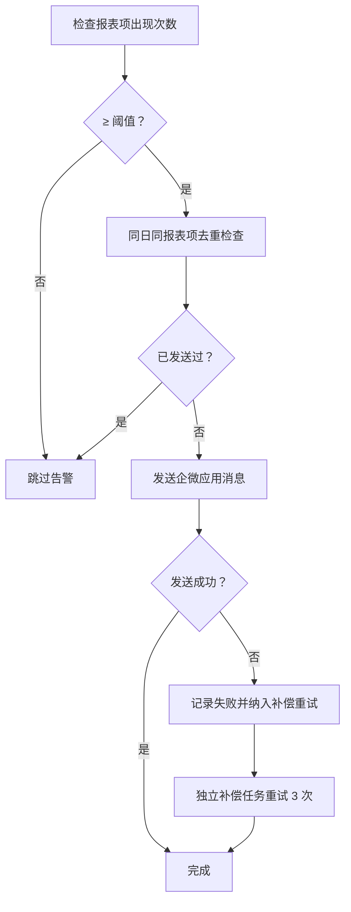
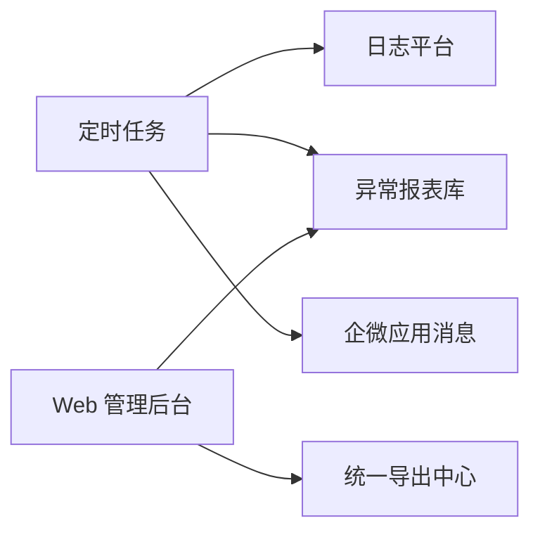

# 错误日志管理

<cite>
**本文引用的文件**   
- [SKILL.md](file://运维管理/错误日志管理/SKILL.md)
- [wecom-alert.md](file://运维管理/错误日志管理/references/wecom-alert.md)
- [log-error-report.html](file://运维管理/错误日志管理/assets/web/log-error-report.html)
</cite>

## 目录
1. [引言](#引言)
2. [项目结构](#项目结构)
3. [核心组件](#核心组件)
4. [架构总览](#架构总览)
5. [详细组件分析](#详细组件分析)
6. [依赖关系分析](#依赖关系分析)
7. [性能与稳定性考虑](#性能与稳定性考虑)
8. [故障排查指南](#故障排查指南)
9. [结论](#结论)

## 引言
本章节面向“错误日志的接入、分级分类与管理规则”，聚焦运维管理下的「错误日志管理」能力：基于日志平台的应用 ERROR/FATAL 日志，按指纹归一化聚合为每日异常报表，提供 Web 端查看、处理、忽略、导出与企微告警等闭环能力。该文档不内嵌实现细节（SQL、接口报文、代码片段），以仓库中的 SKILL 与原型资产为依据进行说明。

## 项目结构
错误日志管理属于“运维管理”模块，真源集中在以下位置：
- 业务规则与验收清单：`运维管理/错误日志管理/SKILL.md`
- 企微告警模板与约束：`运维管理/错误日志管理/references/wecom-alert.md`
- Web 端原型页面（列表、详情抽屉、标记弹窗）：`运维管理/错误日志管理/assets/web/log-error-report.html`

**图示来源**
- [SKILL.md:1-134](file://运维管理/错误日志管理/SKILL.md#L1-L134)
- [wecom-alert.md:1-42](file://运维管理/错误日志管理/references/wecom-alert.md#L1-L42)
- [log-error-report.html:1-800](file://运维管理/错误日志管理/assets/web/log-error-report.html#L1-L800)

**章节来源**
- [SKILL.md:1-134](file://运维管理/错误日志管理/SKILL.md#L1-L134)

## 核心组件
围绕错误日志管理，系统由以下关键组件构成：
- 采集任务：定时扫描前一自然日 ERROR/FATAL 日志，计算指纹并聚合落库。
- 异常分组与报表项：以“日期 + 应用名 + 指纹”为唯一键，形成日报表项。
- Web 端报表页：统计卡、筛选区、分组表格、详情抽屉、标记弹窗。
- 通知集成：命中阈值时通过企微应用消息告警。
- 权限控制：菜单与按钮级权限，默认授给管理员与研发负责人角色。

**章节来源**
- [SKILL.md:10-78](file://运维管理/错误日志管理/SKILL.md#L10-L78)
- [log-error-report.html:257-470](file://运维管理/错误日志管理/assets/web/log-error-report.html#L257-L470)

## 架构总览
错误日志管理的端到端流程如下：

**图示来源**
- [SKILL.md:37-54](file://运维管理/错误日志管理/SKILL.md#L37-L54)
- [wecom-alert.md:3-42](file://运维管理/错误日志管理/references/wecom-alert.md#L3-L42)

## 详细组件分析

### 数据采集与指纹聚合
- 时间窗：以本地时区切日，任务执行晚于窗口结束至少 30 分钟，避免日志延迟丢数据。
- 数据来源：默认按“应用名-环境”定位日志库；多应用/多日志库通过配置枚举接入。
- 指纹生成：应用名 + 异常类名 + 归一化异常消息 + 顶层堆栈行；消息中数字/UUID/时间戳/IP/十六进制串替换为占位符；堆栈仅保留最顶层非框架行。
- 聚合维度：日期 + 应用名 + 指纹三元组唯一；traceId 样例最多保留前 5 个；消息与堆栈各保留首次原始内容（超长截断）。
- 幂等重跑：支持手动指定日期重跑；只更新统计字段，不覆盖处理状态。

**图示来源**
- [SKILL.md:43-54](file://运维管理/错误日志管理/SKILL.md#L43-L54)

**章节来源**
- [SKILL.md:43-54](file://运维管理/错误日志管理/SKILL.md#L43-L54)

### 报表数据模型
报表项分为三组字段：
- 业务幂等键：日期 + 应用名 + 指纹（唯一）
- 统计快照：异常类 / 异常消息 / 出现次数 / 首次与最后发生时间 / traceId 样例 / 消息与堆栈样例 / 日志库
- 处理快照：状态 / 处理人 / 处理时间 / 处理备注

**图示来源**
- [SKILL.md:56-64](file://运维管理/错误日志管理/SKILL.md#L56-L64)

**章节来源**
- [SKILL.md:56-64](file://运维管理/错误日志管理/SKILL.md#L56-L64)

### Web 端报表页面
- 列表页：顶部统计卡（异常分组数/出现总次数/待处理/已处理/已忽略），筛选区（日期/应用/状态/次数下限/关键字），分组表格，手动重跑与导出按钮。
- 详情抽屉：聚合统计、traceId 样例（跳转日志控制台）、消息样例、折叠堆栈。
- 标记弹窗：标记已处理/忽略共用，备注必填，处理人与处理时间自动填充。

**图示来源**
- [log-error-report.html:257-470](file://运维管理/错误日志管理/assets/web/log-error-report.html#L257-L470)
- [log-error-report.html:475-565](file://运维管理/错误日志管理/assets/web/log-error-report.html#L475-L565)

**章节来源**
- [log-error-report.html:257-470](file://运维管理/错误日志管理/assets/web/log-error-report.html#L257-L470)
- [log-error-report.html:475-565](file://运维管理/错误日志管理/assets/web/log-error-report.html#L475-L565)

### 状态机与处理规则
- 状态流转：待处理 → 已处理 → 待处理（撤销）；待处理 → 已忽略（噪声不再统计告警，但保留记录）。
- 处理要素：处理人、处理时间、处理备注；撤销/恢复保持审计可追溯。
- 权限控制：标记已处理/撤销、忽略、手动重跑、导出分别受按钮权限控制。

**图示来源**
- [SKILL.md:50-54](file://运维管理/错误日志管理/SKILL.md#L50-L54)
- [log-error-report.html:605-651](file://运维管理/错误日志管理/assets/web/log-error-report.html#L605-L651)

**章节来源**
- [SKILL.md:50-54](file://运维管理/错误日志管理/SKILL.md#L50-L54)
- [log-error-report.html:605-651](file://运维管理/错误日志管理/assets/web/log-error-report.html#L605-L651)

### 企微告警集成
- 触发条件：单个报表项出现次数 ≥ 告警阈值（默认 50，以配置中心生效值为准）。
- 去重策略：同一报表项一天只发一次，发送记录本地留存用于去重。
- 接收方：企微应用消息，群或人由“研发告警”配置项决定。
- 消息模板：包含应用名、日期、异常类、出现次数、首次/最后、消息样例（截断至 200 字符）、traceId 样例、查看详情与跳转 SLS 链接。
- 失败兜底：推送失败不阻断主任务；失败记录由独立补偿任务重试 3 次。

**图示来源**
- [wecom-alert.md:3-42](file://运维管理/错误日志管理/references/wecom-alert.md#L3-L42)

**章节来源**
- [wecom-alert.md:3-42](file://运维管理/错误日志管理/references/wecom-alert.md#L3-L42)

## 依赖关系分析
- 外部依赖：
  - 日志平台：ERROR/FATAL 日志拉取与 traceId 定位。
  - 企微应用消息：告警通知通道。
  - 统一导出中心：报表导出能力。
- 内部依赖：
  - 定时任务驱动采集与聚合。
  - Web 端依赖报表库查询与操作接口。
  - 权限系统控制菜单与按钮可见性。

**图示来源**
- [SKILL.md:37-78](file://运维管理/错误日志管理/SKILL.md#L37-L78)
- [wecom-alert.md:9-42](file://运维管理/错误日志管理/references/wecom-alert.md#L9-L42)

**章节来源**
- [SKILL.md:37-78](file://运维管理/错误日志管理/SKILL.md#L37-L78)
- [wecom-alert.md:9-42](file://运维管理/错误日志管理/references/wecom-alert.md#L9-L42)

## 性能与稳定性考虑
- 单日志库单日落库上限保护：超限只取前 N 条并告警，防止爆量拖垮任务。
- 任务执行留痕：拉取条数、聚合分组数、落库行数、耗时均需记录。
- 静默丢数据防控：查询失败、解析失败、落库失败必须打 ERROR 日志并标记任务失败，严禁吞异常。
- 超保留期清理：报表项保留 90 天，由独立清理任务每日删除，禁止与采集任务串联。
- 重跑幂等：只更新统计字段，处理状态不被覆盖。

**章节来源**
- [SKILL.md:51-54](file://运维管理/错误日志管理/SKILL.md#L51-L54)
- [SKILL.md:116-125](file://运维管理/错误日志管理/SKILL.md#L116-L125)

## 故障排查指南
- 任务未触发或无数据：
  - 检查定时任务是否执行，确认时间窗与日志延迟缓冲是否符合要求。
  - 核对日志平台拉取条数与聚合分组数日志。
- 指纹拆分异常：
  - 检查归一化规则字典是否覆盖变量字段（数字/UUID/时间戳/IP/十六进制串）。
  - 回归验证新增规则是否导致同源被拆成多组。
- 告警未送达：
  - 检查全局开关与“研发告警”配置项。
  - 查看企微推送失败记录与补偿重试情况。
- 状态被覆盖：
  - 确认重跑逻辑仅更新统计字段，不覆盖处理状态。
- 导出异常：
  - 确认使用统一导出中心，而非自起文件上传。

**章节来源**
- [SKILL.md:116-133](file://运维管理/错误日志管理/SKILL.md#L116-L133)
- [wecom-alert.md:38-42](file://运维管理/错误日志管理/references/wecom-alert.md#L38-L42)

## 结论
错误日志管理通过“采集—归一化—聚合—报表—处理—告警”的闭环机制，帮助研发与运维快速发现、定位与处置高频异常。其核心在于稳定的指纹归一化、严格的幂等重跑、清晰的权限与状态机，以及与企业微信告警和统一导出中心的集成。实施时应严格遵循仓库中的业务规则与 AC 验收清单，确保可观测性与稳定性。