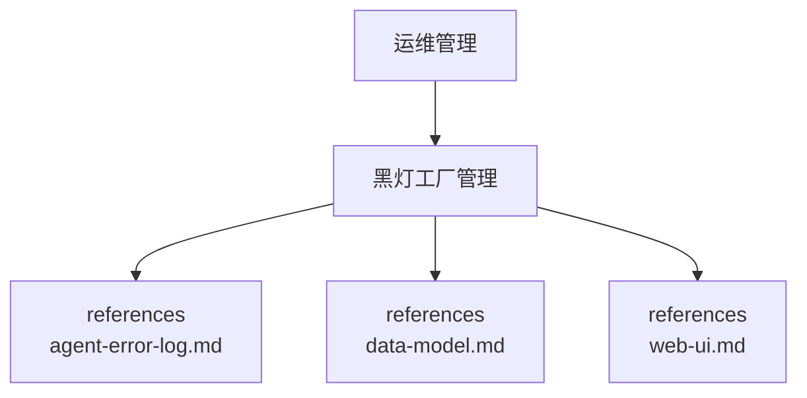
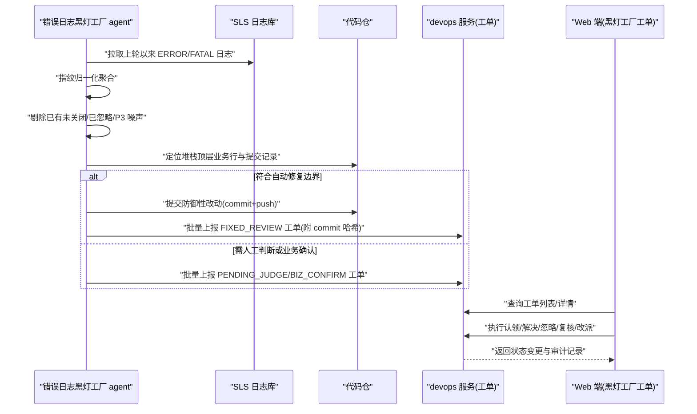
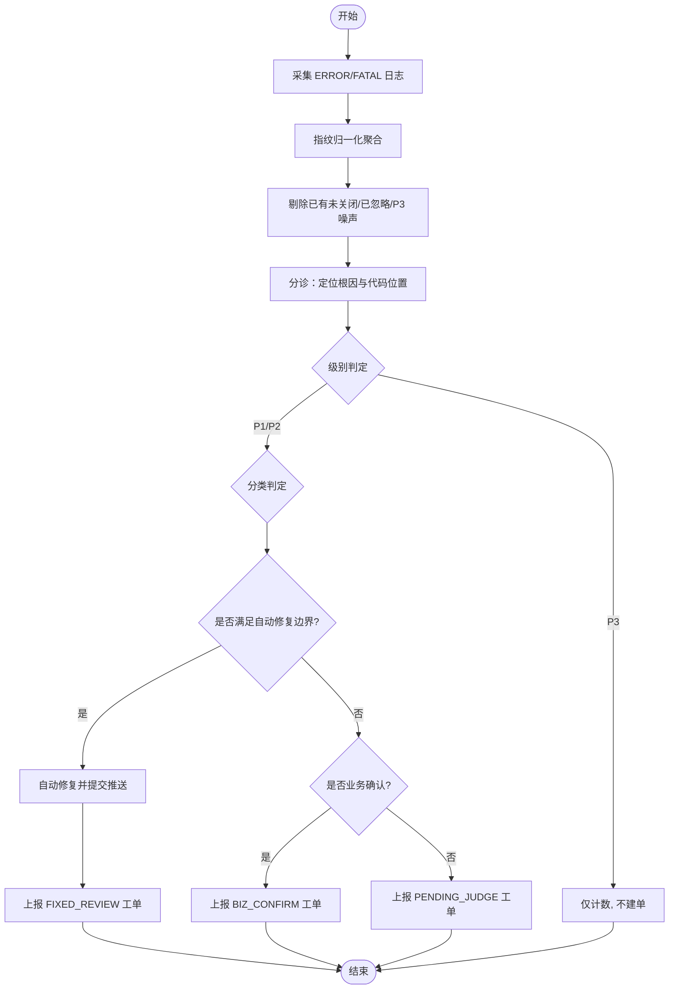
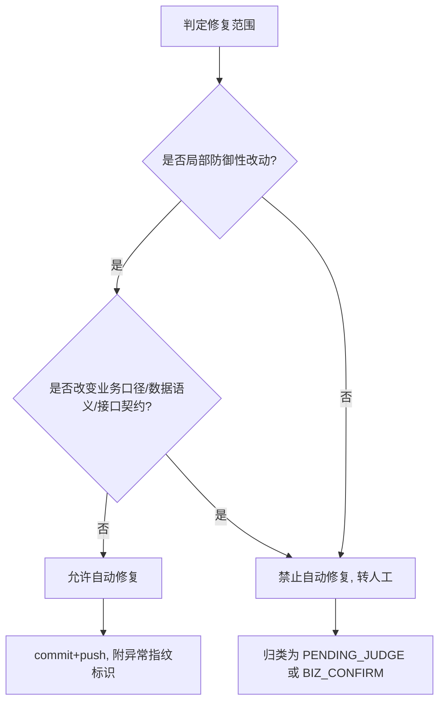
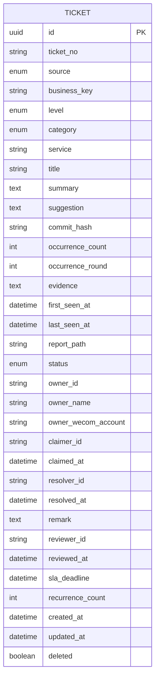
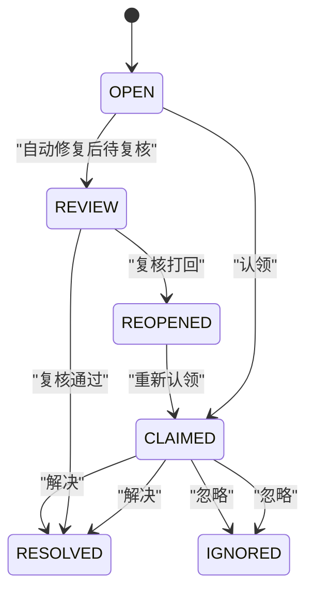
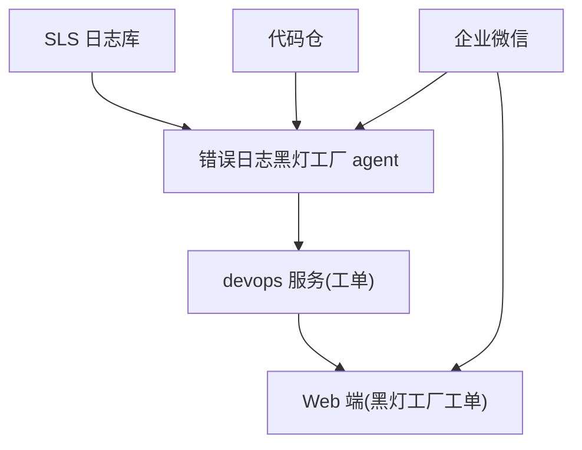

# 黑灯工厂管理

<cite>
**本文引用的文件 **
- [agent-error-log.md](file://运维管理/黑灯工厂管理/references/agent-error-log.md)
- [data-model.md](file://运维管理/黑灯工厂管理/references/data-model.md)
- [web-ui.md](file://运维管理/黑灯工厂管理/references/web-ui.md)
</cite>

## 目录
1. [引言](#引言)
2. [项目结构](#项目结构)
3. [核心组件](#核心组件)
4. [架构总览](#架构总览)
5. [详细组件分析](#详细组件分析)
6. [依赖关系分析](#依赖关系分析)
7. [性能与稳定性考量](#性能与稳定性考量)
8. [故障排查指南](#故障排查指南)
9. [结论](#结论)

## 引言
本文件聚焦“黑灯工厂”在运维管理中的问题分级分类与自动修复边界规则，面向研发、运维与产品读者，帮助理解从错误日志采集到工单闭环的全链路机制，明确哪些情况可自动修复、哪些必须转人工判断，以及 P1/P2 工单的分级、分类、状态流转与 SLA 要求。

## 项目结构
黑灯工厂相关文档位于运维管理模块下，采用“references + assets”的结构：
- references：业务规则、数据模型、Web UI 描述等权威说明
- assets：前端原型页面（列表、详情、处理弹窗等）

**图表来源**
- [agent-error-log.md:1-70](file://运维管理/黑灯工厂管理/references/agent-error-log.md#L1-L70)
- [data-model.md:1-73](file://运维管理/黑灯工厂管理/references/data-model.md#L1-L73)
- [web-ui.md:1-104](file://运维管理/黑灯工厂管理/references/web-ui.md#L1-L104)

**章节来源**
- [agent-error-log.md:1-70](file://运维管理/黑灯工厂管理/references/agent-error-log.md#L1-L70)
- [data-model.md:1-73](file://运维管理/黑灯工厂管理/references/data-model.md#L1-L73)
- [web-ui.md:1-104](file://运维管理/黑灯工厂管理/references/web-ui.md#L1-L104)

## 核心组件
围绕“问题分级分类与自动修复边界”，黑灯工厂由以下关键要素构成：
- 巡检与分诊：每 3 小时一轮，对 ERROR/FATAL 日志进行指纹聚合、剔除噪声、定位根因并给出建议
- 分级：P1（资损/主流程阻断/数据风险/高频爆发）、P2（功能受损但有绕行/局部异常/低频真实缺陷）、P3（仅计数不建单）
- 分类：FIXED_REVIEW（自动修复待复核）、PENDING_JUDGE（待判断）、BIZ_CONFIRM（业务确认）
- 自动修复边界：仅允许局部防御性改动，不得改变业务口径与数据语义；拿不准即不修
- 工单上报与幂等：以“来源 + 业务键”为唯一锚点，同键未关闭只追加轮次与证据，不重复建单
- Web 端处理：认领、解决、忽略、复核通过/打回、改派、导出、SLA 提醒

**章节来源**
- [agent-error-log.md:11-24](file://运维管理/黑灯工厂管理/references/agent-error-log.md#L11-L24)
- [agent-error-log.md:28-49](file://运维管理/黑灯工厂管理/references/agent-error-log.md#L28-L49)
- [agent-error-log.md:51-56](file://运维管理/黑灯工厂管理/references/agent-error-log.md#L51-L56)
- [web-ui.md:69-80](file://运维管理/黑灯工厂管理/references/web-ui.md#L69-L80)

## 架构总览
黑灯工厂的端到端流程如下：

**图表来源**
- [agent-error-log.md:17-24](file://运维管理/黑灯工厂管理/references/agent-error-log.md#L17-L24)
- [agent-error-log.md:44-56](file://运维管理/黑灯工厂管理/references/agent-error-log.md#L44-L56)
- [web-ui.md:69-80](file://运维管理/黑灯工厂管理/references/web-ui.md#L69-L80)

## 详细组件分析

### 问题分级与分类规则
- 分级
  - P1：资损、主流程阻断、数据错误风险，或高频爆发
  - P2：功能受损但有绕行、局部异常、低频但真实缺陷
  - P3：噪声、无害低频、已知口径——仅计数，不建单
- 分类
  - FIXED_REVIEW：根因明确且修复落在安全边界内，自动修复后建单待复核
  - PENDING_JUDGE：根因明确但修复有风险，或无法安全判断，按负责人建单待认领，必须带“建议：”人话结论与证据
  - BIZ_CONFIRM：报错符合业务预期/口径，低打扰知会留痕，确认后关闭或转办

**图表来源**
- [agent-error-log.md:17-24](file://运维管理/黑灯工厂管理/references/agent-error-log.md#L17-L24)
- [agent-error-log.md:28-49](file://运维管理/黑灯工厂管理/references/agent-error-log.md#L28-L49)

**章节来源**
- [agent-error-log.md:28-49](file://运维管理/黑灯工厂管理/references/agent-error-log.md#L28-L49)

### 自动修复边界规则
- 允许的修复类型：空指针防护、边界条件、资源释放、幂等与重试兜底等局部防御性改动
- 禁止的修复类型：任何改变业务口径、数据语义、接口契约的修改
- 提交规范：提交信息中携带异常指纹标识，便于复核回溯与复发统计
- 原则：拿不准即不修，宁可待判断，不赌自动修

**图表来源**
- [agent-error-log.md:44-49](file://运维管理/黑灯工厂管理/references/agent-error-log.md#L44-L49)

**章节来源**
- [agent-error-log.md:44-49](file://运维管理/黑灯工厂管理/references/agent-error-log.md#L44-L49)

### 工单数据模型与幂等策略
- 核心实体：黑灯工厂工单
- 字段分组：
  - 业务幂等键：来源（blacklight/bigsqlfix/bugscan/reqdefect）+ 业务键（异常指纹/服务名+mapper全限定名/需求编号）
  - 内容快照：级别（P1/P2）、分类（FIXED_REVIEW/PENDING_JUDGE/BIZ_CONFIRM）、服务、标题、摘要、建议、commit 哈希、出现次数/轮次、证据、首次/最近出现时间、报告路径
  - 流程状态：状态（OPEN/CLAIMED/REVIEW/REOPENED/RESOLVED/IGNORED）、负责人及快照、认领/处理/复核信息、SLA 截止、复发次数
  - 审计：工单 ID/号、创建/更新信息、删除标记
- upsert 白名单：
  - 可更新：出现次数、出现轮次、最近出现时间、证据、摘要、建议、趋势、报告路径、更新时间
  - 禁更新：状态、负责人/认领人/处理人/复核组、SLA 截止、首次出现时间、工单编号

**图表来源**
- [data-model.md:9-59](file://运维管理/黑灯工厂管理/references/data-model.md#L9-L59)

**章节来源**
- [data-model.md:5-72](file://运维管理/黑灯工厂管理/references/data-model.md#L5-L72)

### Web 端交互与权限
- 菜单与入口：运维管理 → 黑灯工厂工单，权限码 `MENU:RND:OPS:BLACKLIGHT_TICKET`
- 列表与筛选：级别、状态、来源、服务、负责人、关键字、“只看我的”默认开启
- 详情抽屉：展示级别/状态/来源/服务/命中次数×轮次/首末次时间/负责人/SLA 剩余；摘要、建议、commit 链接；证据链（traceId、SQL 样例、堆栈）；处理记录时间线
- 动作闭环：认领、解决、忽略、复核通过/打回、改派、导出
- 按钮权限：认领/解决/忽略、复核通过/打回、改派、导出；默认授予超级管理员、研发负责人；普通研发授认领与复核权限（仅操作自己名下工单）
- 状态色映射：OPEN/REVIEW 黄、CLAIMED 蓝、REOPENED 失败红、RESOLVED 绿、IGNORED 灰

**图表来源**
- [web-ui.md:69-80](file://运维管理/黑灯工厂管理/references/web-ui.md#L69-L80)
- [web-ui.md:93-103](file://运维管理/黑灯工厂管理/references/web-ui.md#L93-L103)

**章节来源**
- [web-ui.md:5-103](file://运维管理/黑灯工厂管理/references/web-ui.md#L5-L103)

### 负责人判定与通知
- 负责人判定：基于堆栈顶层业务行的代码提交记录（git blame/log），映射至在职研发及其企微账号；判不出则负责人留空，工单待认领
- 超时提醒：每日 09:30 企微提醒负责人并抄送其直属上级
- 改派：研发负责人角色可改派，即时提醒对方

**章节来源**
- [agent-error-log.md:58-61](file://运维管理/黑灯工厂管理/references/agent-error-log.md#L58-L61)
- [web-ui.md:78-80](file://运维管理/黑灯工厂管理/references/web-ui.md#L78-L80)

## 依赖关系分析
- 外部系统
  - SLS：ERROR/FATAL 日志采集
  - 代码仓：定位代码、提交修复
  - devops 服务：工单建单、状态流转、内部鉴权
  - 企业微信：应用消息提醒（负责人、直管上级）
- 内部能力
  - Qoder SDK：服务端定时调度会话驱动 agent 执行
  - 统一导出中心：复用导出接入

**图表来源**
- [agent-error-log.md:11-15](file://运维管理/黑灯工厂管理/references/agent-error-log.md#L11-L15)
- [agent-error-log.md:51-61](file://运维管理/黑灯工厂管理/references/agent-error-log.md#L51-L61)
- [web-ui.md:78-80](file://运维管理/黑灯工厂管理/references/web-ui.md#L78-L80)

**章节来源**
- [agent-error-log.md:11-15](file://运维管理/黑灯工厂管理/references/agent-error-log.md#L11-L15)
- [agent-error-log.md:51-61](file://运维管理/黑灯工厂管理/references/agent-error-log.md#L51-L61)

## 性能与稳定性考量
- 巡检频率：每 3 小时一轮，避免频繁拉取造成负载压力
- 聚合与剔除：指纹归一化与噪声剔除减少无效深析与重复建单
- 批量上报：单轮一次批量调用内部上报工具，降低网络与鉴权开销
- 反模式规避：严禁每轮全量新建、P3 条目建单、吞异常静默丢数据

**章节来源**
- [agent-error-log.md:11-15](file://运维管理/黑灯工厂管理/references/agent-error-log.md#L11-L15)
- [agent-error-log.md:17-24](file://运维管理/黑灯工厂管理/references/agent-error-log.md#L17-L24)
- [agent-error-log.md:51-56](file://运维管理/黑灯工厂管理/references/agent-error-log.md#L51-L56)
- [agent-error-log.md:63-70](file://运维管理/黑灯工厂管理/references/agent-error-log.md#L63-L70)

## 故障排查指南
- 采集失败/解析异常：发群机器人简报（每轮最多 1 条，@ 运维负责人），下轮重试；严禁吞异常
- 建单失败：走内部上报工具失败重发，幂等由“来源 + 业务键”保证
- 负责人缺失：若 git blame/log 无法判定，负责人留空，工单进入待认领；可通过改派补齐
- 忽略后仍出现：IGNORED 的同键后续轮次仅计数不再深析；如需恢复深析需先解除忽略
- 自动修复越界：若误改业务口径/数据语义，应立即停止自动修复，转 PENDING_JUDGE/BIZ_CONFIRM 并由人工复核

**章节来源**
- [agent-error-log.md:58-61](file://运维管理/黑灯工厂管理/references/agent-error-log.md#L58-L61)
- [agent-error-log.md:51-56](file://运维管理/黑灯工厂管理/references/agent-error-log.md#L51-L56)
- [web-ui.md:75-78](file://运维管理/黑灯工厂管理/references/web-ui.md#L75-L78)

## 结论
黑灯工厂通过“指纹聚合—分诊分级—边界修复—工单闭环”的机制，将自动化与人工判断清晰切分：
- 自动修复仅限局部防御性改动，绝不触碰业务口径与数据语义
- P1/P2 工单严格分级分类，FIXED_REVIEW 自动修复后仍需复核
- 工单幂等与 upsert 白名单保障数据一致性与可观测性
- Web 端提供完整的认领、处理、复核、改派与 SLA 提醒能力，确保问题可追踪、可闭环